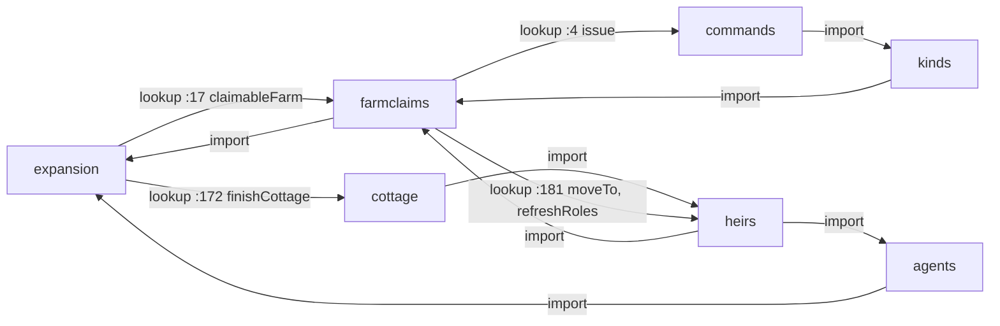

# Ownership map: who writes each piece of state, and which modules depend on which

VB-172, read from the source at `bb6e193` (3 November 2026, after VB-171). This is the project's own map, the assessment that the architecture
review asked for before any refactor (`docs/review-architecture.md`). The other three files in this folder are the external proposal it
measures the code against (`target-architecture.md`, `prompt.md`, `stress-tests.md`). Kim reviews this map and chooses the boundaries to
make firm, and in which order (`QUESTIONS.md`). No code changes here.

**Kim's answers of 3 November** (`QUESTION_ARCHIVE.md`, "VB-172: the ownership map"): the order of section 7 and the
proposals of sections 4, 7 and 8, except that the food task records every movement at once (7.1, "Records"). The tasks are VB-173
(the owners table and its check), VB-174 (food), VB-175 (membership and founding), VB-176 (the dependency rule), VB-177 (a pawn's
movement), VB-178 (ties), VB-179 (the crop's life) and VB-180 (wrap-up).

VB-173 (4 November 2026) declares those first boundaries in `src/owners.json`. `fields` maps each field to its owner (or `signal`);
an object with `owner` and `category: "cache"` declares a derived cache, enforced by the same rule. `creators` names the seeding
modules and `exempt` names the save codec. `plannedOwners` declares modules not yet implemented (`sim/stores` until VB-174);
all other module names must exist in the manifest. Invalid fields, owner values, categories, keys and exemptions fail validation.
`node tests/ownership.js` checks the table with this document's scanner; normal checks reject stale allowances and require `--update`
to remove fixed sites from `tests/ownership-baseline.json`. Updates refuse new sites or increases. Baseline entries group tokenized receivers and operations by field
and module, count repeated sites, and survive changes in line numbers or whitespace. A new site or an additional copy fails with
its file, line, field and owner. `// lint-allow: owner <reason>` exempts just that line. Creation before a record enters a state
collection is excluded; writes after insertion are checked. The report now reads its Owner column from the table and marks writes
past the owner with `!` (also `outsideOwner` in `--json`). The historical tables below retain the original proposals.

The scanner now uses Acorn for lexical scope boundaries (a development dependency, absent from the built page), tracks reassigned
aliases, and keeps possible state targets across conditional/deferred assignments. It recognizes bracketed mutator calls,
destructuring assignments, `Object.assign`, property definitions and `Reflect.set`. A write through a dynamic property or an unknown
object source checks all declared fields it might affect. Receiver inference still uses the documented conventions and return hints;
this is not interprocedural type analysis, and unresolved receivers remain visible in the writes report.

Cache checks: `tests/lib/invariants.js` checks both directions of membership, exact owners of farm houses, fields and meadows,
and roles derived independently from member lists and union records. Existing gameplay may keep a child's role through its fourteenth
birthday until the next social refresh; the daily check permits that bounded lag. In the five long invariant runs, a test-only loader
checks roles strictly immediately after every `refreshRoles`, before any importer can bypass the wrapper. `tests/cacheowners.js`
proves that wrong nonzero owners, wrong roles and membership corruption are detected before repair, and tests the birthday boundary.
`tests/owners.js` retains the full seeded ownership map and extinction checks. Roles remain written by `sim/heirs` in the baseline
until VB-175 moves membership to `sim/records`.

The counts and the file:line lists come from `node tools/writes.js`, which can be rerun after each refactor; `--field household.grain`
lists one field's write sites. The proposed owners, the traces, the gap table and the ranking are judgements, made by hand.

VB-195 (5 November): `sim/records` owns the `st.living` and `st.liveHouseholds` caches, sorted by record id.
Creation appends through `person` and `makeHousehold`; `killPawn` and `extinct` call the owner's removal operations.
Seed/load rebuild them from source records, so format-1 saves need no migration. Daily invariants compare both arrays
with independent full scans, and `tests/living.js` probes missing, duplicate and reordered ids, mutation during walks
and old saves. The existing non-enumerable `st.idx` also indexes active unions and whether a person has an ended union;
`tests/indexes.js` compares these lookups with the union records after long runs. Historical queries retain the full records.

## 1. In short

- **174 fields are written in play or at seeding, 71 of them by more than one module, at 618 writes.** Fields written only when a
  record is made (`pawn.sex`, `farmstead.house`) are not counted (section 3.3).
- **Tile owners meet the rule.** `st.owner` has one writer, `setOwner` in `sim/ownership`, called from seven modules. The other
  boundaries can follow that model.
- **Household food has no owner.** `household.grain` has 8 writer modules (17 sites). Taken with rations, sheaves, the ledger, the
  village store and the heirs' shares, it is 10 modules and 30 sites. Only harvests, gifts, meat, milk and butter leave a record. Seed,
  cooking, meals, spoilage, shares, handing on and provisions leave none.
- **Household membership has 5 writer modules** (records, heirs, cottage, births, lifecycle). Each of three places founds a household
  in play with its own copy of the same steps: `farmclaims.moveIn`, `cottage.finishCottage` and `settle.settleFarm`.
- **A crop's life is written in six modules.** The job kinds set the stage when work is done. `sim/clock` ripens the crop, schedules
  weeding, applies frost and lets empty farms go to grass. `sim/heirs` resets the fields when a farm empties. The review said
  `sim/clock` "holds no rules of its own". That is not so: it also holds firewood use, the village store's spoilage, fence decay,
  empty-farm decay and the pruning of the ledger (`clock.js:54-109`).
- **Four dependency cycles, all through a lookup inside a function into a module loaded later.** The review named
  farmclaims → heirs and expansion → cottage. The scan finds two more: expansion → farmclaims (`expansion.js:17`) and
  farmclaims → commands → kinds (`farmclaims.js:4`). Section 4.
- **The page flags** (`st.visualDirty`, `biomeDirty`, `rigDirty` and others) are written by 16 modules. They are signals to the
  page, not state that anything decides on. Proposed: declare them as signals and leave them out of the rule.
- **Proposed order:** (1) household and village food, then (2) household membership and founding, then (3) agent movement and
  (4) ties, both small, then (5) the crop's life. Section 7.

## 2. How the map counts

- **A write** is an assignment, a compound assignment, `++`/`--`, `delete`, or a call of `push`, `splice`, `set`, `delete`, `add`,
  `clear`, `pop`, `shift`, `unshift`, `sort`, `reverse` or `fill` on a field of the state. An element write (`w.trees[t] = 0`) is a
  write of the field (`w.trees`). A write into a nested record is a write of its top field: `fd.stage = 'sown'` counts under
  `farmstead.fields`, with its full path (`farmstead.fields[].stage`) in `--field`.
- **Creating a record is a write of its collection only.** `st.households.push(hh)` is a write of `st.households`. Fields set on the
  new object before it is pushed (`hh.grain = prov.grain`) are creation, counted as writes to a local object. Fields set on it after
  the push are writes.
- **Seeding counts.** `sim/scenarios`, `sim/layout` and `sim/people` write while the state is made. They are listed like any other
  writer. The proposal in section 8 lets seeding modules create the records they seed, and the counts below say where a field's only
  other writer is seeding.
- **The save codec** (`sim/saves`) writes everything on a load. It appears as `w.*`, `village.*` and `village.w` because of the
  names of its variables, and is exempt.
- **Readers** are the modules that read a field through a receiver the scan can place. `page` stands for the page script, which the
  lint already limits to reading `st`, writing it only through the `Sim` API and three flags. Calls such as `seedReserve(st, hh)` read
  through a function and are not counted as reads of `household.grain`.
- **Limits.** The scan places a receiver from its binding (state chains, `for … of`, callbacks over collections, destructuring, what
  a function returns, a local record pushed into a collection). Failing that, it uses the name's convention (`hh`, `p`, `f`, `v`,
  `a`, `j`), with a short table of hints for each module, kept in the script. 5 writes stay unresolved (section 3.4). On
  inspection all five are local objects. Hand checks against `grep`: household membership, `household.grain`, `household.holder`,
  `household.wood`, `household.unthreshed` and `st.owner` agree exactly.

## 3. The ownership map

### 3.1 How to read it

One table for each entity. Fields with the most writers come first; a bold number counts the writer modules. The owner column is the
proposal. A field with one writer is proposed to stay with that writer unless noted. A superscript names the candidate boundary
of section 7 that would give the field its owner: ¹ food, ² membership, ³ the crop, ⁴ agent movement, ⁵ ties and attitudes,
⁶ farm occupancy, ⁷ land use, ⁸ herds, ⁹ the job store. *signal* is a page flag (section 7.10). The module prefix `sim/` is dropped.

### 3.2 Fields written

##### st

| Field | Owner (proposed) | Writers: lines | Other readers |
| --- | --- | --- | --- |
| `visualDirty` **12** | signal | fields 79; meadows 68; expansion 79,162,171,185; farmclaims 201; kinds 136; heirs 128,187,234; service 53,91; cottage 51; settle 181; lifecycle 37,222; births 41; clock 93,96 | page |
| `biomeDirty` **7** | signal | forest 17; fields 69,79; meadows 47; expansion 162,171,185; farmclaims 201; cottage 51; settle 181 | page |
| `rigDirty` **5** | signal | farmclaims 192; cottage 46; settle 179; lifecycle 112; births 41 | page |
| `used` **4** | fields ⁷ | layout 93,120,134,139,170,215; fields 78; meadows 47; expansion 77 | territory, herds, cottage, settle |
| `demand` **3** | heirs | farmclaims 98,197; heirs 266,313; settle 239 | expansion, jobs, service, lifecycle, page |
| `farmsteads` **3** | layout | layout 141; cottage 27; settle 169 | ownership, records, claims, territory, stakes, forest, herds, hunger, help, fields, meadows, byre, expansion, farmclaims, agents, commands, jobs, heirs, service, lifecycle, births, scenarios, clock, page |
| `households` **3** | records ² | farmclaims 191; cottage 40; settle 173 | records, relations, claims, territory, stakes, herds, help, fields, meadows, byre, expansion, kinds, agents, commands, jobs, heirs, service, society, lifecycle, births, scenarios, clock, page |
| `contacts` **2** | society | society 137; lifecycle 240 | - |
| `jobs` **2** | kinds ⁹ | agents 53; jobs 22 | expansion, farmclaims, commands, heirs, page |
| `jobsBy` **2** | kinds ⁹ | agents 53; jobs 23,24 | - |
| `landDirty` **2** | signal | ownership 11; claims 16 | page |
| `regrow` **2** | forest ⁷ | forest 15,32,41; expansion 158 | - |
| `treeDirty` **2** | signal | forest 9,17; expansion 158 | page |
| `unions` **2** | records | records 52; lifecycle 109 | scenarios, page |
| `villages` **2** | layout | layout 199; settle 189 | ownership, claims, territory, forest, herds, help, fields, expansion, farmclaims, kinds, commands, jobs, heirs, service, cottage, society, lifecycle, clock, page |
| `agents` | births | births 33 | relations, agents, commands, jobs, heirs, society, lifecycle, clock, page |
| `cairns` | territory | territory 111 | page |
| `cenv` | society | society 26 | - |
| `claims` | claims | claims 27,36,37,44 | territory, settle, page |
| `claimSeq` | claims | claims 25 | stakes |
| `events` | records | records 31 | page |
| `headSeq` | herds | herds 62 | - |
| `herds` | herds | herds 51 | byre, page |
| `idlers` | relations | relations 181,183 | - |
| `idx` | records | records 88,92,95,97,99,106,110,111 | - |
| `jobSeq` | jobs | jobs 22 | - |
| `lastMeeting` | lifecycle | lifecycle 70 | - |
| `makeFields` | scenarios (tests set it) | scenarios 32 | jobs |
| `meetingLog` | lifecycle | lifecycle 68,69,103 | page |
| `owner` | ownership | ownership 10,16 | claims, territory, stakes, settle, page |
| `pathCache` | routes | routes 103,124,134 | - |
| `pathDirty` | signal | paths 31 | page |
| `pawns` | records | records 48 | relations, territory, stakes, hunger, help, fields, expansion, farmclaims, agents, commands, jobs, heirs, service, cottage, society, settle, lifecycle, births, scenarios, clock, page |
| `record` | records | records 12 | - |
| `rng` | rng | rng 7,26 | relations, herds, deaths, meadows, byre, kinds, jobs, society, settle, lifecycle, births, clock |
| `routeDirty` | routes | routes 108,136 | - |
| `routeFallbacks` | routes | routes 101 | - |
| `t` | clock | clock 114 | records, relations, claims, territory, stakes, herds, hunger, help, deaths, byre, expansion, farmclaims, kinds, agents, commands, jobs, heirs, society, settle, lifecycle, births, page |
| `talks` | relations | relations 164 | - |
| `weather` | clock | clock 104 | meadows, kinds |

##### w

| Field | Owner (proposed) | Writers: lines | Other readers |
| --- | --- | --- | --- |
| `dev` **4** | fields ⁷ | layout 179,180; fields 78; meadows 47; expansion 161 | gen/paths, gen, routes, paths |
| `stones` **4** | fields ⁷ | layout 178; fields 68; meadows 65; expansion 160 | gen, names, page |
| `trees` **2** | forest ⁷ | forest 15,30,40; expansion 158 | gen, page |
| `*` | saves (the load) | saves 118,119 | - |
| `biome` | gen (setBiome) | gen 574 | rules, names, routes, layout, territory, herds, fields, meadows, expansion, settle, clock, saves, page |
| `tb` | gen | gen 578 | - |
| `tg` | gen | gen 577 | - |
| `tr` | gen | gen 576 | - |
| `treesMax` | forest | forest 15 | gen, page |
| `wear` | paths | paths 17,20,28,55 | page |
| `worn` | paths | paths 17,31,56 | gen/paths, routes, page |

##### pawn

| Field | Owner (proposed) | Writers: lines | Other readers |
| --- | --- | --- | --- |
| `ties` **5** | relations ⁵ | relations 158; help 37; society 35,38,40; lifecycle 30,117,234,238,241; births 29,30 | culture |
| `advocate` **4** | culture ⁵ | culture 198,212; commands 113; society 35; births 29 | lifecycle, page |
| `events` **4** | records | records 125; lifecycle 27; births 31; scenarios 157 | page |
| `household` **4** | records ² | records 66,70; heirs 84; cottage 45; births 27 | relations, help, farmclaims, agents, commands, jobs, service, society, settle, lifecycle, page |
| `stake` **4** | stores (new) ¹ | farmclaims 173; heirs 113; cottage 39,63; settle 174 | page |
| `age` **3** | lifecycle | society 32; lifecycle 123,226; births 27 | culture, records, relations, farmclaims, heirs, service, cottage, settle, page |
| `alive` **3** | lifecycle | society 32; lifecycle 26; births 27 | culture, records, relations, territory, stakes, help, expansion, farmclaims, jobs, heirs, service, cottage, settle, clock, page |
| `anc` **3** | culture ⁵ | culture 187; society 34; births 28 | - |
| `att` **3** | culture ⁵ | culture 183; society 34; births 28 | - |
| `rel` **3** | relations ⁵ | relations 62,64,66,77,79,80,87,88; society 35; births 29 | lifecycle |
| `servant` **3** | records ² | heirs 84,175; service 66; settle 180 | - |
| `interest` **2** | society | society 35,84,126; births 29 | culture |
| `owed` **2** | stores (new) ¹ | heirs 113; cottage 62 | page |
| `prestige` **2** | society | society 35,76,77; births 29 | culture |
| `born` | births | births 27 | records, relations, deaths, expansion, farmclaims, heirs, service, society, settle, lifecycle, scenarios, page |
| `died` | lifecycle | lifecycle 26 | hunger, fields, commands, jobs, heirs, society, scenarios, clock, page |
| `health` | hunger | hunger 62,63,64 | deaths, agents, page |
| `hunger` | hunger | hunger 54 | deaths, agents, lifecycle, births |
| `hungerLog` | hunger | hunger 53 | - |
| `kinPush` | lifecycle | lifecycle 82,86,95 | society |
| `landWait` | settle | settle 42 | heirs |
| `nursingUntil` | births | births 38 | page |
| `owedFrom` | stores (new) ¹ | heirs 114 | cottage |
| `pregnantBy` | births | births 22,51 | - |
| `pregnantUntil` | births | births 22,51 | page |
| `retired` | heirs | heirs 103 | hunger, fields, service, lifecycle, page |
| `role` | heirs | heirs 277,279,280,281,282,283,284 | farmclaims, agents, jobs, page |

##### household

| Field | Owner (proposed) | Writers: lines | Other readers |
| --- | --- | --- | --- |
| `grain` **8** | stores (new) ¹ | hunger 38,49,73; help 28,33,60; farmclaims 171; kinds 54,110,119; heirs 113,270; cottage 62,63; settle 175; scenarios 34,72 | jobs, lifecycle, page |
| `members` **5** | records ² | records 70; heirs 82,83,185; cottage 45; lifecycle 36; births 27 | relations, herds, hunger, help, fields, farmclaims, jobs, service, society, settle, page |
| `ledger` **4** | stores (new) ¹ | help 28,33,60; byre 132,143; kinds 76; clock 107 | herds |
| `rations` **4** | stores (new) ¹ | hunger 38,49; farmclaims 193; kinds 110; cottage 48 | jobs, lifecycle |
| `hay` **3** | stores (new) ¹ | herds 228,241,242; meadows 111; byre 172,173 | page |
| `grievance` **2** | claims | claims 109; territory 130 | society |
| `larder` **2** | stores (new) ¹ | hunger 16,26; byre 148,158 | herds, jobs |
| `manure` **2** | stores (new) ¹ | fields 98; byre 163,191 | page |
| `stone` **2** | stores (new) ¹ | fields 67; meadows 65 | page |
| `wood` **2** | stores (new) ¹ | kinds 91; clock 60 | jobs, page |
| `cookDay` | kinds | kinds 110 | jobs |
| `dissolved` | heirs | heirs 162 | records, claims, stakes, herds, help, meadows, byre, farmclaims, commands, service, cottage, society, settle, lifecycle, births, clock, page |
| `fodderDay` | byre | byre 189 | - |
| `guardian` | heirs | heirs 198,205 | farmclaims, service, settle, page |
| `herds` | herds | herds 51,242 | meadows, byre, jobs, page |
| `holder` | heirs | heirs 101,225 | records, claims, territory, stakes, herds, help, expansion, farmclaims, commands, service, settle, lifecycle, page |
| `hunger` | hunger | hunger 57 | page |
| `hungryDays` | hunger | hunger 49 | page |
| `milkDay` | byre | byre 137 | - |
| `spoilt` | stores (new) ¹ | hunger 73 | - |
| `unthreshed` | stores (new) ¹ | kinds 76,119 | jobs, lifecycle, page |
| `ward` | heirs | heirs 198 | settle |
| `waterDay` | kinds | kinds 101 | jobs |

##### farmstead

| Field | Owner (proposed) | Writers: lines | Other readers |
| --- | --- | --- | --- |
| `fields` **6** | fields ³ | layout 170,216; fields 76,84,98; kinds 45,54,55,64,65,68,79,115,136; heirs 161; scenarios 143; clock 72,73,79,80,84,96 | paths, ownership, claims, hunger, meadows, expansion, farmclaims, jobs, settle, lifecycle, page |
| `condition` **4** | farmclaims ⁶ | farmclaims 194; heirs 160; scenarios 142; clock 91 | page |
| `project` **4** | stakes | stakes 47,59,67; fields 62,68,78; meadows 59,66; settle 177 | hunger, expansion, kinds, jobs, page |
| `state` **4** | farmclaims ⁶ | records 65; heirs 160; scenarios 142; clock 93 | farmclaims, page |
| `emptySince` **3** | farmclaims ⁶ | farmclaims 194; heirs 160; scenarios 142 | clock, page |
| `household` **3** | farmclaims ⁶ | records 65; heirs 160; scenarios 142 | ownership, territory, herds, fields, meadows, expansion, farmclaims, kinds, jobs, lifecycle, clock, page |
| `line` **3** | heirs | records 65; heirs 101,225; scenarios 136,137,139,142 | - |
| `woodlot` **3** | territory | layout 177; territory 173; forest 21 | jobs |
| `meadows` **2** | meadows | meadows 46,106,107,111,120,122; kinds 144 | ownership, claims, byre, farmclaims, jobs, page |
| `name` **2** | names (farmName) | layout 155,156; settle 171 | stakes, herds, help, fields, meadows, byre, expansion, farmclaims, kinds, jobs, heirs, service, cottage, lifecycle, births, clock, page |
| `booth` | expansion | expansion 179,185,187 | settle, page |
| `claim` | farmclaims | farmclaims 96,107,135,155,194 | clock |

##### village

| Field | Owner (proposed) | Writers: lines | Other readers |
| --- | --- | --- | --- |
| `plots` **4** | expansion | expansion 79,110,161,162,164,171; agents 113; cottage 20,22,27; scenarios 241 | claims, fields, jobs, settle, page |
| `commonsWood` **3** | territory | layout 173; territory 174; forest 18 | ownership, expansion, cottage, settle |
| `crowded` **2** | settle | settle 39,238; scenarios 241 | page |
| `farmsteads` **2** | layout | cottage 27; settle 169 | layout, territory, herds, page |
| `grain` **2** | stores (new) ¹ | help 52,61; clock 62 | - |
| `fence` | layout | layout 175 | jobs, clock, page |
| `founded` | settle | scenarios 241 | settle, page |
| `name` | layout | layout 156 | territory, help, expansion, farmclaims, service, cottage, society, settle, lifecycle, page |

##### herd

| Field | Owner (proposed) | Writers: lines | Other readers |
| --- | --- | --- | --- |
| `cull` **2** | herds ⁸ | herds 239; byre 50,64,111,113,130 | - |
| `head` **2** | herds ⁸ | herds 63,90,91,92,93,104,128,235,238; byre 120 | page |
| `*` | herds ⁸ | byre 124 | - |
| `cullSeq` | byre | byre 50 | - |
| `ewes` | herds | herds 112,114,179,195,223,236,238 | byre, page |
| `home` | herds | herds 164 | page |
| `household` | herds | herds 239 | byre, page |
| `lambs` | herds | herds 112,148,236,238 | byre, page |
| `lean` | byre | byre 64,170 | - |
| `rams` | herds | herds 112,114,179,223,236,238 | byre, page |
| `unfed` | byre | byre 172,175 | - |

##### job

| Field | Owner (proposed) | Writers: lines | Other readers |
| --- | --- | --- | --- |
| `claims` | agents | agents 45,56,67 | kinds, jobs, page |
| `done` | agents | agents 111 | expansion, farmclaims, kinds, jobs |
| `live` | jobs | jobs 25,47 | - |

##### agent

| Field | Owner (proposed) | Writers: lines | Other readers |
| --- | --- | --- | --- |
| `path` **3** | agents ⁴ | relations 162; agents 17,33,36,38,64,153; lifecycle 28 | clock, page |
| `anim` **2** | agents ⁴ | relations 162; agents 17,39,65,86,89,137 | page |
| `idleUntil` **2** | agents ⁴ | relations 162; commands 45 | agents |
| `inside` **2** | agents ⁴ | agents 17,39,65,89,92,136,137; lifecycle 28 | relations, society, clock, page |
| `phase` **2** | agents ⁴ | agents 17,47,49,57,65,82,89,92,127,136; commands 40 | relations, jobs, clock, page |
| `x` **2** | agents ⁴ | agents 17,122,148,149; clock 37 | relations, page |
| `y` **2** | agents ⁴ | agents 17,122,148,149; clock 37 | gen, relations, page |
| `carry` | agents | agents 17,82,127 | relations, page |
| `face` | agents | agents 120,145 | page |
| `job` | agents | agents 17,45,56,65,82,135 | - |
| `seg` | agents | agents 39,148 | - |
| `stride` | agents | agents 121,147 | page |
| `talk` | relations | relations 159 | page |
| `work` | agents | agents 57,65,90,117,118,127,135 | - |

##### union

| Field | Owner (proposed) | Writers: lines | Other readers |
| --- | --- | --- | --- |
| `end` | lifecycle | lifecycle 29 | records, page |

##### fence

| Field | Owner (proposed) | Writers: lines | Other readers |
| --- | --- | --- | --- |
| `cond` **2** | kinds | kinds 199; clock 100 | jobs, page |
| `dirty` **2** | kinds | kinds 199; clock 100 | - |
| `owner` | records | records 67 | - |

##### claim

| Field | Owner (proposed) | Writers: lines | Other readers |
| --- | --- | --- | --- |
| `renewed` | claims | claims 24,32 | - |
| `state` | claims | claims 24 | - |
| `until` | claims | claims 24 | - |
| `why` | claims | claims 24 | territory |

##### cenv

| Field | Owner (proposed) | Writers: lines | Other readers |
| --- | --- | --- | --- |
| `cultures` | culture | culture 123 | names, territory, society, lifecycle, page |
| `driftMul` | lifecycle | lifecycle 244 | culture |
| `settlements` | society | society 48 | culture, names, records, claims, territory, commands, settle, lifecycle, page |
| `t` | lifecycle | lifecycle 45,244 | culture, commands |

##### settlement

| Field | Owner (proposed) | Writers: lines | Other readers |
| --- | --- | --- | --- |
| `practice` **2** | culture | culture 244,269; commands 52 | records, settle, page |
| `tie` **2** | society | culture 291; society 60,68 | settle, lifecycle, page |
| `culture` | culture | culture 291 | territory, society, settle, page |
| `distance` | society | society 69 | - |
| `divergence` | culture | culture 276,279,291 | page |
| `fissionYears` | culture | culture 280,291 | page |
| `kinLinks` | society | society 69 | - |
| `lastSupport` | culture | culture 233 | - |
| `lastVoices` | culture | culture 233 | - |

##### culture

| Field | Owner (proposed) | Writers: lines | Other readers |
| --- | --- | --- | --- |
| `customs` | culture | culture 267 | territory, page |
| `history` | culture | culture 292 | - |
| `lastAgg` | culture | culture 273 | - |
| `size` | culture | culture 273 | - |

### 3.3 Fields set only when the record is made

These are read and never written after creation. Each has one owner by construction: the module that makes the record.

| Entity | Fields | Made by |
| --- | --- | --- |
| pawn | `id`, `given`, `sex`, `father`, `mother`, `fatherName`, `patronym`, `founder`, `look`, `buffer`, `born` (and `born`, `alive`, `age` for a newborn) | records (`person`), births |
| household | `id`, `farmstead` | records (`makeHousehold`) |
| farmstead | `id`, `house`, `village`, `rowAngle`, `fence` | layout (`makeFarmstead`) |
| village | `id`, `center`, `green`, `well` (only `layout.js:144` sets them, at seeding) | layout, settle (`found`) |
| union | `id`, `a`, `b`, `start`, `kind` | records (`marry`), lifecycle (`wed`) |
| herd | `id`, `species` | herds (`makeHerd`) |
| job | `id`, `key`, `kind`, `owner`, `site`, `posted`, `hours`, and its source's fields (`field`, `farm`, `meadow`, `plot`, `claim`, ...) | jobs (`post`) |
| claim | `by`, `since`, `seq` | claims (`addClaim`) |
| w | every generated field except `trees`, `treesMax`, `stones`, `dev`, `wear`, `worn`, `crossing` and `biome` | gen, gen/rivers |
| st | `ECON`, `scenario`; `driftMul` and `naturalDeaths` are set by the page through its three flags | scenarios |

### 3.4 Writes the scan could not place

All five are writes to local objects. They are listed so that a rerun shows when a new one appears.

| Module | Line | How | Lvalue |
| --- | --- | --- | --- |
| sim/records | 57 | add | `s` |
| sim/claims | 134 | ++ | `row(households, c.by.id, HK).claims` |
| sim/claims | 134 | ++ | `row(villages, c.by.id, VK).claims` |
| sim/herds | 202 | = | `ramHerd.rams` |
| sim/expansion | 139 | sort | `live` |

### 3.5 Notes on single-writer fields

- `household.grievance` is written by `claims.js:109` and `territory.js:130`, the two places that settle a dispute. Proposed owner:
  `sim/claims`, with territory calling its `aggrieve`.
- `village.plots` has writers in expansion, cottage and agents. `agents.js:113` adds the hours a pawn works on a plot (`j.plot.hours`).
  Proposed owner: `sim/expansion`; the hours could go through the kind's `worked` hook, as stakes and farm claims do.
- `village.grain` (the village store) is written by `help.js` (gifts out, the store filled) and by `clock.js:62` (it spoils). It belongs
  with food (¹).
- `fence.cond` is mended in `kinds.js:199` and decays in `clock.js:100`. Proposed owner: `sim/kinds`, beside the `mend` kind, with the
  decay rule moved out of the clock. Small; no task proposed.
- `pawn.role` has one writer (`heirs.refreshRoles`) and is derived from membership and holding. It goes with membership (²).
- `st.used`, `w.dev` and `w.stones` are written at seeding by `sim/layout` and in play by fields, meadows and expansion. They go with
  land use (⁷).

## 4. Dependencies

Modules import each other at the top of their IIFE, in the order of `src/manifest.json`, so imports alone cannot form a cycle. Cycles come
from lookups inside a function (`VB['x']` evaluated when the function runs), which reach modules loaded later. The table is the script's
output. The Mermaid graph shows only the modules on a cycle, since the full graph (43 modules, 274 edges) is too dense to draw.

| Module | Imports at load | Lookups inside functions (later: a module loaded after it) |
| --- | --- | --- |
| gen/paths | - | - |
| gen/rivers | - | - |
| gen | gen/rivers | gen/paths:622, gen/rivers:622 |
| culture | - | - |
| sim/rules | gen | - |
| sim/rng | - | - |
| sim/hex | - | - |
| sim/names | gen, rules, hex, culture | - |
| sim/routes | rules, hex | - |
| sim/paths | rules, routes | - |
| sim/layout | gen, rules, names, hex, routes, paths | - |
| sim/ownership | - | - |
| sim/records | culture, rules | - |
| sim/relations | rng, rules, records | - |
| sim/claims | culture, rules, ownership, records | - |
| sim/territory | gen, rules, hex, routes, culture, claims, records, relations | - |
| sim/stakes | rules, claims, territory, records, relations | - |
| sim/forest | gen, rules, routes, territory | - |
| sim/herds | rng, gen, rules, records, hex, routes, relations | - |
| sim/hunger | rules, records | - |
| sim/help | rules, records, hunger | - |
| sim/deaths | rng, rules | - |
| sim/fields | gen, rules, hex, routes, records, layout, territory, stakes, herds | - |
| sim/meadows | rng, gen, rules, hex, routes, records, ownership, layout, herds, fields, territory, stakes | - |
| sim/byre | rng, rules, records, hunger, herds, hex | - |
| sim/expansion | gen, rules, hex, routes, records, ownership, territory, forest, fields, layout | farmclaims:17 (later), cottage:172 (later) |
| sim/farmclaims | rules, hex, records, claims, ownership, hunger, expansion | commands:4 (later), heirs:181 (later) |
| sim/kinds | rng, rules, records, forest, hunger, fields, meadows, byre, expansion, claims, farmclaims | - |
| sim/agents | rng, rules, routes, paths, records, herds, expansion, kinds | - |
| sim/commands | agents, kinds, culture, records | - |
| sim/jobs | rng, rules, hunger, hex, records, agents, relations, commands, kinds, fields, meadows, byre, expansion, farmclaims | - |
| sim/heirs | records, agents, ownership, stakes, farmclaims, hex, rules, herds | - |
| sim/service | records, heirs, commands, hex, rules, expansion | - |
| sim/cottage | records, layout, ownership, rules, heirs, names | - |
| sim/society | rng, commands, culture, rules, hex, routes, records, heirs | - |
| sim/settle | commands, rng, gen, rules, hunger, hex, routes, records, ownership, layout, names, fields, stakes, expansion, heirs, cottage, society | - |
| sim/lifecycle | rng, culture, rules, hunger, deaths, records, agents, heirs, expansion, farmclaims, settle, service, cottage, help, society, commands, relations | - |
| sim/births | rng, rules, records, agents, heirs, lifecycle | - |
| sim/people | records | - |
| sim/scenarios | gen, rng, rules, hex, routes, layout, people, records, agents, hunger, heirs, society, ownership, fields, herds, meadows, territory, farmclaims | - |
| sim/clock | rng, rules, records, forest, gen, hex, routes, paths, hunger, help, agents, jobs, commands, society, relations, lifecycle, births, herds, meadows, byre, claims, stakes, farmclaims, territory | - |
| sim/saves | gen | - |
| sim | culture, rules, kinds, records, agents, jobs, hunger, fields, expansion, ownership, heirs, society, saves, commands, relations, lifecycle, scenarios, clock, herds, claims | - |

Strongly connected: expansion, farmclaims, kinds, agents, commands, heirs, cottage. Each cycle, through a lookup of a later module:

- expansion → farmclaims → expansion (the lookup at expansion.js:17)
- expansion → cottage → heirs → agents → expansion (the lookup at expansion.js:172)
- farmclaims → commands → kinds → farmclaims (the lookup at farmclaims.js:4)
- farmclaims → heirs → farmclaims (the lookup at farmclaims.js:181)



What each cycle is, and a proposal to break it:

| Cycle | Why it is there | Proposal |
| --- | --- | --- |
| farmclaims → heirs → farmclaims (`farmclaims.js:181`) | `moveIn` founds the claimant's household. It needs `moveTo` and `refreshRoles`, which live in heirs, and heirs imports farmclaims (`birthright`, `claimOf`) | Move founding into one act (section 7.2), reached through the command layer |
| expansion → cottage → heirs → agents → expansion (`expansion.js:172`) | The cottage's last stage done founds the household (`finishCottage`). cottage needs heirs, and heirs needs agents, which imports expansion (`finishStep`) | The same: the last stage issues a command whose act founds the household |
| expansion → farmclaims → expansion (`expansion.js:17`) | Plots are started only for those with no farm to claim (`claimableFarm`), while farmclaims asks expansion who has a plot (`hasPlot`, `awaitsCottage`) | The choice between a plot and a farm belongs to the moving round (`sim/lifecycle`), which imports both: pass the filter to `startPlots` |
| farmclaims → commands → kinds → farmclaims (`farmclaims.js:4`) | `claimFarms` chooses claimants at the moving round and issues the `claim` command. farmclaims loads before commands | Accept: `issue` is the one way an actor acts, and the command layer exists to be called from anywhere. Or move `claimFarms`, a choice of the round, into `sim/lifecycle` |

**Proposed rule:** an import at load goes only to a module loaded earlier, and the only lookup into a later module is `issue`, together
with the verbs' own `later()` in `sim/commands`. All four cycles then go through the command layer. The script lists every lookup, so the
rule can be checked once Kim agrees to it.

## 5. Workflow traces

One row for each change of state, with its writer. *Past the owner* marks a write by a module other than the field's proposed owner
(section 3).

### 5.1 A pawn works a job (sowing, and hauling sheaves)

| Step | State changed | Writer |
| --- | --- | --- |
| Each work hour, every job is marked unposted | `job.live = false` | `jobs.js:47` (refreshJobs) |
| The fields post their work: hoe, sow, weed, reap, haul | `st.jobs`, `st.jobsBy`, `st.jobSeq`, `job.live` | `jobs.js:20-26` (post), called at `jobs.js:55-61` |
| Idle pawns are gathered; each bids for every job it may take | draws `st.rng.work` | `clock.js:117-124`, `jobs.js:192-207` (planRound) |
| The best bid is carried out as a command | none in the planner | `jobs.js:205` → `issue` (`commands.js:132`) → verb `work` (`commands.js:22-26`) |
| The job in hand is left, keeping its progress | `job.claims` (splice), `agent.job`, `agent.phase`, `agent.work` | `agents.js:55-58` (release) |
| The pawn joins the job and sets out | `job.claims` (push), `agent.job`, `agent.phase = 'go'`, `agent.path`, `seg`, `inside`, `anim`; the route is cached in `st.pathCache` | `agents.js:44-50` (start), `agents.js:30-41` (walkTo), `routes.js:103` |
| Walking | `agent.x`, `y`, `seg`, `face`, `stride`; worn paths `w.wear` | `agents.js:141-153` (moveAgent), `paths.js:17-20` (tread) |
| Arrival | `agent.phase = 'work'`, `anim`, `inside`, `work` (the row being walked) | `agents.js:85-92` (arrived) |
| Working | `job.done`; for a land project, its claim renewed (`claim.renewed`) | `agents.js:111`; `claims.js:32` through the kind's `worked` |
| Every work hour, a better job may interrupt | as release and start | `jobs.js:130-144` (lookUp) |
| Sowing done: the other hands are freed | their `agent.job`, `phase`, `work`, `inside`, `anim`, `path`; `job.claims` | `agents.js:60-68` (freeHands) |
| The seed goes into the ground | **`household.grain -= seedPerField`**, `farmstead.fields[].stage = 'sown'`, `sown`, the weeding fields | `kinds.js:54-55` (the kind's `done`) — past the owner of food and of the field |
| The job ends | `st.jobs.delete`, `st.jobsBy` | `agents.js:53` (dropJob) — past `sim/jobs`, which posts |
| Hauling done: the pawn carries the sheaves home | `agent.carry`, `phase = 'back'`, a new walk | `agents.js:125-132` |
| At the barn door | **`household.unthreshed.push`**, **`household.ledger.push`** (harvest), `fields[].held = 0`, `stage = 'stubble'` | `agents.js:78-83` (deposit) → `kinds.js:75-79` (`deliver`) |
| 18:00: everyone goes home | release; verb `goHome`, `agent.phase = 'home'` | `clock.js:42-46`, `commands.js:40` |

The split into opportunity (posting), coordination (matching, commands) and execution (the kinds) is as the review describes. What
crosses boundaries is execution writing food and fields directly, and two modules writing `st.jobs`.

### 5.2 A household makes a field

| Step | State changed | Writer |
| --- | --- | --- |
| At the start of the work day, a household with fewer fields than it wants picks a tile | none (reads `st.used`, `w`, claims, `st.owner`) | `jobs.js:70` → `fields.js:54-63` (startProject, chooseTile) |
| With no free tile, it may contest a stake another household left unworked | `st.claims` (the old claim dropped), the loser's **`farmstead.project = null`**, the loser's `pawn.rel` (remember), `st.record` | `stakes.js:41-51` (contest), `claims.js:33-39`, `relations.js:59-69` |
| The tile is staked | `st.claims`, `st.claimSeq`, `st.landDirty` | `stakes.js:14` → `claims.js:22-30` (addClaim) |
| The project starts | **`farmstead.project`** = {clear} | `fields.js:62` — past `sim/stakes`, proposed owner |
| Jobs are posted and worked as in 5.1; each step of work renews the stake | `claim.renewed` | `jobs.js:71`, `kinds.js:37` (workStake) → `claims.js:32` |
| Clearing done | **`household.stone +=`**, `w.stones = 0`, `project.stage = 'break'`, `st.biomeDirty` | `fields.js:65-70` (finishClear) |
| Breaking done: the stake becomes owned land | `st.claims` (dropped), `st.owner`, `st.landDirty` | `fields.js:75` → `stakes.js:15` → `claims.js:55-58` (realise) → `ownership.js:10` (setOwner) |
| The field exists | `farmstead.fields.push`, `farmstead.project = null`, `st.used.add`, `w.dev = 1`, `st.visualDirty`, `st.biomeDirty`, `st.record` | `fields.js:76-80` (finishBreak) |
| A stake left unworked for 3 years lapses, and the project ends | `st.claims`; `farmstead.project = null` | `clock.js:64-65` → `claims.js:60-66`, `stakes.js:52-61` (lapsedStakes) |
| The project job, no longer posted, is dropped at once and its hands freed | `st.jobs`, agents | `jobs.js:88-93` |

Land is owned well here: every change of claim and owner goes through `sim/claims` and `sim/ownership`. The project record has
writers in fields, meadows, stakes and settle.

### 5.3 Grain from the harvest to the meal

| Step | State changed | Writer |
| --- | --- | --- |
| Reaped: the crop's size is drawn | `fields[].stage = 'stooks'`, `reaped`, `held` (yield × fertility × soil × weather × `st.rng.fields`), `soil` worn | `kinds.js:62-69`, `fields.js:84` (wearSoil) |
| Hauled to the barn | `household.unthreshed.push(held)`, `household.ledger` (harvest) | `kinds.js:76` |
| Threshed | `household.grain += unthreshed.shift()` | `kinds.js:119` |
| Sown | `household.grain -= seedPerField`; the reserve for unsown fields is computed by every reader (`seedReserve`), not kept apart | `kinds.js:54`; `hunger.js:6-9` |
| Cooked, from 14:00 when the coming meal is short | `household.grain -= make`, `household.rations += make`, `cookDay` | `kinds.js:107-110`; the cook called off other work at `jobs.js:33-43` |
| The day's meal: larder food about to spoil first, then rations, then grain above the seed, then the rest of the larder | `larder[].n`, `household.larder` (filter), `rations`, `grain`; when short, `hungryDays` and the feed order by custom | `clock.js:59` → `hunger.js:31-58` (feedHousehold), `hunger.js:20-27` (takeFood) |
| Hunger and health follow the meal | `pawn.hungerLog`, `hunger`, `health`; `household.hunger` | `hunger.js:52-57`, `60-65` (updateHealth) |
| Grain spoils in the barn | `household.grain -= lost`, `household.spoilt += lost` | `hunger.js:68-74` (spoilGrain) |
| The village store spoils | `village.grain *= ...` | `clock.js:62` |
| Larder food past its day | `household.larder` (filter) | `byre.js:157-158` |
| A short household asks kin, then the village store | the giver's and the taker's `grain` and `ledger` (gift), `village.grain`, **`pawn.ties`** of both holders | `clock.js:56` → `help.js:41-54` (shareFood), `help.js:27-38` (gift) |
| At the moving round every household gives to the village store | `household.grain`, `ledger`, `village.grain` | `help.js:56-63` (fillStores) |
| Shares to the heirs who do not inherit | `household.grain -= paid`, `pawn.stake`, `pawn.owed`, `pawn.owedFrom` | `heirs.js:105-121` (transfer) |
| A holder marrying away with nobody to take the farm brings its grain | `to.grain += hh.grain; hh.grain = 0` | `heirs.js:270` (handOn) |
| Provisions for those who take an empty farm, or settle new land | the old households' `grain`, `pawn.stake = 0`; the new household's grain (at creation) | `farmclaims.js:163-175`, `settle.js:69-79` and `175`, `cottage.js:38-39` |
| Seeding | `household.grain` | `scenarios.js:34`, `72` |

Ten modules write a household's food. The ledger records harvests, gifts, meat, milk and butter (`byre.js:132`, `143`). Seed, cooking,
meals, spoilage (only the running total `spoilt`), shares (only as pawn events), handing on and provisions (only as log lines) leave no
entry. A balance read from the ledger (`tools/balance.js`, VB-092's store views) cannot add up.

### 5.4 A pawn joins and leaves a household

| Event | State changed | Writer |
| --- | --- | --- |
| Born | `st.pawns.push` (`person`), the newborn's fields, **`pawn.household`**, **`household.members.push`**, culture fields (`att`, `anc`, `ties`, `rel`, `prestige`, `interest`, `advocate`), `ties` of the housemates, `pawn.events`, `st.agents.push` | `births.js:20-41` (giveBirth), `records.js:48` |
| Marries | `st.unions.push`; each spouse moves (`moveTo`); `pawn.ties`; a spouse who held a farm hands it on | verb `marry` → `lifecycle.js:107-119` (wed), `heirs.js:80-87` (moveTo), `heirs.js:248-272` (handOn) |
| Moves house (`moveTo`) | the old `household.members` (filter), the new one's `members.push`, `pawn.household`, `pawn.servant = false`, the agent released and placed at home | `heirs.js:80-87` |
| Takes over the farm | heir, spouse and minor children move; `household.holder`, `farmstead.line`, `pawn.retired` | `heirs.js:90-104` (transfer) |
| Enters service | `moveTo`, `pawn.servant = true` | verb `serve` → `service.js:47`, `66`; `heirs.js:175` (after a farm empties) |
| The farm empties | the members move to kin or into service; `household.members = []`, `household.dissolved = true` | `heirs.js:158-187` (extinct) |
| Settles new land | a new household (`st.households.push`); each of the party moves; followers become servants | verb `leave` → `settle.js:165-183` (settleFarm) |
| Takes an empty farm | a new household; the claimant's family moves | `farmclaims.js:179-201` (moveIn) |
| Moves into a new cottage | a new household; members with a household move, others are added directly (`members.push`, `pawn.household`) | `cottage.js:16-52` (finishCottage) |
| Dies | `pawn.died`, `alive`, `events`; **`household.members` (filter)**; unions end; ties dropped; succession | `lifecycle.js:24-38` (killPawn) |

`moveTo` is the membership operation, but births (`births.js:27`), the cottage (`cottage.js:45`) and death (`lifecycle.js:36`) write
past it. The three ways of founding a household repeat the same steps: `makeHousehold`, the push, `setOwner`, `moveTo` for each member,
`st.rigDirty`, `refreshRoles`, `st.visualDirty`.

### 5.5 A tile changes owner

| Event | State changed | Writer |
| --- | --- | --- |
| Seeding | `st.owner` for houses, fields, centres, commons woods | `ownership.js:14-23` (seedOwners) |
| A stake broken or a meadow cleared becomes owned | `st.claims`, `st.owner` | `claims.js:55-58` (realise), from `fields.js:75`, `meadows.js:64` |
| A meadow added at once (no project) | `st.owner` | `meadows.js:45` (addMeadow) |
| A plot's tile cleared for a cottage | `st.owner` (the village's) | `expansion.js:77` |
| A cottage founded | `st.owner` of house and field | `cottage.js:41` |
| Settlers' house | `st.owner`; the first field staked | `settle.js:176` |
| A farm empties | house, fields and meadows pass to the village; the household's stakes dropped; the old family's birthright set | `heirs.js:162-163` → `ownership.js:25-29` (farmToVillage), `stakes.js:65-68`, `farmclaims.js:19-23` |
| An empty farm claimed, then moved into | a claim on the house; then every claim on it cleared and every tile set to the new household | `farmclaims.js:97`; `farmclaims.js:195-196` |
| Outland claimed at the autumn meeting, settled half a year on | `st.claims`; `st.owner` through realise; `st.cairns`; `household.grievance` of the losers | `territory.js:86`, `territory.js:136-158`, `territory.js:111`, `territory.js:130`, `claims.js:109` |
| Claims unworked for 3 years lapse | `st.claims` | `claims.js:60-66` |

The model case: one writer of `st.owner` (`setOwner`), one of `st.claims` (`sim/claims`), and every change through them.

### 5.6 A talk between two pawns

| Step | State changed | Writer |
| --- | --- | --- |
| Each hour, pawns near each other are noted | `st.contacts` | `clock.js:33` → `society.js:136-160` (noteContacts) |
| Each pawn may start one talk; a partner is drawn | draws `st.rng.talk`; scratch arrays kept in the module (not state) | `relations.js:127-148` (talkHour) |
| The talk: chat, good talk or cross words, by compatibility | `pawn.rel` of both (memories, band), a life event on becoming friends or falling out (`pawn.events`, `st.record`) | `relations.js:151-156` → `relations.js:59-69` (remember) |
| Their tie grows | `pawn.ties` of both | `relations.js:158` |
| A bubble shows on the page | `agent.talk` | `relations.js:159` |
| An idle pawn outdoors stops until the talk is over | **`agent.path = null`, `agent.anim`, `agent.idleUntil`** | `relations.js:162` — past `sim/agents`, and past the `idle` verb |
| Counted | `st.talks` | `relations.js:164` |
| Daily: hours together become ties; kin keep at least 0.4; weak ties are dropped | `pawn.ties`, `st.contacts.clear()` | `lifecycle.js:224-242` (dailyLife) — a rule of ties kept in the coordinator |
| Each season, faded memories are forgotten | `pawn.rel` | `relations.js:73-83` (fadeRelations) |

### 5.7 Shares paid and owed: the nearest thing to a transaction

| Step | State changed | Writer |
| --- | --- | --- |
| A farm is handed on under a custom of shares: the value is fields × `SHARES.perField` + grain × `SHARES.perGrain`, split among the living siblings by weight | `household.grain -= paid`, `pawn.stake += paid`, `pawn.owed += due - paid`, `pawn.owedFrom`, a `share` life event | `heirs.js:105-121` (transfer) |
| At each moving round, owed shares are paid from the debtor's grain above its reserve | the debtor's `grain`, `pawn.owed`; the payee's household `grain`, or `pawn.stake` while it has none | `lifecycle.js:120` → `cottage.js:55-65` (payOwed) |
| A pawn's stake is spent when it founds a household | `pawn.stake = 0`; the new household's grain | `cottage.js:38-39`, `farmclaims.js:165`, `173`, `settle.js:71`, `174` |

There is no record of basis, due date or status, and nobody checks that what one side loses the other gains. A debtor household that
dissolves stops paying without a trace (`payOwed` skips it). `pawn.stake` is the only food a pawn holds. The review keeps obligations as
records for their second kind (tithe, tax, rent, loans); the food boundary below would at least make each payment a recorded transfer.

## 6. The target architecture against the modules

Each domain and process of `target-architecture.md` (sections 3 and 4, and the infrastructure of section 7), in the five classes of
`prompt.md`, section 2E.

| Target | In the code | Class |
| --- | --- | --- |
| Society: identity, lifecycle, kinship | `sim/records` (people, the kin index `st.idx`), `sim/births`, `sim/deaths`, `sim/lifecycle` | Well represented; `pawn.alive` and `pawn.age` have three writers (seeding, births, lifecycle) |
| Society: relationships, reputation | `sim/relations` (memories, bands), `sim/society` (ties, prestige, interest) | Present, ownership unclear: `pawn.ties` has 5 writer modules |
| Society: skills, knowledge | Roles only; all is known to all (Decided, 30 October) | Future, not to build yet |
| Households: membership | `moveTo` in `sim/heirs`, `joinHousehold` in `sim/records` | Present, ownership unclear: 5 writers |
| Households: formation, division, dissolution | Founded in three places (cottage, settle, farmclaims), dissolved in `sim/heirs` (extinct) | Present, tightly coupled: three copies, two dependency cycles |
| Households: needs | Computed where used (`dailyNeed`, `seedReserve`, `cookWanted`, `wantsMeadow`, `fieldsWanted`) | Present; adequate until plans need them in one place |
| Households: goals, plans, commitments | None; households answer the jobs of the moment | Missing, needed soon (VB-164) |
| Households: heads | `household.holder`, one writer (`sim/heirs`) | Well represented |
| Settlements: identity, collective affairs | `st.villages`, `sim/names`; the meeting and customs in `culture`, `sim/lifecycle`, the `decide` verb | Well represented |
| Settlements: shared property | The village store (`village.grain`: help, clock); plots (`village.plots`: expansion, cottage, agents) | Present, ownership unclear |
| Land: ownership, claims, stakes, territory | `sim/ownership`, `sim/claims`, `sim/stakes`, `sim/farmclaims`, `sim/territory` | Well represented: one writer for owners, one for claims |
| Land: tenure, use rights, land held by a pawn | None | Future (cities review, phase 2) |
| Ecology: soil, trees, stones, worn paths, rivers | Soil in `sim/fields`, trees in `sim/forest`, paths in `sim/paths`, rivers in `gen/rivers` | Well represented, except stones and developed ground (`w.stones`, `w.dev`: 4 writers) and a tree felled by hand in `sim/expansion` |
| Production: crops | The kinds (execution), `sim/fields`, `sim/clock` (ripening, weeding, frost) | Present, tightly coupled: the crop's stage has 6 writer modules |
| Production: animals, hay | `sim/herds`, `sim/byre`, `sim/meadows` | Present; herds split between two modules of one domain (`herd.head`, `herd.cull`) |
| Production: construction | Plots, booths and cottages in `sim/expansion`, `sim/cottage`, `sim/settle` | Present, tightly coupled: the cycles of section 4 |
| Resources: household and village food, stores | Written where used: 10 modules write food, 7 the other stores (larder, hay, wood, stone, manure) | Present, ownership unclear; the one domain with state and no home |
| Resources: reservations and commitments | The seed reserve is computed by each reader, not reserved | Missing, needed soon (with plans, VB-164; milling, VB-009) |
| Institutions: customs and the meeting | `culture`, `sim/lifecycle`, the `decide` verb | Well represented for what exists |
| Institutions: obligations | The heirs' shares (`pawn.owed`, `stake`): set in heirs, paid in cottage | Present, tightly coupled; no record (5.7) |
| Institutions: Church, Crown, guilds, tithe, tax | None | Future (cities review, phase 5) |
| Exchange: gifts | `sim/help` | Present, ownership unclear: writes food and ties directly |
| Exchange: markets, prices, businesses, credit | None | Future (cities review, phases 1 to 3) |
| Regional and outside world | Settling new land (`sim/settle`); nothing beyond the archipelago | Present for settling; the rest future |
| Process: agency, decisions | Commands (`sim/commands`, VB-167 to VB-171); the planner, the meeting, the moving round | Well represented |
| Process: planning | None | Missing, needed soon (VB-164) |
| Process: work coordination | Posting (`sim/jobs`), matching (`sim/jobs`), execution (`KINDS`) | Well represented; `st.jobs` written by jobs and agents |
| Process: social interaction | `sim/relations` (talk), `sim/society` (contacts) | Present, tightly coupled: talk halts agents directly (`relations.js:162`); dailyLife holds a rule of ties |
| Process: the moving round, the meeting | `sim/lifecycle` | Present; it chooses and issues commands, but `dailyLife` holds rules of ties (5.6) |
| Infrastructure: geometry, movement | `sim/hex`, `sim/routes`, `sim/agents` | Well represented; agent fields written by four modules besides agents |
| Infrastructure: time, scheduling | `sim/clock` | Present, tightly coupled: it holds rules (section 1) |
| Infrastructure: randomness, commands, events, persistence | `sim/rng`, `sim/commands`, `st.record`, `sim/saves` | Well represented |
| Infrastructure: presentation | `src/page/*.js`, reading only | Well represented |
| Player: embodiment, control | `a.controller` (VB-169) | Missing, needed soon |

## 7. Candidate boundaries, ranked

Ranked by the number of writers, the coupling, and how soon a planned task needs the boundary. The sizes are for a refactor that keeps
behaviour (golden file unchanged), under the refactor rules of `BACKLOG.md`.

| Rank | Boundary | Fields | Writer modules | Write sites | Planned tasks that need it | Size |
| --- | --- | --- | --- | --- | --- | --- |
| 1 | 7.1 Household and village food | grain, rations, sheaves, ledger, spoilt, village store, shares | 10 | 30 | VB-009, VB-119, VB-092, VB-048; the fair, tithe and tax (cities review) | M |
| 2 | 7.2 Household membership and founding | `pawn.household`, `members`, `servant`, `role`; `st.households` | 8 | 15 | VB-090, VB-034, VB-036, VB-043; breaks two cycles | M |
| 3 | 7.3 Agent movement | `agent.path`, `phase`, `anim`, `inside`, `idleUntil`, `x`, `y` | 5 | 26 | VB-169 (take control) | S |
| 4 | 7.4 Ties and attitudes | `pawn.ties`, `rel`; `st.contacts`; culture fields at birth | 5 | 22 | VB-127 (at most 150 ties a pawn), VB-062, VB-036 | S |
| 5 | 7.5 The crop's life | `farmstead.fields[]` | 6 | 22 | VB-023, VB-034, VB-100, VB-160, VB-123 | M |
| 6 | 7.6 Other stores | larder, hay, wood, stone, manure | 7 | 17 | VB-144, VB-159, VB-119 | S |
| 7 | 7.7 Farm occupancy | `farmstead.household`, `state`, `condition`, `emptySince`, `claim` | 5 | 10 | VB-034, VB-058 | S |
| 8 | 7.8 Land use | `w.dev`, `w.stones`, `st.used`, `w.trees`, `st.regrow` | 5 | 22 | VB-160, VB-136 | S |
| 9 | 7.9 Herds and the job store | `herd.head`, `cull`; `st.jobs`, `jobsBy` | 2 each | 21 | VB-136, VB-144 | S |
| - | 7.10 Page flags | `st.visualDirty` and five more | 16 | 32 | none: declare as signals | none |

### 7.1 Household and village food (proposed first)

- **Owner.** A new module, proposed `sim/stores`, loaded after `sim/records` and before `sim/hunger`. Among the existing modules,
  `sim/hunger` is about meals and health and `sim/help` about gifts; neither owns the store, and both would have to import the other's
  callers. The review: Resources is the one domain with state and no home. (A question for Kim.)
- **Holders.** A household (`grain`, `rations`, `unthreshed`), a village (`grain`), and a pawn (`stake`, the only food a pawn holds).
  `ledger` and `spoilt` are its records.
- **Operations.** Each names its reason, which today's code already knows at every call:
  - `put(st, holder, n, why)`: threshing, a gift received, a share paid, provisions;
  - `take(st, holder, n, why)`, which returns what it took, never more than is held: seed, a meal, spoilage, a gift given, a share paid
    out;
  - `move(st, from, to, n, why)`: a gift, the village store, shares, handing on, provisions, so that what one loses the other gains;
  - `cook(st, hh, n)`: grain to rations;
  - `sheaf(st, hh, n)` and `thresh(st, hh)`: the crop into the barn, and out as grain.

  The rules stay where they are: how much a meal takes and its feed order (`sim/hunger`), how much a gift is (`sim/help`), the size of
  a share (`sim/heirs`), what spoils (`spoilGrain`). They call the operations.
- **Checks.** `n` is finite and at least 0; a take never leaves less than zero; the holder exists and is not dissolved; a move gives
  what it takes.
- **Records.** Proposed: in the refactor, exactly what is recorded today, since the ledger is part of the hashed state
  (`tests/golden.js` hashes every household), and a later task for the rest. Kim chose instead to record everything in the same
  task (VB-174), which therefore changes behaviour on purpose and re-records the golden file: a ledger entry for every
  movement (seed, meal, cooking, spoilage, share, handing on, provisions), so that a household's food balance can be read from its
  ledger, as VB-092 and `tools/balance.js` need. Its cost (about 48 meal entries a household a year, pruned at three years) is to be
  measured.
- **Modules that change.** hunger, help, kinds (sow, cook, thresh, haul), heirs (shares, handing on), cottage (payOwed, the stake),
  farmclaims and settle (provisions), clock (the village store's spoilage). Seeding (`scenarios.js:34`, `72`) creates and may stay.
- **Size.** M: about 30 sites, a new module of about 80 lines; behaviour and the golden file unchanged.

### 7.2 Household membership and founding

- **Owner.** The data operations go in `sim/records`, which is loaded early enough for every writer and already has
  `joinHousehold`: `join(st, id, hh)` and `leave(st, id)`. `moveTo` stays in `sim/heirs` as the act that also releases the pawn's
  agent and places it at home, and calls them. `refreshRoles` derives `pawn.role` from membership and stays beside `moveTo`.
- **One founding act.** `foundHousehold(st, f, members, grain)` replaces the three copies (`farmclaims.moveIn`,
  `cottage.finishCottage`, `settle.settleFarm`): make the household, push it, own the house (and the fields of an empty farm), move each
  member, refresh the roles. This is the third case of one pattern, so the `CLAUDE.md` rule asks for the general one. farmclaims and
  expansion reach it through the command layer (a `moveIn` verb), which removes the lookups at `farmclaims.js:181` and `expansion.js:172`
  and two of the four cycles.
- **Checks.** The pawn is alive, or a newborn; the household exists and is not dissolved; the pawn is not already a member. The
  invariant (`pawn.household === h` exactly when `h.members` includes the pawn) is already in `tests/lib/invariants.js`.
- **Records.** As today: the `moved`, `service` and `born` events.
- **Modules that change.** births, cottage, lifecycle (death), heirs, farmclaims, settle, service, commands (a new verb).
- **Size.** M: S for `join` and `leave`, S for founding with its verb. VB-043 (typed membership edges) then changes the representation
  in one module.

### 7.3 Agent movement

- **Owner.** `sim/agents`, which writes 21 of the 26 sites already.
- **Writes past it.** `relations.js:162` stops an idle pawn for a talk (path, anim, idleUntil), past the `idle` verb. `clock.js:37`
  places pawns indoors by their door at dawn. `lifecycle.js:28` stops a dead pawn. `commands.js:40` and `45` set `phase` and
  `idleUntil` in the verbs.
- **Operations.** `halt(st, a, until)` (the talk, through the `idle` verb or beside it), `atDoor(st, a)`, `still(st, a)` (a death); the
  verbs call agents' functions instead of setting fields.
- **Why soon.** VB-169: a pawn the player holds should change only by the player's commands and the rules every pawn has. Today a talk
  writes its agent directly.
- **Size.** S.

### 7.4 Ties and attitudes

- **Owner.** `sim/relations` for `pawn.ties` and `pawn.rel`; `culture` for `att`, `anc` and `advocate`, with `sim/society` as its
  adapter, as now.
- **Writes past it.** Gifts (`help.js:37`), marriage (`lifecycle.js:117`), death (`lifecycle.js:30`), the daily turning of contacts into
  ties and the kin floor (`lifecycle.js:234-241`), the seeding of ties (`society.js:35-40`) and a newborn's (`births.js:29-30`).
- **Operations.** `strengthen(st, a, b, by)`, `setTie(st, a, b, v)` (marriage, the kin floor), `dropTies(st, id)` (a death),
  `newPerson(st, p, parents)` for the culture fields of a newborn.
- **Why soon.** VB-127 caps ties at 150 a pawn. With five writers, the cap would have to be applied in five places, or it leaks.
- **Size.** S.

### 7.5 The crop's life

- **Owner.** `sim/fields`.
- **Writes past it.** The kinds' `done` and `deliver` (`kinds.js:45-136`: 17 sites), the clock's ripening, weeding schedule, frost and
  empty farms going to grass (`clock.js:72-96`: 9 sites), and a farm emptying (`heirs.js:161`).
- **Operations.** `hoed(fd)`, `sown(st, fd, day)`, `reaped(st, fd)`, `hauled(fd)`, `reclaimed(fd)`, `abandon(f)`, and a daily
  `fieldsDay(st, c)` that takes the rules out of the clock.
- **Why.** The order of sowing (VB-023), splitting land (VB-034: fields move between farms), common fields (VB-100) and job steps
  (VB-123) all change the crop's life; today each would touch three modules.
- **Size.** M.

### 7.6 Other stores

The larder (hunger, byre), hay (herds, meadows, byre), wood (kinds, clock), stone (fields, meadows) and manure (fields, byre) go to the
owner of 7.1 once it exists, with the same operations by kind. Hay spoiling (VB-159) and ewes' milk (VB-144) would then be one rule
each in `sim/stores` or its callers. Size S, after 7.1.

### 7.7 Farm occupancy

`farmstead.household`, `state`, `condition`, `emptySince` and `claim` are written by records (founding), heirs (a farm empties),
farmclaims (claims and moving in), clock (decay) and scenarios (seeding). Proposed owner: `sim/farmclaims`, the module of empty farms,
with `vacate(st, f)` (from `heirs.extinct`), `occupy(st, f, hh)` (from the founding act of 7.2) and the daily decay moved out of the
clock. Size S.

### 7.8 Land use

`w.dev`, `w.stones` and `st.used` go to `sim/fields`, with `develop(st, tile)`, `clearStones(st, tile, keep)` and `take(st, tile)`,
called by meadows and expansion. `w.trees` and `st.regrow` go to `sim/forest`: expansion fells a tree by hand (`expansion.js:158`)
instead of calling forest. Seeding (`sim/layout`) creates. Size S.

### 7.9 Herds, and the job store

`herd.head` and `herd.cull` are written by herds and byre, two modules of one domain; byre's cull list could go through herds
operations. `st.jobs` and `st.jobsBy` are added to in `sim/jobs` (post) and removed from in `sim/agents` (dropJob). Both could live in
`sim/kinds`, which already says what a job is (`isOpen`) and loads before both. Size S each; low value until a task touches them.

### 7.10 Page flags

`st.visualDirty`, `biomeDirty`, `rigDirty`, `treeDirty`, `pathDirty` and `landDirty` are set by whichever module changes what the page
draws, and cleared by the page. Nothing in the simulation decides on them. Giving them an owner would add a call at every site for
nothing. Proposed: declare them as signals, which any module may set, and leave them out of VB-173's check.

## 8. How an owner is declared (proposed for VB-173)

**Proposed: one owners table, `src/owners.json`, keyed by the fields as the writes map names them.**

```json
{
  "household.grain": "sim/stores", "household.members": "sim/records", "st.owner": "sim/ownership",
  "st.visualDirty": "signal",
  "creation": ["sim/scenarios", "sim/layout", "sim/people"], "exempt": ["sim/saves"]
}
```

- **Why a table, not the `@state` line.** One `@state` line documents a whole record: `st.households[]` lists every field of a household in one
  comment, and some fields (`household.larder`, `farmstead.claim`) are described in another module's line. An owner per field does not
  fit there without splitting every line. A table can list each field exactly as `tools/writes.js` reports it, so the check is the
  scan plus a lookup, and the writes map can print the owner column itself.
- **How the check reads it.** A write to a field in the table, from a module that is neither its owner nor a creation module, fails,
  naming the file, line, field and owner. `signal` fields may be written anywhere. Fields not in the table are not checked yet, so the
  table grows one boundary at a time, as the refactors land. `// lint-allow: owner <reason>` exempts a line. Known violations sit in a
  baseline that may only go down, as `tests/lint-baseline.json` does.
- **Creation.** Writes to a new record before it is pushed are creation and are never checked. The scan already counts them as local.
  Seeding modules may write the records they seed.
- **The alternative** is the form VB-173 proposes: `// @state household.grain (owner sim/stores): ...`, one line per owned field,
  beside the existing schema lines. It keeps the owner next to the description, at the cost of many more `@state` lines and a parser
  for them.

## 9. What this map leaves for later

- **Interfaces for every subsystem** (prompt, deliverable 4): only the boundaries Kim chooses get operations, as above (the review,
  "Not taken").
- **The stress tests** (`stress-tests.md`): the wrap-up of the `ownership` arch reviews them against the code once the first
  boundaries are in.
- **Reads.** Reads stay free (`docs/review-architecture.md`, section 2, point 1). The readers column is here so a refactor knows whom a
  change of representation touches, not so reads get an owner.
