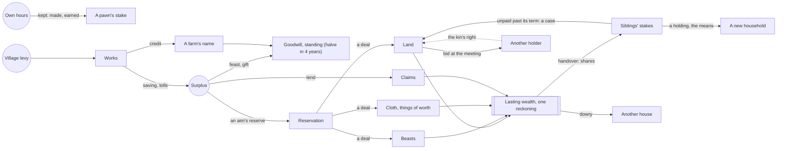

# The generational system: growth, wealth, aims and what passes on

25 November 2026. A design pass on Kim's decisions of the same day (`docs/design-changelog.md`, 0.4, "a generation"), which followed
the review of growth (`docs/review-growth-2026-11-25.md`, sections 6 to 8). It designs as one system how a pawn and a village pursue
growth, wealth and goals over about twenty years, and how what a house gains passes on across generations: the review's priorities 0
to 6 and the handover. It sits on the job system of the arch `plans` (`docs/plans/four-scales/README.md`, v2): one plan record, steps
with authors and a `by`, verbs any pawn has, decision points with deadlines, the levy and own hours, the strip. It builds nothing
parallel to that grammar. That design is on `origin/main` (PR #325); this branch is not built on it, and Kim's answers 20 and 21 are
two commits on `origin/claude/dreamy-allen-vhu47g` that main does not yet have.

Kim's answer 21 there names `docs/plans/four-scales/aims.md` as the design of long-term plans and aims; no such file was written.
This document is that design, placed here because it covers more than aims (question 10).

Revised once after an independent review (`review.md` in this folder, with the designer's response at its end). No code is changed
by it and `design.md` is not edited. Type sketches are TypeScript-style: shape and ownership, not code to build. *Measured* means
measured in this pass (section 2.4, with seeds and commands) or by the review's read of the same saves; every other number is
Proposed. Principles are cited by name (`docs/principles-concordance.md`). "Claim" means a land claim only; a body's hold on labour
is a levy; a debt or a due is an obligation.

---

## 1. For discussion

### What is decided (Kim, 25 November), and built on here

1. **A generation** (Vision and scope): a house rises over two or three generations and is held back each generation. The farm, not
   the family, persists. Soft stocks (goodwill, standing, skill) keep their decay; the office stays a life's.
2. **Ambitions are pawns' aims**: one structure for every pawn and the player (Every act is a pawn's), a step of the year with a `by`
   that may lie years ahead and, where it saves, a reserve the feast, the gift's allowance and a lender's spare leave alone.
3. **Personal goods** come forward from slice 8 as a pawn's stake, the servant's generalised; what a pawn makes or earns in its own
   hours is its own. Coin stays with slice 8.
4. **Land is bartered and sold, and dear**, by mechanism and never by a price rule.
5. From the arch `plans` (Kim, 25 November): the levy and own hours, the plan record with authors, a step at risk handed back after its
   `by`, any holder may `propose` to the meeting, breach costs goodwill only for now, "No pawn decides entirely for itself".

### What this pass proposes

- **One reckoning of lasting wealth** (`sim/wealth`, 3.0), read by the handover's shares, the dowry, the aims, the land market and the
  report: land at its village's worth, beasts, things of worth, claims net, grain at half.
- **Land's worth follows what land sells for** (3.6): a number a village, the middle of its last witnessed sales, starting at the
  custom's 120. Shares, lasting wealth, the hard bargain and a deal's goodwill all read it, so the handover counts land at what it is
  worth where it lies, and there is one worth of land, not three.
- **The price is bid at the meeting** (3.6): the seller offers a field at the public act, each holder present bids what the field is
  worth to it by its own need, the seller takes the best bid above its own need of the field, and kin of inherited land may take it at
  that price. While free land is in reach a bid is bounded by the hours of clearing one (about 40 to 90, *measured* from the code's
  rules), so land is cheap while the map is open and dear as it fills.
- **The handover as the valve** (3.H): shares on all lasting wealth, paid over years into the siblings' stakes; a share left unpaid
  past `SHARES.term` (6 years) becomes a debt like any, with the case and the remedy, which is how land leaves a house that cannot pay
  (a house falls). An optional custom, "The heir takes the farm at", is the brake's setpoint (question 2).
- **The earmark is a reservation that yields to obligations** (3.1): an aim's reserve is held back from the three readings Kim named
  (the feast's laying out, the gift's allowance, a lender's spare) and from nothing else: a share, a dowry, a price or a loan due is
  paid before it, and the floor does not count it.
- **The stake generalised** (3.2): title to goods lying in a named store, rotting as grain does in a store nobody eats from, carried by
  a journey, passed at death by the succession order (it vanishes today: VB-1476). Cloth, which keeps, is the beastless saver's store.
- **Eight aims** (3.3), read from the state and granting nothing: a holding, the children placed, a craft, the office, a house of
  standing, a farm to hand on, a work for the village, a cause. A head's aims about its household are steps of the household's plan,
  offered to the next head at the handover. **VB-1472 answered**: no count of large projects; the season's labour budget and the
  stores, by the head's estimate; ranked by the aim each serves and its `by`.
- **Village works** (3.4): proposed by any holder with an estimate over five years, voted by the meeting with their days a year and
  their years, carried out by the alderman, paid by a levy of days by the custom of lots, credited to the proposer. Most works are a
  year's effort or less, bounded by their goods (millstones, iron) more than their hours; the twenty-year agenda is their sequence,
  their upkeep, and the long ones (ways built along a long worn way, later the church). The mill becomes a proposal (question 8).
- **Craft beside a master** (3.5), a contribution to the learning rate; an apprenticeship is a place in service with a master. **A
  farm's name**: the memorial stone's fading term of standing, extended to the two other things a holder makes or pays for that stay
  at the farm (a work credited, a masterwork), under one cap with the well-kept house.
- **A generational report first** (3.0): persistence of a farm's rank from holder to heir on gross holdings and net wealth, mobility
  by cohort, the spread, land by how it moved and at what price, shares owed and their age, works and their proposers, aims met.

### The Proposed rows of 25 November: confirmed, revised or replaced

| Row (`design.md`) | Here | Why |
| --- | --- | --- |
| Ambitions: the first set | Revised: eight aims, two folded, two added (3.3) | A portion is one way of placing a child; a herd is one form of lasting wealth; a work and a cause are the player's listed ambitions ("change a custom", "found a village") and rest on `propose` and taking up a cause |
| Ambitions: the reserve | Confirmed, as a reservation read by the three readings Kim named and yielding to obligations (3.1) | Kim's decision 2; Hunger presses, the feast binds |
| Land's worth | Revised: a village's worth of land is the middle of its witnessed sales, from 120 (3.6) | *Measured*: 120 is about 1.5 to 2 years of a field's grain above its seed, 4 to 5 years of its rent; one worth, following what happens, keeps the valve and the booking on what land is worth (One quantity, one reckoning) |
| Why a holder sells | Confirmed and made exact (3.6): food's need, the holder's horizon, a child's rung (which carries "the means to marry"), its hands; class by land dropped | A label is read, never a switch |
| The kin's right | Confirmed; three forms, "the offer and redemption" the default; a quick sale is redeemable for a year and a day at the price and what the buyer put in (3.6) | Puts the brake where fire-sales happen; What can be undone costs something to undo |
| A public act | Confirmed, and it is where the price is bid (3.6) | |
| Payment | Confirmed: goods of the worth table, the rest an obligation of kind `price` over years (3.6) | The claim that lasts |
| Shares on all wealth | Confirmed through one reckoning, land at its village's worth (3.0, 3.H); a share overdue becomes a debt (question 5) | |
| By land bought | Confirmed; its brakes are restated (3.6): the fields a household's hands can till (`FIELDS.perHand`, held as the head's estimate), tenants to let to, sellers, the kin's right, shares | The draft named "hands"; the measured idle hours do not show hands binding over a season (2.4) |

### What stays open

The values of every parameter, set by Kim's tuning runs; the questions of section 6; things of worth until slice 6's second half; how
the town (slice 9) and coin (slice 8) take up the stake.

---

## 2. The system in one view

### 2.1 Stocks

In the balance map's words (`docs/balance/README.md`, Vocabulary): stocks, flows, gates on the flows and their setpoints. A **hard**
stock lasts a generation; a **soft** one decays in a few years by design and is not lengthened here.

| Stock | Held by (owner module) | Grows by | Leaves by | Lasts | At the handover |
| --- | --- | --- | --- | --- | --- |
| Land (fields, meadows), with its origin | household (`sim/ownership`) | clearing while land is free; buying; foreclosure | selling; shares in land or by a case; let go | indefinitely; soil to its floor | to the heir whole; counted in shares at its village's worth |
| Beasts | household; a pawn's head in its stake (`sim/herds`) | breeding, up to hay and the stint; buying | slaughter, sale, shares, dowry, hunger | a herd indefinitely | to the heir; counted in shares |
| Cloth, and later things of worth | household; a pawn's stake (`sim/stores`) | spinning and weaving; buying, gifts | wear in use; gifts, dowry; the hoard | cloth while unworn; worth does not wear | to the heir; counted in shares |
| Claims net (loans, a price owed, shares owed) | the body named (`sim/obligations`) | lending, selling land on terms | paid, forgiven, a case | until met | to the successor; counted net |
| Grain | household, village (`sim/stores`) | harvest | eaten, sown, feasted, given, rotted (5, 20, 40% a year by tier) | a year or two | with the farm; counted at half |
| A pawn's stake | pawn (`sim/stores`) | wages, shares received, what it makes in kept hours, gifts | provisions, the means, its own deals | as its goods do | to its line (3.2) |
| Skill at a craft | pawn (`sim/skills`) | hours at it; faster beside a master | a tenth a year unused | a working life | no; taught to whoever worked beside it |
| A farm's name (monuments) | farmstead (`sim/house`) | a memorial stone, a work credited, a masterwork | each term fades over a generation | a generation | stays with the farm |
| Works (mill, bridge, way, meadow) | village (`sim/facilities`) | a vote and a year or two of levied days | wear without upkeep | decades if kept | the village is permanent |
| Goodwill, standing, opinion | pawn (soft) | gifts, feasts, help, office | halve in about 3 to 4 years | ~4 years | half of goodwill to the new holder |

### 2.2 Flows, and who acts at each

Every flow is an act of a pawn through a verb, or nature's (The simulation has no hand of its own).

| Flow | From, to | Who acts | Verb or process |
| --- | --- | --- | --- |
| Harvest, breeding, rot, decay, death | nature | none | the natural processes |
| Surplus held for an aim | grain, beasts, cloth, claims → a reservation | the aim's holder (a head on its household's plan; a pawn in its stake) | `aim` (its reserve) |
| Surplus spent on standing | grain → goodwill, standing | the head | the feast, the good-year gift |
| Surplus lent | grain → a claim | the head | `lend`; an ask answered |
| Surplus converted | grain, hours → beasts, meadow, cloth, land | the head, the pawn | a deal (`offer`), a project, `work` |
| Own hours kept and worked | hours → goods in the stake | the member | `work` on a goal it owns (3.2) |
| Goodwill repaid as a portion | the household's goods → a member's stake | the head | `give` |
| Land sold in need or short of hands | land: the needy and the hand-short → the able | the seller, the bidders, kin | `offer` basis `land`, `bid`, `redeem` |
| A work | adult-days and goods → a facility | proposer, meeting, alderman, every levied head | `propose`, the meeting's vote, `levy`, `name`, `commute` |
| The handover | the farm → the heir; shares → siblings' stakes | the holder (timing), the heir (paying), the creditor sibling (pressing) | the handover; shares paid at each round; a case |
| Dowry | a share of the bride's share of the house's lasting wealth, paid in movables → her new house | the bride's head | the marriage's terms (`sim/terms`) |
| Craft learnt | a master's skill → a learner's | the head who allots, the member who asks, the master who answers | `assign`, `ask`; a place in service |

### 2.3 Loops and their brakes

Each reinforcing loop with its brake and both timescales (target-v2, 6.1 and 6.2). Where a reinforcing loop is faster than its
opposers it is tuned by its ceiling, so each such ceiling is named.

| Loop | Kind | How it runs | Its timescale | Its ceiling or brake | The brake's timescale |
| --- | --- | --- | --- | --- | --- |
| Land begets land | reinforcing | surplus → land bought → more surplus | a field in a few good years, once the map is full | **ceiling:** fields worked are held to what the head reckons its hands can till (`FIELDS.perHand`, 2 a working adult, as the head's estimate), land beyond that only let, and letting needs a tenant (a landless couple asking for a home) at a quarter's rent; sellers are few (in need or short of hands). **Brakes:** the kin's right; shares counted at land's worth at each handover | ceiling: each review; tenants and sellers: years; kin: a year; shares: a generation (~30 years) |
| Dearth sells land | reinforcing (with the above) | a bad year → quick sales to the rich → the poor poorer | a season | redemption of a quick sale by kin; a hard bargain remembered; a buyer in haste bids low where kin could redeem | a year and a day; memories 2 to 4 years |
| Land follows hands | balancing | a household short of hands (old, widowed, shrunk) sells or lets to one with hands to spare | years, with the family cycle | none needed: the market's levelling half | |
| The herd | reinforcing | beasts breed | years | hay and meadow (*measured*: beastless households have a median of 2 meadow tiles and no hay, against 6 and hay); the stint; shares, dowry | a winter; the stint in decades |
| Claims | reinforcing | lending at a quarter → more to lend | a harvest | default, forgiveness, debtors' politics | a case in ~2 years; the practice in decades |
| Office | reinforcing | standing → office → keep → feasts | a few years | the payers' pull; the office a life's | decades; a life |
| A house's name | reinforcing | things made or paid for → standing → matches and votes → wealth → more | a generation | each term fades; one cap with the well-kept house; a poor heir makes nothing | a generation |
| A craft in the house | reinforcing | skill → better goods → income → more hours at the craft; a child learns beside | a working life | skill fades unused; the market's reach; material rights; a child who takes another aim | a decade; a generation |
| Village capital | reinforcing | a work saves hours or earns tolls → surplus → the next work | a year or two a work | the goods a work needs; upkeep; the levy's weight on small households (payers' pull); the vote and its term | years; decades |
| The handover | balancing, on all the above | lasting wealth → siblings' stakes; dowries out; an unpaid share → a case → a field | once a generation; a case some years on | its setpoints: the share custom, `SHARES.term`, and, if adopted, "The heir takes the farm at" | decades (custom) |



### 2.4 Grounding: what the game does today (*measured*)

Populous, small map, seed 7 (commands below; this folder's `wealth.js` and `persist.js` are throwaway read scripts). The review ran
runs 1 and 3 and the scripts again and every figure reproduced.

| Measure | Value | From |
| --- | --- | --- |
| Grain a field reaped, by decade and farm class | 79 to 108 rations (years 1 to 10: 101 to 108; 11 to 20: 79 to 100) | run 1, `--report soil` |
| Seed a field | 17 to 48 (barley 25) | `sim/crops` |
| Field work a sown field-year, households of 2 to 4 fields | about 60 to 90 hours (2 fields 80, 3 fields 74, 4 fields 88) | run 2, `--report hours` (year 21, which had 47 hungry household-days) |
| Hands idle in spring, the busiest field season | 52% (2 fields), 44% (3), 36% (4) | run 2 |
| So a field's grain above seed and work, at the worth table's day (3 rations for 8 hours) | about 20 to 50 rations a year before rot | the three above |
| `SHARES.perField` (120) against that | about 1.5 to 2 years of grain above seed; 4 to 5 years of the custom's rent (a quarter and 2 days, about 26 to 33) | |
| Clearing a new field (the code's rules) | about 40 to 90 hours: scrub 10, stones up to 20, breaking 30, a wood's felling and grubbing 16, and its ground's own; 15 to 35 rations at the worth table | `sim/fieldplans`, `sim/forest` |
| Grinding by quern, a household-year | 40 to 120 hours (households of 2 to 9 fields) | run 2 |
| Fields a household, year 20 / year 40 | p10, p50, p90: 2, 3, 7 / 1, 3, 6; Gini 0.31 both | `wealth.js` |
| Lasting wealth (fields at 120, beasts at customary worth), year 20 / year 40 | p50 480 / 390; p90 1,016 / 810; Gini 0.30 / 0.31; beasts 10 / 11% of it. Households 105 / 156 on much the same land: the median house **falls** | `wealth.js` |
| Households keeping no beast | 61 of 105 / 99 of 156. At year 40 those with beasts have a median of 6 meadow tiles and hay in store; those without, 2 meadow tiles and none (12% none), and 70% of them have never had a herd | `wealth.js`; a read of the year-40 save |
| Living pawns holding a stake | 53 (median 146 rations) / 102 (median 82); most are shares paid out | `wealth.js` |
| Live obligations at year 40 | 125 shares, 80 loans, 144 days, 24 wages | `wealth.js` |
| Open shares at year 40 (the review's read) | 125, owed by 35 of 156 farms; 7,517 rations owed, 688 delivered; the median owing farm owes about 200 against a median lasting wealth of 390; half 3 years old or more, a tenth 14 or more, the oldest 24 | review, finding 8 |
| A farm's wealth rank in its village, year 20 against year 40 | all 79 farms ρ 0.27; same holder (28) −0.10; holder to its own child (18) 0.52 | `persist.js` |

The last row is indicative only: one seed, 18 pairs (a 95% interval of roughly ±0.4), and not the report's measure (an heir against
its parent at the same age). The negative figure for the same holder is what a family cycle gives: a holder lets fields go as its
hands fall. Three readings follow for the design: the valve already backs up (shares are paid slowly from grain, and most houses have
no beasts to pay in), so widening what is counted widens a debt unless a share can come due (3.H); the herd is closed to most houses
by meadow and hay, so the first conversion of surplus for them is hours into meadow, or into cloth (3.1); and the hours a household
has do not hold its fields down over a season, so the ceiling on land is the head's count of what its hands can till (2.3, 3.6).
Commands (scratch saves, not kept):

```
node tools/sim.js --scenario populous --seed 7 --map small --years 20 --report soil --period decade --save pop7-y20.json.gz   # run 1, 3 min
node tools/sim.js --load pop7-y20.json.gz --years 1 --report hours --every hour                                               # run 2
node tools/sim.js --load pop7-y20.json.gz --years 20 --save pop7-y40.json.gz                                                  # run 3
node docs/plans/generations/wealth.js pop7-y40.json.gz;  node docs/plans/generations/persist.js pop7-y20.json.gz pop7-y40.json.gz
```

Found while grounding, for the surfacing lists (`AGENTS.md`, Surfacing): a pawn's stake is one number on the pawn (`pawn.stake`), so
its grain moves with the pawn when it changes household, with no journey (a **teleport**, collected); the stake never rots (`sim/goods`
`KEEPING.stake`), one reckoning of grain with two rots; and it vanishes at death (VB-1476, open). The name `sim/aims` already holds a
head's project menu (VB-255), which this design folds into the aims (3.3).

### 2.5 Twenty years of one house and one village

Västergården in Ås, an old village of eight farms whose land within a day's walk is all taken, so clearing is no alternative to buying.
The customs are the defaults: "one heir buys out the rest", the kin's right as "the offer and redemption", a work's lots by fields.
Numbers are Proposed and illustrative, worked through the rules of section 3; every act names its pawn. Ås's worth of land stands at
160 a field from its last sales.

| Year | The house | The village | Stocks moved |
| --- | --- | --- | --- |
| 0 | Olof (38) holds 4 fields and 3 cows: lasting wealth 760 (fields at 160, cows at 40). Ambitious, he takes **a farm to hand on** (+30% by his handover, about 990) and **the children placed** (four children); both are steps of his household's plan | | |
| 2 | A good harvest: grain at 2.6 years of need. The feast decides on the store whole and lays out from what is not reserved: a quarter of the 0.6 year above its threshold. His reserve takes half of what is then spare above the floor (generosity 0.5) | | grain → goodwill; grain reserved |
| 3 | At the gathering Olof swaps 60 rations of reserved grain and a sack of butter for a heifer, so the reserve stops rotting | Bengt, widowed with one hand, has two fields more than he can till | grain → beast |
| 4 | At the autumn meeting Bengt offers a field. It is inherited, so his brother Lars stands first. Three holders bid what the field is worth to them by their need; Olof's 210 is best (a cow, 50 rations, 120 owed over 4 years). Bengt, with no child to place, no hands for it and no tenant asking, would let it go: it is worth little to him, so he takes the bid; Lars, with no hands to spare, lets it pass. Ås's worth moves to 170 | Witnessed at the meeting; free of redemption | land: Bengt → Olof; a `price` claim |
| 6 | Erik (16), the heir, is allotted to the tar pit beside the village's tar burner, Nils (14) to the herd | Per proposes a meadow cleared on the commons; voted: 2 days a farm for 2 summers | days → a work |
| 8 | A dearth. Hans, hungry, sells Olof a field quickly before the alderman. Hans's sister's household holds the price in its spare, so Olof bids only what the field's season is worth to him (its crop less its seed, about 75 rations); Hans, whose son is in service and whose remembered yields fell in two bad harvests, needs the field at about 200 and values 75 rations at food's need of three, so he takes it: a hard bargain, remembered. In spring Hans's sister's husband redeems it for the 75 and the seed and hours Olof put into the standing crop (about 130). Olof's aim goes **at risk**: he lowers it to +20% | The meadow is mown | land out and back; Olof's standing − |
| 10 | Olof proposes a bridge at the ford: his estimate, 5 years of detours saved against its 40 hours and 6 loads of timber | Voted: 1 day a farm this year, and timber; Hans's household, one adult, commutes its day for 3 rations | a day, timber → a work |
| 11 | | The bridge stands: "Olof's bridge". Per, now alderman, proposes the mill: its hours are a quarter of a year's grinding saved, but the millstones are not of place; voted with a levy of grain toward their price | Olof's farm's name + |
| 12 | Anna marries out; her dowry (half her share of the house's lasting wealth, paid in movables: a cow and cloth, about 100) leaves the house | | movable wealth out |
| 13 | Nils (19), deft and diligent, takes **a craft**: some 50 of his own hours a year at the loom and the clay; cloth lies in his stake. Olof gives a heifer into it from a good year (by goodwill owed for hours Nils gave: question 6) | The alderman deals grain for millstones at the gathering | hours → stake |
| 15 | | The mill is built (100 hours in a season) | a facility |
| 16 | Nils's stake reaches the provisions; he asks the alderman for a plot and takes it at the round | | stake → a new household |
| 18 | Erik marries; Olof hands over and retires. Lasting wealth: 5 fields at 170 (850), 4 cows and a heifer (180), cloth (40): 1,070, his lowered aim met. Olof's household aims are offered to Erik, who takes **a farm to hand on** with its target and lets the children placed go: its reservation is released | | the valve |
| 18 to 24 | Shares: three siblings besides the heir (Nils, Anna, Karin) about 270 each, Anna's less her dowry: about 700 owed by the farm, two thirds of its lasting wealth. Erik's net wealth is about 370, below the village's median; his holdings are his father's. Paid at each round from grain above the reserve and in beasts; Karin's last 60 is still owed at year 24, short of the term | | farm → siblings' stakes |

What the twenty years show: the farm grew by a field and kept it; the field Olof bought in a dearth went back along its line at what
he had put in; most of the gain left at the handover as his younger children's start; the house's name grew by the bridge; the village
built a meadow, a bridge and a mill, each in a year or two, the mill held back by its goods. On gross holdings Erik stands where his
father stood; on net wealth he stands below him until the shares are paid.

**A fall, in the same village.** Hans's farm: in year 8 he sold in haste and his kin redeemed it, so it stayed in the line, not with
Hans. Year 14, his heir Sven takes over a farm of 3 fields and no beasts, owing two siblings 240 each. Two lean harvests leave no grain
above the reserve; at year 20 the first share passes `SHARES.term` and comes due as a debt. His brother presses; the meeting upholds
the case under "labour, then land"; Sven's household cannot give the days within the year, and at the next meeting a field passes to
the brother's household, which lets it back to Sven as tenant. In one generation the farm has lost its rank and a field, by the acts
of its own kin, and no rule of the simulation's.

---

## 3. The parts

Each part gives its mechanism, who acts, state and owner, verbs, decision points, the page and its parameters. 3.0 comes first
because every later number is read through it.

### 3.0 Lasting wealth, and the generational report (priority 0)

**One reckoning** (One quantity, one reckoning). A household's lasting wealth is one function, read wherever wealth is weighed: the
handover's shares (3.H), the dowry (`sim/terms`), the aims' progress (3.3), a holder's need in the land market (3.6) and the report.
It stores nothing.

```ts
// sim/wealth (new; reads only): Wealth.lasting(st, household) and its parts
type Lasting = {
  land: number;      // each holding owned (`own`), at its village's worth of land (3.6): a field's, and a meadow's (half a field's at the start)
  beasts: number;    // each head and sheep at its customary worth (sim/norms WORTH)
  worth: number;     // cloth by its grade, things of worth (slice 6b), at their customary worth
  claims: number;    // obligations held less obligations owed, each at what is still owed (shares, loans, a price, wages)
  grain: number;     // all its grain at SHARES.perGrain (0.5), as the estate is valued today (the reserve limits what is paid, not what is counted)
  gross: number;     // land + beasts + worth + grain: what the house holds
  net: number;       // gross + claims
};
// A pawn's stake is reckoned apart (Wealth.stake(st, pawn)) and never in its household's.
```

The house and yard are not counted: they stay with the farm and its heir under every custom, and a house's grade is a condition, not
a good (A made good is graded, a built thing is not). The dowry stays as built in its base: `TERMS.dowryShare` of the bride's share of
the estate, now the estate's lasting wealth, paid in movables (beasts, cloth, grain, later worth).

**The report** is measured, never asserted (An elite is what the rules leave over), beside the slice bands (`tests/lib/bands.js`),
nightly on long runs (populous, seeds 7, 11 and 42, 150 years; founders the same). It is a tool, `tools/generations.js`, that steps a
run as `tools/hours.js` does and reads `st` at each year's end; it writes nothing to `st`. One thing is added to the simulation: the
handover's event (`personEvent` of `sim/heirs`) carries the farm's `Lasting`, taken **before** the shares are booked, so the measure
reads the record. Its figures are given for the island, not by village or culture, until the numbers bear it (about 12 handovers a
village in 150 years).

| Measure | Definition | Why |
| --- | --- | --- |
| **Persistence** | Spearman's ρ, over farms, between the farm's rank in its village when the holder was 45 and when the heir is 45 (the handover's snapshot where either age falls outside a holding), on **gross** holdings and on **net** wealth | The review's scale (8.3). Shown to Kim with what answer B leads one to expect, about 0.4 to 0.6 on gross holdings; no target, and no task tunes toward it |
| **Mobility by cohort** | For pawns born in each decade, the quintile of their household's net wealth in their village at 15 against that of the household they live in at 40 (5 × 5), and the share who are holders at 40, by birth order and sex | Whether younger children fall, as the farm's persistence says they should |
| **Spread** | Gini of gross and net wealth by household and of land owned; the top tenth's share | Land concentration, a balance property |
| **Land by how it moved** | Per decade: fields cleared, inherited, sold (in need, short of hands, other), redeemed, foreclosed, let go; prices paid against the custom's 120 and the village's worth | Whether the market concentrates or levels, and which brake held |
| **Shares** | Owed, paid, their age, those come due and their cases, per decade | Whether the valve pays out or backs up |
| **Works** | Each work proposed: by whom (alderman, his household, others), voted, days and years, built, ended short | What villages built and on whose proposal |
| **Aims** | Share of pawns holding each aim; met, lowered, failed, let go; by trait tertile | Whether aims are reached by those who hold them |
| **Own hours** | Given, kept, taken, by trait (from the arch `plans`) | Whether diligence is selected for over generations |
| **A house's curve** | For each farm, gross and net wealth and rank at each handover, the chronicle's line | The player's view of answer B |

**The page.** The chronicle gains a house's curve: the farm's wealth and rank at each holder's handover, the holders named, a mark at
each monument. The village card's history lists works with their proposers.

### 3.1 A store of value, and the earmark (priority 1)

**The stores.** The design keeps grain from piling up ("rot is what stops hoarding") and that stands. A surplus kept for years becomes
a hard stock, and which is the saver's choice:

| Store | Its cost of keeping | Its way out | Open to |
| --- | --- | --- | --- |
| Land | its work, or a tenant's quarter | sold, let, shares, a case | a household (3.6) |
| Beasts | hay and meadow; the stint; deaths | slaughter, sale, shares, dowry | a household with meadow; a pawn's head in its master's herd by leave (3.2) |
| Meadow | its making (hours), then its mowing | as land | a household: the first conversion for a beastless house (*measured*: 2 meadow tiles against 6) |
| Cloth | none until worn; worth 40 a length | worn, given, dowry, dealt | anyone who spins and weaves; a member in its own hours (3.2) |
| Claims | the risk of default | paid, forgiven, a case | a household; a pawn as creditor (3.2) |
| Things of worth | none | given, buried, lost (What does not wear needs a way out) | slice 6b |
| Grain | 5, 20, 40% a year by tier | eaten | a store for a year or two only |

So an aim that saves for ten years saves in land, beasts, meadow, cloth or claims, and its grain is a way station. Most houses have no
beast and too little meadow for one (2.4), so their first saving is hours (a meadow made, cloth woven), not goods. Loans stay of one
harvest: a longer loan is a claim with no new use while land can be paid for over years, which is the long claim this design needs.
The head's estimate weighs the rot it would suffer against a beast's hay; nothing forces the conversion. The herd's target is set
through the verb `plan` (the arch `plans`; today `target`).

**The earmark** (Kim's decision 2). An aim's reserve is a **reservation** of named goods, with the aim's step as its `why`, held where
the aim saves: the household's store for an aim of the household's plan (`plan.reserved`, which today holds a plan's reservations of
grain by crop and of other goods), a pawn's stake lots for a pawn's own aim, and the village store for a work (3.4). The last two are
new uses of the reservation. Three readings, the three Kim named, leave it alone:

- **the feast**, which decides on the store whole (grain above the seed and 2 years of need, `FEAST.above`) and lays out its quarter of
  the grain beyond that from what is not reserved. Worked through: a household at 2.6 years of need with half its spare above the floor
  reserved lays out a quarter of 0.6 of a year, all of it from the unreserved 1.3 years: a saver feasts whenever a holder who saves
  nothing does. (The draft's reading, which subtracted the reserve before deciding, would have held a half-reserving holder back from
  feasting below about 3.6 years of need.)
- **the gift's allowance** (the giver's grain above its floor, less its own reserve, plus goodwill's and opinion's terms), which
  subtracts the aim's reservation beside the holder's own reserve;
- **a lender's spare** (`sim/loans` `spareOf`), which subtracts it.

Nothing else does. **Obligations come first**: a share paid at the round, a dowry agreed, a price or a loan due, the alderman's keep
in grain and a commuted day are paid from the store whole, and paying them shrinks the reserve; that is not breaking the earmark
(question 4). **The floor does not count it**: `floorOf` (the plan's reservations and 20 days of need) is what a household must keep,
read to excuse it from a named day and to decide who asks for help, so an aim's reservation carries a reason, `aim`, that `floorOf`
leaves out: a household with grain reserved for an aim is not short and asks nobody.

The **cap**: an aim's reserve of a good is at most `RESERVE.share` of the household's spare of it above the floor, 0.75 for the
tight-fisted to 0.25 for the open-handed (generosity, a contribution to a declared rule). Converted to land or a beast, the goods leave
the reservation: it is of what is still to spend.

**Breaking the earmark** is an act: help in hunger asked of a head reads its spare without the aim's reservation only when the head
chooses to break it (a decision point; an unplayed head breaks it for its own household's hunger always, and for kin by its
generosity), and the aim's holder remembers it ("Spent what we saved"). A work's reservation of the village store is the meeting's:
only the meeting releases it; an alderman who spends it on help in a dearth between meetings breaches it, and it is a cause at the
next meeting.

**Parameters.** `RESERVE.share` (0.25 to 0.75, by generosity).

### 3.2 Personal goods: the stake (priority 2)

**What it is.** A pawn's stake is its title to goods lying in a named store (Title moves at once; custody moves by a journey). It
generalises the servant's portion (VB-637) and the shares paid to a pawn without a household, both of which it holds today.

```ts
// pawn.stake (owner sim/stores): absent, or the lots of the pawn's own goods, at most STAKE.lots places
type StakeLot = { at: { household: number } | { village: number }; goods: { [good: GoodKey]: number }; reserved?: { [good: GoodKey]: number } };
// A head of cattle may be a pawn's: head.owner (owner sim/herds), a pawn id, absent for its household's.
```

**What is booked to it.**

- *What it makes in kept hours.* A goal of the arch `plans` names its owner (`Goal.owner: BodyRef`). A goal a pawn opens in its own
  hours, by its own step, is owned by the pawn: the good is put into the pawn's stake where it is made, and the hours are booked
  `kept`. Material: what it takes from the commons by its village's rights (below), or from its household's store by the head's leave
  (an ask answered once, as leave is).
- *What it earns*: a servant's wage (as built), a day's hire, a gift, a share received, the price of its own goods at a deal.
- *A portion earned* (Proposed; question 6). The arch `plans` books hours **demanded** as goodwill the head owes the member and hours
  **taken** as goodwill the member owes the head; hours **given** are a tally for the card. This design extends the booking: an hour
  given books as a gift of work, the worth table's day (3 rations for 8 hours) to the member's credit, as an hour of help to another
  household does today (`GOODWILL`, VB-704). A head may repay that balance by a gift into the member's stake, by the gift's rule: the
  good-year gift's occasion (a holder above the feast's threshold, on its planning day after the harvest) is open to a member it owes,
  before other households. So a diligent son's stake grows from his father's surplus, by his father's generosity; goodwill, the gift
  and the stake, and nothing new.

**The road in numbers.** Under the custom's levy a member keeps about 100 hours a year (2.5, 2, 1.5 and 2.5 hours a day of 12 by
season, 12 days a season). If half go to a craft, 50 hours of spinning and weaving make about half a length of cloth, some 20 rations
of worth a year that do not rot. The provisions of new land for a couple (84 rations) are then about four years of one pawn's kept
hours, two with a partner's, beside a servant's 12 rations of wage a year: the own-hours road is real, slow, and quickened by the
head's gift, which is intended. A craft's skill rises with the hours (VB-360, half in about 400) and faster beside a master (3.5).

**Its rules.**

| Rule | Design |
| --- | --- |
| Where it lies | In the store of the household it lived in when the goods were booked (a servant's in its master's house). A head may not spend it (title); taking it is a breach, booked as goodwill and remembered, as a demand is |
| Custody | When its pawn moves household, the pawn carries up to a back load (`TRAVEL.load`, 30 rations' worth) on the move's journey; the rest stays a lot where it lies, a pile with title in the arch `plans`' sense, and is fetched (the stray method) |
| Rot | Its grain rots as the second tier of grain does (20% a year), as the village store's does (`ECON.villageStoreTier`), since nobody eats from it day by day; other goods as their kind wears |
| Use | The provisions of new land and the means of the home it marries into (as built); its own deals (it may give, swap and lend from it, as a party of an offer); a dowry it brings |
| A head of cattle | A pawn may own a head kept in its household's herd by the head's leave: its hay is the household's, its calves the owner's. A servant's wage may be paid in a heifer, by its contract |
| Joining a household as holder | When a pawn becomes a holder or a holder's spouse its stake becomes its household's (the means, the provisions), as stakes do at founding today; what a pawn's own aim reserves stays its own |
| Debt | Who owes (Households and other bodies) binds the body an agent dealt for; a pawn dealing for itself may lend from its stake and owes only what it pays at once, until coin |
| At death | Its lots pass, title at once, by Nothing is left to no one, along the succession order that exists (Succession: the spouse, the children and theirs, the siblings and theirs, the parents' siblings and theirs), for a servant as for anyone; with none of the line living, to the household it lived in. Fixes VB-1476 |
| The retired | What the keep names is the retired's own (VB-1122's plan): it is the retired pawn's stake |

**A landless pawn's right to its material.** The village's rights on its outland (`gather`, `fell`, `dig`, `graze`) are granted to its
households; a custom, "The commons serve" (Customs may prescribe), says whether they serve every person living in the village for its
own use and making (default, as the *allmänning* was used) or households only. Under the first, a member, servant or lodger digs clay
and cuts fuel on the commons for its own work, within any stint. Material on another's land, and wool from the household's sheep, is
asked of its holder.

**Who acts.** The member (works, keeps, deals), the head (grants hours and material, gives into a stake, may breach it), the master
(pays the wage), nature (rot, a beast's death).

**Verbs.** `give` (to a pawn's stake; its target widened from a household to a pawn), `offer` and `answer` with a pawn as a party,
`ask` on basis `material`, `work` on a goal the pawn owns.

**Decision points.** A member: what to make in its kept hours; a head's ask to lend its stake in dearth (by its generosity, its
opinion of the head and the need it sees). A head: an ask for material; whether to repay a member's goodwill into its stake.

**The page.** The pawn's card shows its stake as goods with their icons, where each lot lies, and what it counts toward ("the
provisions: 70 of 84"); the strip's kept hours show what they made.

**Parameters.** `STAKE.lots` (3), a declared cap of a per-pawn collection: past it the smallest lot is fetched first.

### 3.3 Aims (priority 3), and the limit on a holder's projects (VB-1472)

**The shape.** An aim is a step of a plan's year list, with a `by` years ahead, a target read from the state, a reserve where it
saves, and its state. It needs four changes to the one plan record (`PlanStep`, the arch `plans`, 3.4), for that arch's design pass:

| Field of `PlanStep` | Change |
| --- | --- |
| `what: { aim: AimKey }` | gains `target` (in the measure's unit) and `of` (the child, the craft, the work or the custom it is about) |
| `gap` (new) | `{lo, mid, hi}`: the target less the measure at `by`, by the planner's estimate (beside `left`, which is hours) |
| `reserve` (new) | the named goods the step holds back, as a reservation (3.1) |
| `by` | may lie years ahead on a year step |

**Whose plan holds it.** An aim about the pawn's own life is a step of the **pawn's** plan: a holding, a craft, the office, a cause, a
work for the village. An aim about its household (the children placed, a farm to hand on, a house of standing) is a step of the
**household's** plan, authored by its head as the household's agent: its projects name it as their `why` upward, as the record wants,
and it outlives the head who wrote it (below).

**The set.** Each is read from the state and grants nothing (Ambitions: they grant nothing).

| Aim | Whose plan; who takes it | Measure (by the holder's estimate) | Weight (each trait a contribution, 0.5 to 1.5 at its tails) | What it moves | Brake |
| --- | --- | --- | --- | --- | --- |
| **A holding** | a pawn's; an unmarried or landless adult | rungs open; its stake against the means and the provisions | ambition, diligence | its wish's ranking at the round; its kept hours to the stake; its reserve | the queue for land; the means |
| **The children placed** | the household's; a holder with children | children placed (a farm, a plot, a match onto a holding, a portion paid) of children of age | generosity, honour | a farm or cottage for a child (today's menu), land bought, a dowry reserved, a place in service | land; shares owed |
| **A craft** | a pawn's; an adult member or a landless pawn | its skill at the craft; its income from others against its need | hands, diligence, openness | its kept hours at the craft; working beside a master; dealing at the gathering | material; the market's reach; skill's fade |
| **The office** | a pawn's; a holder | its standing against the last election's margin | ambition, sociability | feasts and good-year gifts; standing at a vacancy | the payers' pull; goodwill's decay |
| **A house of standing** | the household's | the house's rung and condition; the farm's name | ambition, piety | a building project; a memorial stone; tar and mending | wear; materials of place; one cap on standing |
| **A farm to hand on** | the household's | gross wealth (3.0) against the target | ambition, husbandry | the herd's target; meadow made; land bought; lending; its reserve | `FIELDS.perHand`; hay; tenants; the kin's right; shares at the handover |
| **A work for the village** | a pawn's; a holder | the work's state (3.4) | generosity, sociability, piety | `propose`; the levy's days named first | the vote; the payers' pull |
| **A cause** | a pawn's; any adult | the custom's leaning in its village | openness, honour | taking up a cause (today's norm entrepreneur) | attitudes move in decades |

The player's ambitions of the Vision map onto these: hold three farms (a farm to hand on, its target in farms owned: 3.6, Whole farms),
change a custom (a cause), found a village (a holding on new land), become a master household (a craft, or a farm to hand on), leave
service and hold land (a holding). The played pawn sets its targets on its sheet; since an aim grants nothing, a low target gains
nothing.

**Taking an aim.** The pawn's own rule weighs the aims open to its position at its yearly look (the head's first review after the
autumn count, where `sim/aims` looks today; a seeker's asking day) and at a turn of its life (marriage, becoming head, a child of age,
the handover): it takes each whose weight passes `AIMS.least` and whose hours and reserve its own hours and stores bear by its
estimate, as a project is limited (below). `AIMS.held` (4) is only the declared cap of a per-pawn collection (Rules for cost 2), set
high enough never to decide. The **target and `by`** are its rule's: `by` the custom's time for the thing (a holding by the means'
wait; the children placed by the handover; a farm to hand on by the custom's handover age), the target scaled by ambition
(`AIMS.reach`: a farm to hand on at +10% to +40% of the gross wealth it took over).

**Progress and risk.** At the season's first review, and when a deal or a handover changes its measure, the holder's estimate
reckons the measure at `by` from what its plan gains a year (its remembered yields, `sim/yields`: the same function as the doing), with
the estimate's range. When the upper end falls short of the target the aim is **at risk**: a decision point of its holder, with a
deadline at its next review. The answers are verbs any holder has: lower the target or move `by` (`aim`), demand more of members
(`call` beyond the levy, a breach), ask a patron or a lender (`ask`), sell or buy (`offer`, `bid`), let it go. Unanswered, the default
author answers by traits: the ambitious borrow where a loan is open to them, the rest lower the target to what the estimate's upper end
still reaches; an aim is let go when that falls below the least target its holder would still hold (the threshold that took it). A met
aim is told in the record; a failed one leaves its holder a memory ("Never got our land"), weighed by ambition.

**At the handover** (Nothing is left to no one). A household's aims, their reservations and the projects that name them stay on the
household's plan; each is a decision point of the new head: take it as its own, with its target and `by`, or let it go. Let go, its
reservation is released and its projects are steps with no `why`, at risk like any unauthored step, by the arch's take-back. An
unplayed new head takes an aim its own weights would have taken, and weighs its predecessor's higher by its opinion of him: the
soft thread of a house's direction across a generation, with no weight of its own. The retired keeps its pawn's aims.

**VB-1472: the limit and ranking of a holder's projects.** Kim removed "one project at a time" on 21 November; small constructions are
unlimited. For the large projects:

- *No count.* A project is a step of the household's plan with hours left, by the head's estimate (the arch `plans`, The season). The
  head begins one when its season's labour budget (its members' levies less its outer days less its targets' hours) has room for the
  project's share of hours this season, and its stores hold what the project's first stages spend (reserved). That is the limit: hours
  and goods, by the head's estimate, flaws and all.
- *Ranking.* When hands are short: work a household lives by and windowed work first (the template), then project steps by `rank =
  weight of the aim the project serves × urgency of its by`; a project of the old menu with no aim behind it takes the menu's weight.
  The day's allotment reads the rank where it reads urgency today.
- *A project it cannot go on with* is at risk like any authored step: its author is asked; unanswered, the default author pauses it
  (its progress lives in the world: piles, stages, `sim/progress`), and lets it go when the head's estimate no longer finds it room
  before its `by`.
- *What counts:* every step with hours. The settler's cottage and the stone foundation, the cases VB-1472's notes feared would be
  special, are steps with hours like any other.

**State and owner.** Aim steps on `st.plans.of[...]` (owner `sim/plans`). The rules (weights, measures, the default author,
progress): `sim/aims`, which today holds a head's project menu (VB-255) and becomes the aims' module: its menu (a field, a claim, a farm
for the heir, a barn, a crop's trial) is the default author's projects for a farm to hand on, the children placed and a house of
standing. `plan.aim` (the household's) is replaced by the head's aim steps.

**Verbs.** `aim` (any pawn, for its own plan; a head, for its household's): take, change, let go; with its reserve.

**The page.** The pawn's card shows its aims, and the household card the household's, each on the one meter, the target marked, the
estimate at `by` as a range; an aim at risk is flagged with its cause. The strip's year zoom draws an aim as a bar to its `by`. The
chronicle tells an aim taken, met, lowered and failed. An unplayed pawn's aims are shown (knowledge moves at once, for now).

**Parameters.** `AIMS.least` (the lowest weight taken, and the threshold an aim is let go at), `AIMS.reach` (the target's scale by
ambition), `AIMS.held` (4, a cap that does not decide), and each aim's weight table above.

### 3.4 Village works across years (priority 4)

**The mechanism.** A work (a mill, a bridge, a stretch of way, a meadow on the commons, a well, a bell, later a church) is a **project
plan of the village** (`st.plans.projects.village`, VB-123; the record exists), with a step on the village's year plan. It generalises
the alderman's five-year reckoning for a built way (Built ways, passage and upkeep) to every work and every holder.

1. **Proposed** by any holder of the village (`propose`, as the arch `plans` designs it for routines), with its estimate: what the
   work is worth to the village a year by the proposer's estimate (grinding hours saved and tolls for a mill; detours saved, from the
   crossings counted, for a bridge; hay for a meadow; for a bell, what its sound is worth to the village's people, which their piety
   sets) over `WORKS.years` (5), against its hours at the worth table's day and its goods. The default author proposes a work when the
   estimate passes and its aim (a work for the village, the office) weighs it. The meeting's agenda (at most four routines a year, as
   today) is what limits proposals.
2. **Voted** at the meeting by its procedure (`sim/decisions`), **with its days a farm a year and its years**. Each voice weighs what
   the work is worth to its household by its own estimate (one judgement for every work: piety values a bell as a full quern values a
   mill) against its lot (its days, valued by its season's labour budget), with its opinion of the proposer and its position (the
   payers' pull: a household whose lot is large against its hands leans no). The played pawn has no ballot (Decided, 7 November).
3. **Paid by a levy** for the voted years: an outer levy of adult-days in a window, split by the custom of lots, with the terms of a
   routine (the levied names its days; `commute` at the worth table's 3 rations). The goods it needs (millstones, iron fittings,
   timber) are a target on the village store, reserved by the meeting's vote and met by commuted days, the store's quarter of surplus,
   a levy of grain where voted, and the alderman's dealing for the village at the gathering.
4. **Carried out** by the alderman (`levy`, `callWorkday` for work done together): the step on the village's plan is authored by the
   meeting's decision and he is its agent. It becomes a facility of the village (`sim/facilities`) when its last stage is done. A mill
   may be let to a household for a share of its tolls, a tenancy of a facility beside the Decided toll (question 8).
5. **At risk** when the levy is breached or the goods fall short of `by` by the alderman's estimate: **the alderman** is asked. More
   days or more years are a new proposal (his, the proposer's or anyone's) and a new vote; unanswered, the levy ends at its voted term
   and the work stands as far as it got, its progress in the world.
6. **Credited**: the proposer's farm gains a monument (3.5) and the record names the work after him ("Olof's bridge"). A work ended
   short leaves each head who worked days on it a memory of the proposer ("Our days for nothing", by honour).

**What works cost** (hours Decided or Proposed in `design.md`; a lot of 4 days a farm is 32 hours):

| Work | Hours | Goods | Worth a year, by the reckoning | Years at 4 days a farm: 3 / 8 / 15 farms |
| --- | --- | --- | --- | --- |
| Water mill (windmill) | 100 (140) | a pair of millstones (of place or traded), iron fittings | grinding: a quern takes 40 to 120 hours a household-year (*measured*), a mill a fifth of it: about 300 to 700 hours for 8 farms | 1.0 (1.5) / 0.4 / 0.2, held back by the goods |
| Bridge (over a river) | 40 (80) | 6 (12) loads of timber | detours saved, from crossings | 0.4 (0.8) / 0.2 / 0.1 |
| Track; causeway | 3 to 12; 16 a tile | 2 loads of timber a tile (causeway) | crossings eased | a stretch of 20 tiles: 1 to 3 / 0.5 to 1 / under 0.5 |
| Meadow on the commons | as a household's, a tile at a time | | hay | a tile or two a year |
| Bell | casting, slice 6b | bronze, traded | by its people's piety | held back by the bronze |

So **a work is a year's effort or less**, bounded by its goods more than its hours, and a village that wants them builds the first
three or four within its first decade; its twenty-year agenda is their sequence, their upkeep (a routine by its custom), and the long
ones: ways built a few tiles a year along a long worn way, meadows widened in stages, later the church. That is stated rather than
padded: the yearly levy with its term is for the long works, and the short ones vote one year.

**A household's outer days.** Routines' lots (at most four routines), the alderman's keep (4 days), a debt's or a patron's days and a
work's lot (at most `WORKS.lot`, 4 days) come to about 8 to 16 days a farm a year: 64 to 128 hours against about 470 levied hours of one
adult. A one-adult household carries the most; its relief is in the existing terms (lots by fields, naming its own days, commuting),
and the payers' pull is its voice against a work.

**State and owner.** The work's project plan (owner `sim/projectplans`, read by `sim/projects`), with `proposer`, `estimate`, `voted`
(days a farm a year, years) and its levies' obligation ids; the levies are obligation records (`sim/obligations`, source `routine` with
the work named); the facility (`sim/facilities`); `sim/works` (new) holds the menu of works and their estimates, and writes through
those owners.

**Decision points.** A holder: a work to propose (its yearly review). The alderman: a work at risk; the work days to call; dealing for
its goods. Each levied head: its days to name, the ladder, commutation.

**The page.** The village card's year zoom shows each work as a bar to its term, the days levied, named, worked and breached, and its
goods against their target; the proposer and its estimate are a tap away. A holder's card offers `propose` with the works the village
lacks and the holder's own estimate of each.

**Parameters.** `WORKS.years` (5): the years of worth an estimate counts; `WORKS.lot` (4 days): the most a farm's lot a year.

### 3.5 Craft and name that outlast a pawn (priority 5)

**Learning beside a master.** A contribution to the learning rate of a craft's skill (`sim/skills`, VB-360's crafts learnt by doing):
a pawn working at a craft on a task with a hand of higher skill at it learns faster, by `TEACH.beside` times the gap (1 + 2 × gap, so a
novice beside a master learns about three times as fast), never past the master's level; the master works `TEACH.cost` (a tenth)
slower while it teaches. The hands of a task are known when its leg is reckoned, so no pair is searched. Who works beside whom is a
choice: a head allots a child to the task (`assign`), a member asks to work beside a master in its own hours (`ask`, answered by the
master), or an **apprenticeship** is a place in service with a master of the craft (the offer of a place, the craft its reason, the
wage lower by custom). The son of the tar burner is the next tar burner because he worked beside him.

**A farm's name.** The memorial stone (VB-745, Proposed) gives the heir a term of standing by the stone's kind, fading over a
generation, under one cap with the well-kept house. It is extended to the two other things a holder makes or pays for that stay at
the farm: a **work credited** (3.4) and a **masterwork** made there. Nothing else is a monument: not an aim met (aims grant nothing)
and not years in office (the office is a life's, and office goodwill never passes). The sum of a farm's monuments is its name, read as
a term of the standing of its holder and the holder's family, and it stays with the farm at the handover. The fade is the stone's own
(a generation), applied only to things that exist in the world; goodwill's and standing's decays are not lengthened.

| Monument | Size (a term of standing) |
| --- | --- |
| Memorial stone | 0.03 (granite) to 0.1 (marble), by its kind's customary worth |
| A work credited | 0.02 a 100 hours of levied work, at most 0.06 |
| A masterwork | 0.02 |
| **One cap** | the well-kept house's term (`HOUSE.term` 0.15; tarred 0.18) and the farm's name together at most `REPUTE.cap` (0.25) |

```ts
// farmstead.monuments (owner sim/house, beside the well-kept house's term): at most REPUTE.terms, the faded pruned yearly
type Monument = { kind: 'stone' | 'work' | 'masterwork'; by: PawnId; at: Hour; size: number };
// Repute.of(st, farmstead): Σ size × 0.5 ^ ((now − at) / REPUTE.halfLife), read in closed form (Rules for cost 3)
```

Farm names as surnames (*gårdsnamn*, an open proposal) are presentation: the chronicle and the panels may name a line by its farm.

**Parameters.** `TEACH.beside` (2), `TEACH.cost` (0.1); `REPUTE.halfLife` (25 years, the stone's "a generation"), `REPUTE.cap` (0.25),
`REPUTE.terms` (8), and the sizes above.

### 3.6 The land market (priority 6)

**The mechanism is the exchange that exists.** A deal passes when both sides gain by need (The fair; Need), and its residual against
customary worth is booked as goodwill between the two who dealt (Decided, 10 November). Land, the third class of goods, now enters it.
What is new: land's need, land's worth, how the price is found, and three rules of land.

**Land's need to a household.** As food's need is what a ration is worth to a household, a field's need is what it is worth to the
one who holds or would hold it: its net yield to that household by its estimate (its remembered yield, less seed, less its work valued
at what its labour budget makes it cost: little with hands idle, a hired hand's 3 rations a day when short, or the quarter a tenant
would give when it cannot till it), times its **horizon**: `LAND.horizon` years, and `LAND.heir` more when the field would cost or
give a child its rung (heir to the farm, or the means of a child to marry onto it). Against it, goods are weighed at their own need:
grain at food's (up to 3 times its worth at empty stores), a beast at an animal's. While free land lies within a day's walk, no one
needs a field more than the hours of clearing one (about 40 to 90 hours, 15 to 35 rations, *measured* from the rules) and the walk to
it. So:

- a holder with an heir and hands rarely sells: its field is worth twenty years of yield to it, several hundred rations;
- a holder in hunger sells, since a ration is worth three to it (Hunger presses);
- a holder short of hands sells or lets, since its field is worth only a tenant's quarter to it: **land follows hands**, the family
  cycle's levelling flow (Chayanov's, from the standard literature, not checked);
- while the map is open land sells near the cost of clearing, and as it fills, up toward what holders need of it: dear by mechanism.

**Land's worth: one number a village, following its sales.** The custom's worth of a field in a village is the middle (median) of its
last `LAND.sales` (8) witnessed sales, a field's price each (a meadow's at half), with the custom's 120 filling the places no sale has
yet; one write a sale, no loop. It is read through the one door (`Culture.norm('worth', 'field', village)`) by everything that values
land: lasting wealth and so the shares and the dowry, the hard bargain, a deal's residual, the debt remedy's half a field. So the valve
counts land at what it sells for where it lies, the residual of an ordinary sale is small, and a buyer does not become the village's
great giver by buying. This is norm learning (target-v2, 5.3) for land alone, brought forward from slice 8 because land is now traded;
it is a custom following practice, not a price rule (question 1). The report shows prices against both 120 and the village's worth.

**How the price is found** (the public act is where it is bid). A holder who would sell offers a named field at the village's meeting.
Each holder present answers with a **bid**: what the field is worth to it by its own need, times `LAND.bid` (0.8, the share of its
gain a bidder gives up), no more than it can pay now and owe within `LAND.payYears`. The seller takes the bid worth most to it by its
own need, if it passes the seller's own need of the field; else there is no sale, and it may offer again at a later meeting. Under the
kin's right, kin of the line (heads of households of the seller's line within the succession order's reach, within a day's walk) may
take inherited land at the best bid. Between meetings a seller in need may sell **quickly** before the alderman to one buyer it asks:
that buyer's bid is the same reckoning, discounted by the redemption it risks (below). No order of asking is imposed: the meeting asks
everyone present at once, and the quick sale is the seller's choice of buyer, by its opinion and the buyer's spare.

**The supply.** Today a household lets fields go beyond those it wants (`FIELDS.letGo`, `slack`) and they return to waste. Now the
head first offers such a field at the next meeting (for sale or to let), and lets it go only when nobody bids. A holder in hunger
offers a field when food's need passes the field's. A buyer whose aim wants land asks a holder at the meeting to offer a named field.

**The kin's right** (*bördsrätt*; a custom of three forms, differing between villages: none; the offer to kin; **the offer and
redemption**, the default, after medieval Swedish law: *lagbjudning*, the offer to kin; from the standard literature, not checked).

- *Origins.* Each holding is **inherited** (*arv*) or **acquired** (*avlinge*): bought, cleared by its present holder, or foreclosed.
  Acquired land is free of the right in its holder's hands and inherited in its heir's: a house's purchase returns to the right one
  generation on.
- *The offer.* Inherited land offered at the meeting may be taken by kin at the best bid. A sale witnessed there is free.
- *Redemption.* A quick sale of inherited land may be redeemed by kin within `LAND.redeem` (a year and a day), for the price paid and
  what the buyer put into a crop still standing on it (the seed sown, its hours at the worth table): What can be undone costs
  something to undo.
  A buyer in haste knows the line (knowledge moves at once): where a kin household of the line holds the price in its spare, it bids
  only what the field's season is worth to it. So a quick sale is cheap where kin could redeem and fair where none could, and the
  brake sits where fire-sales happen.

**The public act.** The deal concludes at the meeting or before the alderman; the record logs it with its price and terms; title moves
at once (`sim/ownership`), the price's goods by a journey, fetched or brought as a gift's are.

**Payment.** In goods of the worth table (beasts, grain in whole sacks, cloth, iron, later things of worth and coin), and the rest as
an obligation of kind **`price`** owed by the buyer's household over at most `LAND.payYears` (6), due at each autumn round as shares
are, from grain above the reserve; unpaid, a debt like any (overdue, default, a case), its remedy by "Debts are paid with". A seller
may sell and stay as its buyer's tenant (`stay` in the terms), by the tenancy row. **Barter** is the same offer: a field for a field
(consolidation), a field for beasts.

**Whole farms.** A farm (its house and yard with its land) may be offered and bought as a field is. A household works one farm; one it
buys is worked by a tenant household or becomes a child's household's, as foreclosure already makes "a household own several farms,
each worked by its old family" (Land and rights, Foreclosure). The Succession row ("farms are not combined while someone else can take
them... no household holds two farms") is about inheriting and working a farm, and stands. "Hold three farms" is owning three
(question 9).

**By land bought.** A buyer works the land within what it reckons its hands can till (`FIELDS.perHand`, 2 fields a working adult, plus
`oxenHands` for a team), and lets the rest at the custom's quarter. Over a season hands do not bind (2.4: a third to a half of the
hands' hours idle in spring), so `FIELDS.perHand` is the ceiling, held as the head's estimate of what its hands can till and re-derived
in step 4's task from the windowed peak (a field's hours inside its sowing and reaping windows against the levy's hours in those days).
An aim for land raises what the head wants (`FIELDS.want`), never `FIELDS.perHand`. Land let needs a tenant: a landless couple of the
village asking for a home, which the queue for land supplies as the map fills. Brakes, with both timescales: tenants and sellers
(years); the kin's right (a year, and a generation for land bought); shares at land's worth at each handover (about 30 years). Debtors'
politics does not reach a sale. Rent cannot feed an elite (`docs/balance`, findings), so a landed elite by purchase needs many fields:
the road is long, as the Vision's "few founding homesteads" want.

```ts
// st.titles (owner sim/ownership; it exists: holding → {kind, farm, owner, user, since, basis, rent, why}): fields added
type TitleAdded = { origin: 'inherited' | 'bought' | 'cleared' | 'foreclosed'; line?: PawnId;   // the line the kin's right follows
                    redeemBy?: Hour; price?: number; put?: number };                               // a quick sale's term, price, what was put in
// A record exists for a holding split off its farm or let (as today) and for one acquired by its present holder; at the handover an
// acquired holding's record is dropped unless it is let (it is then inherited), so absence means "inherited", and records follow activity.
// village.landSales (owner sim/landsale): the last LAND.sales prices a field, oldest first. A quick sale's term is a due-queue entry.
```

**State and owner.** Titles: `sim/ownership`. The rules (land's need, the meeting's bids, the kin's offer and redemption, the kind
`price`, the village's worth of land): `sim/landsale` (new), contributing to `sim/offers`, `sim/obligations` and the custom's door. The
custom "The kin's right": `sim/customs`.

**Verbs.** `offer` on basis `land` (sell, let, barter; terms: the part owed, its years, `stay`), `bid` (any holder at the meeting),
`answer`, `redeem` (a kin head, within the term). The player as head has them as any head.

**Decision points.** A holder: a field to offer (at its review, when food's need or its hands say so; a field it would let go); a bid
at the meeting; a quick sale to answer. A seller: which bid to take. A kin head: inherited land at the best bid; a quick sale to redeem.
A buyer: a price owed at the round.

**The page.** The Land overlay shows each holding's origin and the year it changed hands; the tile card the kin's term where one runs.
The offer form shows the field's need to the looking pawn, the village's worth, whether a bargain would be hard, and the kin who stand
first. The meeting log shows the bids.

**Parameters.** `LAND.horizon` (10 years), `LAND.heir` (10), `LAND.bid` (0.8), `LAND.sales` (8), `LAND.redeem` (a year and a day),
`LAND.payYears` (6); a meadow's worth at half a field's.

### 3.H The handover, the generational valve

Everything that crosses a generation crosses at the handover, in life or at death. It keeps the farm whole and owes the siblings
shares in proportion to it; what changes is what is counted, and that a share can come due.

1. **The farm's value for shares** is its lasting wealth (3.0), gross: land at the village's worth, bought as well as inherited, beasts,
   cloth and things of worth, grain at half, with the claims it holds and owes. The reserve of seed, food and winter hay is never paid
   out. A daughter's dowry, an advance on her share, is subtracted from it (as built: `pawn.advance`).
2. **Shares** by the custom ("one heir buys out the rest"; *systerlott*: a daughter half a son's), owed by the farm, paid at each moving
   round from grain above the reserve, then in beasts at their worth (as built), and, under "land split between heirs", in fields. Paid
   shares go into the sibling's stake, its start.
3. **A share comes due** (question 5). A share still owed `SHARES.term` (6) years after the handover is overdue, and from then is a debt
   like any (Loans, obligations and cases): its creditor may press, the meeting hears the case, and the remedy is by "Debts are paid
   with" (labour, then land by default). One mechanism with the `price` of 3.6, and the way land leaves a house that cannot pay: a house
   falls (2.5). Today shares stand for decades (2.4: half 3 years old or more, the oldest 24); with more counted, a share that never
   comes due would turn the valve into a debt that only stands.
4. **The heir's valuation**, optional (question 2): a custom, "The heir takes the farm at", full worth (default) or a part of it, as
   the Norwegian *åsetesrett* let the heir take the farm below its value. It is the valve's setpoint, and attitudes to it move by
   position: holders and heirs lean to the part, younger children to full worth.
5. **Aims** on the household's plan pass to the new head as decision points (3.3).
6. **What does not pass** stays as decided: standing, the office, skill (but for what was taught), and goodwill but its half.
   **Monuments stay with the farm** (3.5).

**What brakes it, and when** (Vision and scope, A generation): the shares and the dowry grow with what the house gained (at each
handover and each daughter's marriage) and come due within a term; a poor heir (a head's foresight drawn when it becomes head,
regressing to the culture's mean); dearth forcing sales (a season); the kin's right (a year; a generation for land bought).

**The page.** At a handover the household card shows the farm's lasting wealth, each sibling's share, what is still owed and when it
comes due; the chronicle's house curve gains a point.

---

## 4. Cost, named before building

At the late reference (about 1,000 living, 200 households, 30 villages). Rules for cost (`docs/cost.md`, 1.3) in brackets.

| Work | Entities × cadence × work | Bound |
| --- | --- | --- |
| Lasting wealth | about 200 households × 4 aims' reckonings a year (the season's first review) + handovers, dowries and deals; each walks its holdings, herds and its obligations index | about 1,000 reckonings a year, under 0.05 ms a game day |
| The report | outside the simulation; one snapshot on each handover's event (about 7 a year) | none in a run |
| The earmark | reservations exist; the three readings and `floorOf` read a reason apart | none added |
| Stakes | about 300 pawns with up to 3 lots; a put at a leg's end for goals a pawn owns; rot in closed form when read (3) | under 0.05 ms |
| Aims | about 600 adults × a few aims; weighed at the yearly look (5: on the planning day, spread); progress at the season's first review (about 2,400 a year) | under 0.1 ms |
| VB-1472's ranking | the rank read where urgency is read; the room check at the review | none in the allotment's inner loop |
| Land offers | a few offers a village a year; each a meeting's bids: the holders present (≤ 30) × one need reckoning each; kin found along the succession order's reach (≤ a few dozen pawns); redemption terms in the due-queue (4) | a few thousand reckonings a year |
| Works | proposals bounded by the meeting's agenda; each estimate from compiled counts (crossings, the grinding ledger); a vote = voices (≤ 60) × one estimate each, a few proposals a village a year | under 0.1 ms a game day, a year's mean |
| Learning beside a master | at a craft leg's end, the task's other hands (≤ 3) | constant |
| Monuments | ≤ 8 a farmstead, read in closed form; pruned yearly, spread (3, 9) | none daily |
| Titles | a record a holding split, let or acquired by its present holder, dropped at the handover unless let (1) | a few hundred records |
| A village's worth of land | 8 numbers a village; one write a sale | none |

No pass over pairs (2); nothing polls (4); history bounded by the record's folding (9). Claimed: under 0.5 ms a game day at the late
reference, measured on a late save (`node tools/sim.js --load FILE --years 1 --report perf`) by each step's task.

---

## 5. Predictions that would refute the design

Each is measured by the report (3.0) on populous, small and medium, seeds 7, 11 and 42, to year 150, before (today's rules) and after
each step; three seeds are few, so a direction that holds on all three counts, a size on one does not. Figures are reported for the
island. None is a target: they are what the design leads one to expect, shown to Kim, and no task tunes toward them.

| # | Expectation | It is refuted if | How measured |
| --- | --- | --- | --- |
| 1 | Persistence of a farm's rank from holder to heir on gross holdings lies near the middle of the review's scale (about 0.4 to 0.6, answer B), and lower on net wealth while shares are owed | below 0.3 or above 0.7 on gross holdings on two seeds of three | the report; today's value first (indicative: 0.52 on 18 pairs) |
| 2 | Land concentration rises sooner than by the debt road but stays bounded: land Gini from about 0.31 (*measured*) to at most 0.45 by year 100 | above 0.5, or no rise at all | the report's spread |
| 3 | The kin's right is a brake: under "none" land Gini at year 100 exceeds the default's by 0.03 or more, and quick sales are fewer under the default | a difference under 0.02 | one village custom set by scenario |
| 4 | More land moves because hands fall short than because of hunger, but a dearth year at least doubles the year's sales | sales by hunger exceed those by hands in ordinary years, or a dearth changes nothing | land by how it moved |
| 5 | Prices sit near the cost of clearing (15 to 35 rations) while free land is in reach, and rise above the custom's 120 as it is taken; the village's worth follows | prices flat across the filling of the map | prices against both worths by decade |
| 6 | Shares grow with wealth (the top tenth's heirs owe at least three times the median heir's) and are paid: under a tenth of shares reach their term, and a few a decade come to a case | under twice; or most reach their term | the report's shares |
| 7 | The reserve does not starve the goodwill economy: feasts and good-year gifts fall by at most a fifth | by more than half | the record's counts |
| 8 | Aims are reached by those who hold them more than by like pawns who do not: a holding by 30 reached 10 points more often by holders of that aim | no difference | the report's aims |
| 9 | A village builds the works it lacks and can furnish within its first decade, then ways and upkeep; under 60% are proposed by the alderman's household | none built on two seeds, or all by the alderman | the report's works |
| 10 | A craft stays in a house: where a holder dies with skill 0.6 or more at a craft, a member of the farm has 0.4 or more at it in half the cases, against under a fifth with `TEACH.beside` at 1 | no difference | the record and `pawn.skills` |
| 11 | Growth holds: the median seed grows at 1% a year or more while land is free (The island grows without the player) | below it, after the levy's own change is measured apart | the growth band |
| 12 | Cost: under 0.5 ms a game day at the late reference | over 1 ms | `--report perf` on a late save |

---

## 6. Questions for Kim, each with a proposed answer

1. **Land's worth.** The custom's 120 a field is about 1.5 to 2 years of its grain above seed and 4 to 5 years of its rent (*measured*).
   Kept as it is, the handover would count land at a fraction of what it sells for, and a sale above it would book the difference as
   goodwill to the buyer (the Decided barter row). *Proposed:* a village's worth of land is the median of its last 8 witnessed sales,
   from 120, read by shares, the dowry, the hard bargain, a deal's goodwill and the remedy: norm learning for land alone, brought
   forward from slice 8.
2. **The heir's valuation.** Add the custom "The heir takes the farm at" (full worth; a part, as *åsetesrett*), the setpoint of the
   generational brake? *Proposed:* yes, default full worth, built after the report shows whether the brake binds too hard or too little.
3. **The kin's right.** Three forms (none; the offer to kin; the offer and redemption), default the offer and redemption; redemption
   only of a quick sale, within a year and a day, for the price and what the buyer put in, by kin within the succession's reach and a
   day's walk? *Proposed:* yes.
4. **The reserve and obligations.** Kim named three readings that leave a reserve alone. Does it also stand before a share, a dowry, a
   price or a loan due? *Proposed:* no: obligations are paid first, and the floor does not count the reserve.
5. **A share comes due.** A share unpaid 6 years after the handover becomes a debt with the case and the remedy, as a land price
   does? *Proposed:* yes; it is what lets a house fall in a generation and keeps the valve from becoming a standing debt.
6. **Hours given earn goodwill.** The arch `plans` books hours demanded and taken as goodwill, and tallies hours given. Book an hour
   given as a gift of work (3 rations for 8 hours) to the member's credit, which the head may repay into its stake? *Proposed:* yes;
   it moves a Decided row of 25 November, so it is Kim's.
7. **The aims' set.** Eight, folding "a portion for a daughter" into the children placed and "a herd" into a farm to hand on, adding "a
   work for the village" and "a cause"; a household's aims on its plan, offered to the next head? *Proposed:* yes.
8. **The mill.** The rule "a village of 3 farms or more builds a water mill" (Decided, 11 November, with water where possible and the
   stones and iron) becomes a work proposed by a pawn whose estimate passes, voted and levied; and a built mill may be let to a household
   for a share of its tolls, beside the Decided toll. *Proposed:* yes; the water mill where possible, the stones, the iron and the toll
   stand. It moves a Decided row.
9. **Owning farms.** A household may buy a whole farm, worked by a tenant or a child's household; it works one; "hold three farms" is
   owning three. *Proposed:* yes; the Succession row stands for inheriting and working.
10. **Where the aims' design lives.** Answer 21 of the four-scales README names `aims.md` in that folder. *Proposed:* this document is
    that design; answer 21 points here, and the four-scales path's step 9 (own hours as a livelihood) is this path's step 8.
11. **VB-1472.** No count of large projects: hours and goods by the head's estimate against the season's budget, ranked by the aim each
    serves and its `by`? *Proposed:* yes; it closes VB-1472's design.
12. **A farm's name.** A memorial stone, a work credited and a masterwork add fading terms of standing to their farm, under one cap with
    the well-kept house; an aim met and years in office do not? *Proposed:* yes.
13. **The dowry's base.** The dowry stays a share of the bride's share of the estate, the estate now its lasting wealth (land at its
    worth, beasts, cloth, claims, grain), paid in movables. *Proposed:* yes.

The custom "The commons serve" (default: every person) and a pawn's debts (it owes only what it pays at once, by Who owes) follow from
existing rows and are not asked.

---

## 7. A path

Each step is a task or a few, judged by the arch `plans`' gate (no crash or invariant broken; no village dying out on founders and
populous, seeds 7, 11 and 42, 10 years), reporting the report's measures before and after. First, a design pass with Kim writes the
rows into `design.md` (Vision and scope; Households and other bodies; Handover and shares; Land and rights; section 7, How a holder
chooses: projects and Village routines; section 9; Balance loops and targets).

| # | Step | Waits for | Why here |
| --- | --- | --- | --- |
| 1 | **The report**: `tools/generations.js`, the handover's snapshot before shares, gross and net, shares owed and their age, the band's lines; today's baseline on the long runs | nothing | every later number rests on it; cheap |
| 2 | **Lasting wealth** (`sim/wealth`), read by shares and the dowry; **a share comes due** after `SHARES.term` | step 1; slice 5's cases (VB-315) for the share's case | the valve, before anything feeds it |
| 3 | **The stake**: lots with a place, rot, carried on a move, passed at death by the succession order (VB-1476), a pawn as a party of an offer; "The commons serve" | nothing (the arch `plans` for kept hours: step 8) | removes a teleport; the substrate of personal goods |
| 4 | **The land market**: land's need, the meeting's bids and the quick sale, the village's worth of land, the kin's right in three forms, `price`, titles' new fields; fields let go offered first; `FIELDS.perHand` re-derived from the windowed peak | step 2; VB-315 for a defaulted price | Kim's decision 4; opens the main store of value |
| 5 | **The earmark and aims**: aim steps on the pawn's and the household's plans, weights, progress, at risk, the handover's offer; the reserve as a reservation read by the three readings; `sim/aims` becomes the aims' module | the plan record (VB-1752), a step at risk (VB-1755) | priorities 1 and 3 |
| 6 | **VB-1472**: projects limited by the season's budget, ranked by aim | step 5; the season's budget (VB-1778) | closes the open design |
| 7 | **Village works**: proposal with estimate, vote with days and years, the alderman as agent, credit; the mill as a work | `propose` (VB-1770); routines as levies (VB-1768) | priority 4 |
| 8 | **Own hours as a livelihood**: goals a pawn owns, what it makes to its stake, an hour given as goodwill and the portion repaid (the four-scales path's step 9) | steps 3 and 5; the household's levy (VB-1760 to VB-1763) | the potter's road |
| 9 | **Craft beside a master**, apprenticeship as a place in service | VB-360's crafts (built) | priority 5; independent |
| 10 | **A farm's name**: monuments in `sim/house`, read as standing under one cap | the memorial stone (VB-745) | priority 5 |
| 11 | **Wrap-up**: the expectations of section 5 measured on the long runs; the brake that held named; the tuning for Kim | all | |

Steps 1 to 4, 9 and 10 need nothing of the arch `plans` and can run beside it; 5 to 8 follow its steps 4 (the plan record), 6 (the
household's levy) and 7 (outer levies). Things of worth join the stores when slice 6's second half lands; coin and the town take up
the stake in slices 8 and 9.
