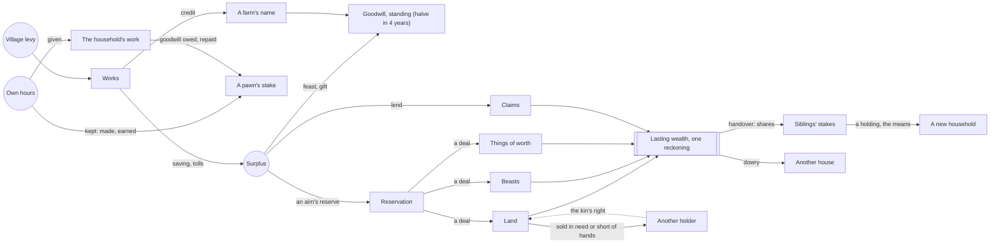

# The generational system: growth, wealth, aims and what passes on

25 November 2026. A design pass on Kim's decisions of the same day (`docs/design-changelog.md`, 0.4, "a generation"), which followed
the review of growth (`docs/review-growth-2026-11-25.md`, sections 6 to 8). It designs as one system how a pawn and a village pursue
growth, wealth and goals over about twenty years, and how what a house gains passes on across generations: the review's priorities 0
to 6 and the handover. It sits on the job system of the arch `plans` (`docs/plans/four-scales/README.md`, v2, merged into main as
PR #325): one plan record, steps with authors and a `by`, verbs any pawn has, decision points with deadlines, the levy and own hours,
the strip. It builds nothing parallel to that grammar.

Kim's answer 21 on the four-scales README names `docs/plans/four-scales/aims.md` as the design of long-term plans and aims; no such
file was written. This document is that design, placed here because it covers more than aims (question 9).

No code is changed by it and `design.md` is not edited. Type sketches are TypeScript-style: shape and ownership, not code to build.
*Measured* means measured in this pass (section 2.4, with seeds and commands) or by a document cited; every other number is
Proposed. Principles are cited by name (`docs/principles-concordance.md`). "Claim" means a land claim only; a body's hold on labour is
a levy; a debt or a due is an obligation.

---

## 1. For discussion

### What is decided (Kim, 25 November), and built on here

1. **A generation** (Vision and scope): a house rises over two or three generations and is held back each generation. The farm, not
   the family, persists. Soft stocks (goodwill, standing, skill) keep their decay; the office stays a life's.
2. **Ambitions are pawns' aims**: one structure for every pawn and the player (Every act is a pawn's), a step of the year in the
   pawn's plan with a `by` that may lie years ahead and, where it saves, a reserve the feast, the gift's allowance and a lender's spare
   leave alone.
3. **Personal goods** come forward from slice 8 as a pawn's stake, the servant's generalised; what a pawn makes or earns in its own
   hours is its own. Coin stays with slice 8.
4. **Land is bartered and sold, and dear**, by mechanism and never by a price rule.
5. From the arch `plans` (Kim, 25 November): the levy and own hours, the plan record with authors, a step at risk handed back after its
   `by`, any holder may `propose` to the meeting, breach costs goodwill only for now, "No pawn decides entirely for itself".

### What this pass proposes

- **One reckoning of lasting wealth** (`sim/wealth`, 3.0), read by the handover's shares, the dowry, the aims, the land market's need
  and the report. It counts land, beasts, things of worth and claims net; grain only above the reserve, at half its worth, as today.
- **The handover as the valve** (3.H): the shares counted on all lasting wealth (the Proposed row confirmed), paid over years into the
  siblings' stakes, so a rich house's gain becomes its younger children's start. An optional custom, "The heir takes the farm at",
  is the brake's setpoint (question 2).
- **The stake generalised** (3.2): title to goods of any good, lying in a named store, rotting as grain does in a store nobody eats
  from, carried by a journey, passed at death to its line (it vanishes today: VB-1476). A head's debt of goodwill to a member for
  hours given is repaid by a gift into the member's stake: a portion earned by work, through mechanisms that exist.
- **The earmark is a reservation** (3.1): an aim's reserve is held as the plan's reservation of named goods, which the readings of
  spare grain (the floor, the feast, a lender's spare) already subtract as they subtract the seed; between a quarter and three
  quarters of the spare above the floor, by generosity.
- **Eight aims** (3.3), each read from the state and tied to a mechanism that exists: a holding, the children placed, a craft, the
  office, a house of standing, a farm to hand on, a work for the village, a cause. The review's "a portion for a daughter" folds into
  the children placed and "a herd" into a farm to hand on; "a work for the village" and "a cause" are added.
- **VB-1472 answered**: no count of projects. A holder runs the large projects its season's labour budget and its stores bear, by its
  estimate; when hands are short, vital and windowed work first, then projects by the weight of the aim each serves and its `by`.
- **Village works across years** (3.4): a project plan of the village (the record exists, VB-123), proposed by any holder with an
  estimate over five years (the built way's reckoning generalised), voted by the meeting, paid by a levy of days each year by the
  custom of lots, commutable to goods; the proposer credited with a monument on its farm. The mill becomes a proposal, not a rule
  (question 7).
- **Craft beside a master** (3.5): a contribution to the learning rate of a pawn working a craft beside one more skilled; an
  apprenticeship is a place in service with a master. **A farm's name**: the memorial stone's term of standing, generalised to every
  monument a holder leaves (a work credited, a masterwork, years in office), read as standing by the farm's holder and family.
- **The land market is the fair's exchange with land in it** (3.6): a deal passes when both sides gain by need, as any deal does;
  land's need to a holder is its net yield to that holder over its horizon (longer with an heir to place); a sale below customary worth
  in need is a hard bargain, as a cow for grain in a dearth is. Three additions: the kin's right, the public act, payment over years.
  Fields a household lets go are offered first. Dear by mechanism: the holder's horizon, few sellers but in need or short of hands,
  the kin's right, payment in lasting goods, and, once the land within reach is taken, no clearing to fall back on.
- **A generational report first** (3.0), outside the simulation but for one snapshot on the handover's event: persistence of a farm's
  wealth rank from holder to heir, a mobility table by cohort, the spread of lasting wealth, land by how it changed hands, the works
  built and by whose proposal, aims taken and met.

### The Proposed rows of 25 November: confirmed, revised or replaced

| Row (`design.md`) | Here | Why |
| --- | --- | --- |
| Ambitions: the first set | Revised: eight aims, two folded, two added (3.3) | A portion is one way of placing a child; a herd is one form of a farm's lasting wealth; a work and a cause are the player's listed ambitions ("change a custom", "found a village") and have mechanisms already (`propose`, taking up a cause) |
| Ambitions: the reserve | Confirmed, as a reservation with a cap (3.1) | Reservations exist (`plan.reserved`); the cap keeps plenty feasting (Hunger presses, the feast binds) |
| Land's worth | Revised: 120 stays the custom's worth; the price is what two needs agree (3.6) | *Measured*: 120 is about 1.5 to 2 years of a field's grain above its seed, or 4 to 5 years of its rent; making it dearer by number would be a price rule. Norm learning (target-v2 5.3) is the road by which the custom's worth may follow deals (question 1) |
| Why a holder sells | Confirmed and made exact (3.6) | Its terms: food's need, the holder's horizon and heir, its hands |
| The kin's right | Confirmed; a sale witnessed after the kin's offer is free, one made quickly before the alderman is redeemable for a year and a day (3.6) | Puts the brake where fire-sales happen |
| A public act | Confirmed (3.6) | |
| Payment | Confirmed: goods of the worth table, the rest an obligation of kind `price` over years (3.6) | The "claim that lasts" of priority 1 |
| Shares on all wealth | Confirmed, through one reckoning (3.0, 3.H) | One quantity, one reckoning |
| By land bought | Confirmed; its brakes gain the household's hands and rent's quarter (3.6) | A field takes 60 to 90 hours a year (*measured*); a let field returns a quarter |

### What stays open

The values of every parameter (named in each part), set by Kim's tuning runs; the questions of section 6; the dependence of
priority 1 on slice 6's second half for things of worth; how the town (slice 9) and coin (slice 8) take up the stake.

---

## 2. The system in one view

### 2.1 Stocks

In the balance map's words (`docs/balance/README.md`, Vocabulary): stocks, the flows between them, the gates on the flows and their
setpoints. A **hard** stock lasts a generation; a **soft** one decays in a few years by design and is not lengthened here.

| Stock | Held by (owner module) | Grows by | Leaves by | Lasts | At the handover |
| --- | --- | --- | --- | --- | --- |
| Land (fields, meadows), with its origin | household (`sim/ownership`) | clearing while land is free; buying; foreclosure | selling; shares paid in land; let go | indefinitely; soil to its floor | to the heir whole; counted in shares |
| Beasts | household; a pawn's head in its stake (`sim/herds`) | breeding, up to hay and the stint; buying | slaughter, sale, shares, dowry, hunger | a herd indefinitely | to the heir; counted in shares |
| Things of worth (slice 6b) | household; a pawn's stake | buying, gifts, a find | gifts, dowry, the hoard | do not wear | to the heir; counted in shares |
| Claims net (loans, a price owed, shares owed) | the body named (`sim/obligations`) | lending, selling land on terms | paid, forgiven, lapsed | until met | to the successor; counted net |
| Grain | household, village (`sim/stores`) | harvest | eaten, sown, feasted, given, rotted (5, 20, 40% a year by tier) | a year or two | with the farm; counted at half above the reserve |
| A pawn's stake | pawn (`sim/stores`) | wages, shares received, what it makes in kept hours, gifts | provisions, the means, its own deals | rots as its goods do | to its line (3.2) |
| Skill at a craft | pawn (`sim/skills`) | hours at it; faster beside a master | a tenth a year unused | a working life | no; taught to whoever worked beside it |
| A farm's name (monuments) | farmstead (`sim/repute`, new) | a memorial stone, a work credited, a masterwork, years in office | each term fades over a generation | a generation | stays with the farm |
| Works (mill, bridge, meadow, bell) | village (`sim/facilities`) | a work's years of levies | wear without upkeep | decades if kept | the village is permanent |
| Goodwill, standing, opinion | pawn (soft) | gifts, feasts, help, office | halve in about 3 to 4 years | ~4 years | half of goodwill to the new holder |

### 2.2 Flows, and who acts at each

Every flow is an act of a pawn through a verb, or nature's (The simulation has no hand of its own).

| Flow | From, to | Who acts | Verb or process |
| --- | --- | --- | --- |
| Harvest, breeding, rot, decay, death | nature | none | the natural processes |
| Surplus held for an aim | grain, beasts, worth, claims → a reservation | the aim's holder (a head for household goods; a pawn for its stake) | `aim` (its reserve) |
| Surplus spent on standing | grain → goodwill, standing | the head | the feast, the good-year gift |
| Surplus lent | grain → a claim | the head | `lend`; an ask answered |
| Surplus converted | grain → beasts, worth, land | the head, the pawn | `offer` (a deal at the gathering or a door; land, 3.6) |
| Own hours kept and worked | hours → goods in the stake | the member | `work` on a goal it owns (3.2) |
| Hours given | hours → the household's work, goodwill owed by the head | the member | given hours (`plans`, 3.3) |
| Goodwill repaid as a portion | the household's goods → the member's stake | the head | `give` |
| Land sold in need or short of hands | land: the needy → the able | both heads; kin first | `offer` basis `land`; `redeem` |
| A work | adult-days and goods → a facility | proposer, meeting, alderman, every levied head | `propose`, the meeting's vote, `levy`, `name`, `commute` |
| The handover | the farm → the heir; shares → siblings' stakes | the holder (timing), the heir (paying) | the handover; shares paid at each round |
| Dowry | movable wealth → the bride's new house | the bride's head | the marriage's terms (`sim/terms`) |
| Craft learnt | a master's skill → a learner's | the head who allots, the member who asks, the master who answers | `assign`, `ask`; a place in service |

### 2.3 Loops and their brakes

Each reinforcing loop with its brake and both timescales (target-v2, 6.1 and 6.2). A brake that is a custom is a setpoint the
meeting can move, by the self-interest of those it binds (How attitudes move), so it is itself a slow loop.

| Loop | Kind | How it runs | Its timescale | Its brake | The brake's timescale |
| --- | --- | --- | --- | --- | --- |
| Land begets land | reinforcing | surplus → land bought → more surplus | a field in a few good years | hands (a field takes 60 to 90 hours a year, *measured*; beyond its members a household hires or lets, and rent is a quarter); the kin's right; the seller's horizon; shares at each handover | hands: each season; kin: a year; shares: a generation (~30 years) |
| Dearth sells land | reinforcing (with the above) | a bad year → sales to the rich at hard bargains → the poor poorer | a season | the kin's right on quick sales; a hard bargain remembered; the buyer's standing | a year and a day; memories 2 to 4 years |
| Land follows hands | balancing | a household short of hands (old, widowed, shrunk) sells or lets to one with hands to spare | years, with the family cycle | none needed: it is the market's levelling half | |
| The herd | reinforcing | beasts breed | years | hay and the stint (the meeting's custom); shares, dowry | a winter; the stint in decades |
| Claims | reinforcing | lending at a quarter → more to lend | a harvest | default, forgiveness, debtors' politics | a case in ~2 years; the practice in decades |
| Office | reinforcing | standing → office → keep → feasts | a few years | the payers' pull; the office a life's | decades; a life |
| A house's name | reinforcing | monuments → standing → better matches and votes → wealth → monuments | a generation | each term fades over a generation; a poor heir raises none | a generation |
| A craft in the house | reinforcing | skill → better goods → income → more hours at the craft; a child learns beside | a working life | skill fades unused; the market's reach; material rights; a child who takes another aim | a decade; a generation |
| Village capital | reinforcing | a work saves hours or earns tolls → surplus → the next work | a decade | upkeep; the levy's weight on small households (payers' pull); the vote | years; decades |
| The handover | balancing, on all the above | a farm's lasting wealth → siblings' stakes, dowries out | once a generation | its setpoint: the share custom and, if adopted, "The heir takes the farm at" | decades (custom) |

What the design expects (the predictions, section 5): a farm's wealth rank from holder to heir at about 0.4 to 0.6, middling, as
Kim's answer B asks; land concentration rising sooner than by the debt road but bounded by hands, the kin's right and shares.



### 2.4 Grounding: what the game does today (*measured*)

Populous, small map, seed 7 (commands below; the two read scripts are this folder's `wealth.js` and `persist.js`, throwaway):

| Measure | Value | From |
| --- | --- | --- |
| Grain a field reaped, by decade and farm class | 79 to 108 rations (years 1 to 10: 101 to 108; 11 to 20: 79 to 100) | run 1, `--report soil` |
| Seed a field | 17 to 48 (barley 25) | `sim/crops` |
| Field work a sown field-year, households of 2 to 4 fields | about 60 to 90 hours (2 fields 80, 3 fields 74, 4 fields 88) | run 2, `--report hours` |
| So a field's grain above seed and work, at the worth table's day (3 rations for 8 hours) | about 20 to 50 rations a year before rot | the three above |
| `SHARES.perField` (120) against that | about 1.5 to 2 years of grain above seed; 4 to 5 years of the custom's rent (a quarter and 2 days, about 26 to 33) | |
| Fields a household, year 20 / year 40 | p10, p50, p90: 2, 3, 7 / 1, 3, 6; Gini 0.31 both | `wealth.js` |
| Households keeping no beast | 61 of 105 at year 20; 99 of 156 at year 40 | `wealth.js` |
| Lasting wealth (fields at 120, beasts at customary worth) | p50 480, p90 1,016 at year 20; Gini 0.30 then 0.31; beasts 10 to 11% of it | `wealth.js` |
| Living pawns holding a stake | 53 at year 20 (median 146 rations), 102 at year 40 (median 82); most are shares paid out | `wealth.js` |
| Live obligations at year 40 | 125 shares, 80 loans, 144 days, 24 wages | `wealth.js` |
| A farm's wealth rank in its village, year 20 against year 40 | all 79 farms ρ 0.27; same holder (28) −0.10; holder to its own child (18) 0.52 | `persist.js` |

The last row is indicative only: one seed, 18 pairs (a 95% interval of roughly ±0.4), and not the review's measure (an heir against
its parent at the same age), which needs the report. The negative figure for the same holder is what a family cycle gives: a holder
lets fields go as its hands fall. Commands (scratch saves, not kept):

```
node tools/sim.js --scenario populous --seed 7 --map small --years 20 --report soil --period decade --save pop7-y20.json.gz   # run 1, 3 min
node tools/sim.js --load pop7-y20.json.gz --years 1 --report hours --every hour                                               # run 2
node tools/sim.js --load pop7-y20.json.gz --years 20 --save pop7-y40.json.gz                                                  # run 3
node docs/plans/generations/wealth.js pop7-y40.json.gz;  node docs/plans/generations/persist.js pop7-y20.json.gz pop7-y40.json.gz
```

Found while grounding, for the surfacing lists (`AGENTS.md`, Surfacing): a pawn's stake is one number on the pawn (`pawn.stake`), so
its grain moves with the pawn when it changes household, with no journey (a **teleport**, `sim/stores`, the stake); the stake never
rots (`sim/goods` `KEEPING.stake`), one reckoning of grain with two rots; and it vanishes at death (VB-1476, open). The name `sim/aims`
already holds a head's project menu (VB-255), which this design folds into the aims (3.3).

### 2.5 Twenty years of one house and one village

Västergården in Ås, a village of eight farms, under the default customs ("one heir buys out the rest", the kin's right as an offer
with redemption). Numbers are Proposed and illustrative; every act names its pawn.

| Year | The house | The village | Stocks moved |
| --- | --- | --- | --- |
| 0 | Olof (38) holds 4 fields and 3 cows (lasting wealth 600). Ambitious and open-handed by halves, he takes **a farm to hand on** (+40% by his handover, about 840) and **the children placed** (four children) | | |
| 2 | A good harvest: grain above 2 years' need. His reserve takes half the spare (generosity 0.5); the rest is the harvest home | | grain → goodwill; grain reserved |
| 3 | At the gathering Olof swaps 60 rations of reserved grain and a sack of butter for a heifer, so the reserve stops rotting | Bengt, widowed with one hand, lets two fields go | grain → beast |
| 4 | Olof offers for one of Bengt's fields. It is inherited land, so Bengt offers it first to his brother Lars, who has no hands to spare and says no in the season he has; at the autumn meeting Bengt takes a cow and 50 rations from Olof and 130 owed over 4 years (220 in all, above the custom's 120: Bengt has no heir at home, so his horizon is short, and Olof's need for it is long) | The meeting witnesses the sale | land: Bengt → Olof; a `price` claim |
| 6 | Erik (16), the heir, is allotted to the tar pit beside the village's tar burner, Nils (14) to the herd. Erik learns the tar quickly beside a master | Per proposes a common meadow; it passes; a levy of 2 days a farm for 2 summers | days → a work |
| 8 | A dearth. Hans sells Olof a field before the alderman at 80 rations of grain (below custom, in need: a hard bargain, remembered). Hans's sister's husband redeems it within the year at the price paid. Olof's aim goes **at risk**: he lowers it to +25% | The meadow is mown; Per's farm gains a monument | land out and back; Olof's standing −; Per's farm's name + |
| 10 | Olof proposes a bridge at the ford: his estimate, 5 years of detours saved against its hours, passes | Voted: 3 days a farm a year for 2 years, and timber; Hans's household, short of hands, commutes a day for 3 rations | days, timber → a work |
| 12 | Anna marries out; her dowry (half her share of the movable worth: a cow and cloth, about 60) leaves the house | The bridge stands: "Olof's bridge" | movable wealth out; Olof's farm's name + |
| 13 | Nils (19), deft and diligent, takes **a craft**: his own hours (about 30 a winter and 24 a summer, at the custom's levy) at the clay; his pots lie in his stake. Olof, owing him goodwill for hours he gave, gives a heifer into his stake | Per, now alderman, proposes the mill; the vote fails (the small farms' lots against their grinding saved) | hours → stake; goodwill → stake |
| 16 | Nils trades pots at the gathering; his stake reaches the provisions; he asks the alderman for a plot and takes it at the round | The mill proposed again, the millstones now bought with grain the village store took in for commuted days; it passes | stake → a new household |
| 18 | Erik marries; Olof hands over and retires on the farm. Lasting wealth: 5 fields (600), 4 cows and a heifer (180), a loan of 30 to a neighbour: 810, his lowered aim met | | the valve |
| 18 to 26 | Shares: three siblings besides the heir (Nils, Anna, Karin), about 200 each and Anna's less her dowry (about 540 in all, two thirds of the farm's lasting wealth), owed by the farm and paid at each round from grain above the reserve, then in beasts. Erik's farm keeps its 5 fields but its spare goes to his siblings for years; his own aim waits | The mill is built (year 20) | farm → siblings' stakes |

What the twenty years show: the farm grew by a field and kept it; the field Olof bought in a dearth went back along its line; most of
the gain left at the handover as his younger children's start; the house's name grew by the bridge; the village gained a meadow, a
bridge and a mill, each proposed by a holder and paid in levied days. Erik begins near his father's rank, not above it.

---

## 3. The parts

Each part gives its mechanism, who acts, state and owner, verbs, decision points, the page and its parameters. Section 3.0 comes
first because every later number is read through it.

### 3.0 Lasting wealth, and the generational report (priority 0)

**One reckoning** (One quantity, one reckoning). A household's lasting wealth is one function, read wherever wealth is weighed: the
handover's shares (3.H), the dowry's movable worth (`sim/terms`), the aims' progress (3.3), a holder's need in the land market (3.6)
and the report. It is a read and stores nothing.

```ts
// sim/wealth (new; kernel of the social layer; reads only): Wealth.lasting(st, household, at?) and its parts
type Lasting = {
  land: number;      // each holding owned (`own`), at the custom's worth: Culture.norm('worth', 'field' | 'meadow'); today SHARES.perField
  beasts: number;    // each head and sheep at its customary worth (sim/norms WORTH)
  worth: number;     // things of worth, at their customary worth (slice 6b)
  claims: number;    // obligations held less obligations owed, each at what is still owed (shares, loans, a price, wages)
  grain: number;     // grain above the household's reserve (SHARES.reserve*), at SHARES.perGrain (0.5), as shares count it today
  movable: number;   // beasts + worth + claims + grain: what the dowry reads (TERMS.dowryShare of the bride's share of it)
  total: number;
};
// A pawn's stake is reckoned apart (Wealth.stake(st, pawn)) and never in its household's total.
```

The house and yard are not counted: they stay with the farm and its heir under every custom, and a house's grade is a condition, not
a good (A made good is graded, a built thing is not).

**The report** is measured, never asserted (An elite is what the rules leave over), beside the slice bands (`tests/lib/bands.js`),
nightly on long runs (populous, seeds 7, 11 and 42, 150 years; founders the same). It is a tool, `tools/generations.js`, that steps a
run as `tools/hours.js` does and reads `st` at each year's end; it writes nothing to `st`. One thing is added to the simulation: the
handover's event (`personEvent` of `sim/heirs`) carries the farm's `Lasting` at that moment, a few numbers on an event that exists,
so the persistence measure reads the record and needs no sampled history.

| Measure | Definition | Why |
| --- | --- | --- |
| **Persistence** | Spearman's ρ, over farms, between the farm's lasting-wealth rank in its village when the holder was 45 and when the heir is 45 (at the handover's snapshot when either age falls outside a holding); by village and by culture | The review's 8.3 scale; B expects about 0.4 to 0.6 |
| **Mobility by cohort** | For pawns born in each decade, the quintile of their household's lasting wealth in their village at 15 against that of the household they live in at 40 (a 5 × 5 table), and the share who are holders at 40, by birth order and sex | Whether younger children fall, as the farm's persistence says they should |
| **Spread** | Gini of lasting wealth by household and of land owned; the top tenth's share; by village | Land concentration, a balance property |
| **Land by how it moved** | Per decade: fields cleared, inherited, sold (in need, short of hands, other), redeemed by kin, foreclosed, let go; prices against the custom's worth | Whether the market concentrates or levels, and which brake held |
| **Works** | Each work proposed: by whom (alderman, his household, others), voted or not, years to build, levied days, abandoned | What villages built and on whose proposal |
| **Aims** | Share of pawns holding each aim; met, lowered, failed and dropped; by trait tertile | Whether aims are reached by those who hold them |
| **Own hours** | Given, kept, taken, by trait (from the arch `plans`) | Whether diligence is selected for over generations (the review, 4.3) |
| **A house's curve** | For each farm, lasting wealth and rank at each handover, the chronicle's line | The player's view of B |

**The page.** The chronicle gains a house's curve: the farm's lasting wealth and rank at each holder's handover, the holders named,
a mark at each monument. The village card's history lists works with their proposers.

**Parameters.** None of the simulation's. The report's ages (45, 15, 40) and periods are the tool's.

### 3.1 A store of value, and the earmark (priority 1)

**The stores.** The design keeps grain from piling up ("rot is what stops hoarding") and that stands. A surplus kept for years must
become a hard stock, and the choice of which is the saver's:

| Store | Its cost of keeping | Its way out | Open to |
| --- | --- | --- | --- |
| Land | its work, or a tenant's quarter; tax later | sold, let, shares, foreclosure | a household (3.6); a pawn through its household's purchase in its name, later |
| Beasts | hay and the stint; deaths | slaughter, sale, shares, dowry | a household; a pawn's head kept in its master's herd by leave (3.2) |
| Claims | the risk of default | paid, forgiven, lapsed | a household; a pawn as creditor (3.2) |
| Things of worth | none | given, buried, lost (What does not wear needs a way out) | slice 6b |
| Grain | 5, 20, 40% a year by tier | eaten | a store for a year or two only |

So an aim that saves for ten years saves in land, beasts or claims, and its grain is a way station. The head's estimate weighs the
rot it would suffer (it already knows the tiers through its estimate of the store) against a beast's hay; nothing forces the
conversion.

**The earmark.** An aim's reserve is a **reservation** in the store the aim saves in: the plan's `reserved` count (`sim/stores`,
`plan.reserved`; a plan already reserves what its steps will spend), named by good and amount, with the aim's step as its `why`.
The readings of spare grain already subtract the plan's reservations as they subtract the seed: the floor (`sim/hunger` `floorOf`, the
reservation and 20 days of need), so the gift's acceptance and allowance and help in hunger; the feast's threshold (`sim/feast`); a
lender's spare (`sim/loans`). What is added is the same subtraction where a reserved beast or thing of worth could be spent: a share
paid in animals, a dowry, a deal at the gathering.

The **cap** keeps plenty feasting (Hunger presses, the feast binds): an aim's reserve of a good is at most `RESERVE.share` of the
household's spare of it above the floor, 0.75 for the tight-fisted to 0.25 for the open-handed (generosity, a contribution to a
declared rule). Reserved goods converted to land or a beast leave the reservation: the reservation is of what is still to spend.

**Breaking the earmark** is an act: in dearth, help in hunger asked of a head reads spare without its reservation only when the head
chooses to break it (a decision point; an unplayed head breaks it when its own household would go hungry, and for kin by its
generosity), and the aim's holder remembers it ("Spent what we saved"). The same act lets an alderman spend a work's reservation of
the village store on help.

**Claims that last.** Payment over years for land (3.6) and shares owed (3.H) are the long claims. A loan's term stays one harvest;
longer loans are not added.

**The herd as store**: a head with a farm aim sets a target on beasts above its need (the verb `target`, as on any made good); hay
and the commons' stint are its brake, and the stint is a custom the meeting can move.

**Parameters.** `RESERVE.share` (0.25 to 0.75, by generosity): the most of the spare above the floor an aim may hold back.

### 3.2 Personal goods: the stake (priority 2)

**What it is.** A pawn's stake is its title to goods lying in a named store (Title moves at once; custody moves by a journey). It
generalises the servant's portion (VB-637) and the shares paid to a pawn without a household, both of which it holds today.

```ts
// pawn.stake (owner sim/stores): absent, or the lots of the pawn's own goods, at most STAKE.lots places
type StakeLot = { at: { household: number } | { village: number }; goods: { [good: GoodKey]: number } };   // whole quanta; grain in rations
// A head of cattle may be a pawn's: head.owner (owner sim/herds), a pawn id, absent for its household's.
```

**What is booked to it.**

- *What it makes in kept hours.* A goal of the arch `plans` names its owner (`Goal.owner: BodyRef`). A goal a pawn opens in its own
  hours, by its own step, is owned by the pawn: the good is put into the pawn's stake where it is made, and the hours are booked
  `kept`. Material: what the pawn takes from the commons by its village's rights (below), or from its household's store by the head's
  leave (an ask answered once, as leave is).
- *What it earns*: a servant's wage (as built), a day's hire, a gift to it, a share received, the price of its own goods at a deal.
- *A portion earned.* Hours a member gives, and hours a head demands, are booked as goodwill the head owes the member (the arch
  `plans`, What a breach costs). A head may repay that balance by a gift into the member's stake, by the gift's rule: the good-year
  gift's occasion (a holder above the feast's threshold, on its planning day after the harvest) is open to a member it owes, before
  other households. So a diligent son's stake grows from his father's surplus, and the head's choice is weighed by its generosity. No
  new mechanism: goodwill, the gift and the stake.

**Its rules.**

| Rule | Design |
| --- | --- |
| Where it lies | In the store of the household it lived in when the goods were booked (a servant's in its master's house). A head may not spend it (title); taking it is a breach, booked as goodwill and remembered, as a demand is |
| Custody | When its pawn moves household, the pawn carries up to a back load (`TRAVEL.load`, 30 rations' worth) of it on the move's journey; the rest stays a lot where it lies, a pile with title in the arch `plans`' sense, and is fetched (the stray method) |
| Rot | Its grain rots as the second tier of grain does (20% a year), as the village store's does (`ECON.villageStoreTier`), since nobody eats from it day by day; other goods as their kind wears |
| Use | The provisions of new land and the means of the home it marries into (as built); its own deals (it may give, swap and lend from it, as a party of an offer); a dowry it brings |
| A head of cattle | A pawn may own a head kept in its household's herd by the head's leave: its hay is the household's, its calves the owner's. A servant's wage may be paid in a heifer, by its contract |
| Joining a household as holder | When a pawn becomes a holder or a holder's spouse, its stake becomes its household's (the means, the provisions), as stakes do at founding today; what an aim of its own reserves stays its own |
| Debt | A pawn may be a creditor (its loans are claims of its own) and owes only what it pays at once: no personal debt until coin (question 3) |
| At death | Its lots pass, title at once, by Nothing is left to no one: to its spouse, else its children, else to the household it lived in. A servant's to its birth household's heir if living, else its master's household. Fixes VB-1476 |
| The retired | What the keep names is the retired's own (VB-1122's plan): it is the retired pawn's stake |

**A landless pawn's right to its material.** The village's rights on its outland (`gather`, `fell`, `dig`, `graze`) are granted to its
households; a custom, "The commons serve", says whether they serve every person living in the village for its own use and making
(default, as the *allmänning* was used) or households only. Under "every person" a member, servant or lodger digs clay and cuts fuel on
the commons for its own work, within any stint the village keeps. Material on another's land is asked of its holder.

**Who acts.** The member (works, keeps, deals), the head (grants hours and material, gives into a stake, may breach it), the master
(pays the wage), nature (rot, a beast's death). The played pawn has the same.

**Verbs.** `give` (to a pawn's stake: exists; its target widened from a household to a pawn), `offer` and `answer` with a pawn as a
party, `ask` on basis `material` (a head's leave to take from its store), `work` on a goal the pawn owns (the arch `plans`).

**Decision points.** A member: what to make in its kept hours; a head's ask to lend its stake in dearth (by its generosity, its
opinion of the head and the need it sees). A head: an ask for material; whether to repay a member's goodwill into its stake.

**The page.** The pawn's card shows its stake as goods with their icons, where each lot lies, and what it counts toward ("the
provisions: 70 of 84"); the strip's kept hours show what they made.

**Parameters.** `STAKE.lots` (3): the most places a pawn's goods may lie at once; past it the smallest lot is fetched first.

### 3.3 Aims (priority 3), and the limit on a holder's projects (VB-1472)

**The shape.** An aim is a step of the pawn's year plan (the plan record of `sim/plans`), with what the review asked: a `by` years
ahead, a target read from the state, a reserve where it saves, and its state.

```ts
type AimKey = 'holding' | 'children' | 'craft' | 'office' | 'house' | 'farm' | 'work' | 'cause';
type AimStep = PlanStep & {
  what: { aim: AimKey; target: number; of?: PawnId | CraftKey | WorkKind | CustomKey };   // what it is about; target in the measure's unit
  by: Day;                                         // may lie years ahead
  gap: { lo: number; mid: number; hi: number };    // the target less the measure at `by`, by the holder's estimate (The future is someone's estimate)
  reserve?: { good: GoodKey; n: number }[];        // held as the plan's reservation (3.1)
  author: 'custom' | 'pawn';                       // the pawn's own rule, or a controller (the player)
};
// Held on the pawn's plan (st.plans.of[pawn]; owner sim/plans). A holder's aims are its own; it acts on them through its household's plan,
// whose project steps name the aim as their `why`.
```

**The set.** Each is read from the state and grants nothing; each rests on a mechanism that exists.

| Aim | Who takes it | Measure (by the holder's estimate) | Weight (each trait a contribution, 0.5 to 1.5 at its tails) | What it moves | Brake |
| --- | --- | --- | --- | --- | --- |
| **A holding** | an unmarried or landless adult | rungs open; its stake against the means and the provisions | ambition, diligence | its wish's ranking at the round; its own hours kept to the stake; its reserve | the queue for land; the means |
| **The children placed** | a holder with children | children placed (a farm, a plot, a match onto a holding, a portion paid) of children of age | generosity, honour | a farm or cottage for the heir (today's menu), land bought, a dowry reserved, a place in service | land; shares owed |
| **A craft** | an adult member or a landless pawn | its skill at the craft; its income from others against its need | hands, diligence, openness | its kept hours at the craft; working beside a master; dealing at the gathering | material; the market's reach; skill's fade |
| **The office** | a holder | its standing against the last election's margin | ambition, sociability | feasts and good-year gifts; standing at a vacancy | the payers' pull; goodwill's decay |
| **A house of standing** | a holder | the house's rung and condition; the farm's name | ambition, piety | a building project; a memorial stone; tar and mending | wear; materials of place |
| **A farm to hand on** | a holder | lasting wealth (3.0) against the target | ambition, husbandry | the herd's target; land bought; clearing; lending; its reserve | hands; hay; land's need; the kin's right; shares at its handover |
| **A work for the village** | a holder | the work's state (3.4) | generosity, sociability, piety (for a bell) | `propose`; the levy's days named first | the vote; the payers' pull |
| **A cause** | any adult | the custom's leaning in its village | openness, honour | taking up a cause (today's norm entrepreneur) | attitudes move in decades |

The player's ambitions of the Vision map onto these: hold three farms (a farm to hand on, target in farms), change a custom (a cause),
found a village (a holding on new land), become a master household (a craft, or a farm to hand on), leave service and hold land (a
holding).

**Taking an aim.** A pawn holds at most `AIMS.held` (2) at once. Its own rule weighs them at its yearly look (the head's first review
after the autumn count, where `sim/aims` looks today; a seeker's asking day) and at a turn of its life (marriage, becoming head, a
child of age, the handover): the weights above times whether its position allows the aim, the two highest above `AIMS.least` taken.
The **target and `by`** are its rule's: `by` the custom's time for the thing (a holding by the means' wait; the children placed by
the handover; a farm to hand on by the custom's handover age), the target scaled by ambition (`AIMS.reach`: a farm to hand on at +10%
to +40% of the wealth it took over). An heir weighs its predecessor's house aims (a farm to hand on, a house of standing, the office)
higher by its opinion of the predecessor (`AIMS.heirloom`, at most +0.3): the one soft thread of a house's direction across a
generation.

**Progress and risk.** Each review the holder's estimate reckons the measure at `by` from what its plan gains a year (its remembered
yields, `sim/yields`; the same function as the doing, One quantity, one reckoning), with the estimate's range. When the upper end
falls short of the target, the aim is **at risk**: a decision point of its holder, with a deadline at its next review. The answers are
verbs any holder has: lower the target or move `by` (`aim`), demand more of members (`call` beyond the levy, a breach), ask a patron
or a lender (`ask`), sell or buy (`offer`), drop it. Unanswered, the default author answers by traits: the ambitious borrow where a
loan is open to them, the rest lower by a step; at risk a second time running, it is dropped. A met aim is done and told in the
record; a failed one leaves a memory of its holder's ("Never got our land"), its weight by ambition.

**VB-1472: the limit and ranking of a holder's projects.** Kim removed "one project at a time" on 21 November; small constructions are
unlimited. Proposed for the large projects:

- *No count.* A project is a step of the household's plan with hours left, by the head's estimate (the arch `plans`, The season). The
  head begins a large project when its season's labour budget (its members' levies less its outer days less its targets' hours) has
  room for the project's share of hours this season, and its stores hold what the project's first stages spend (reserved). That is
  the limit: hours and goods, by the head's estimate, flaws and all.
- *Ranking.* When hands are short: work a household lives by and windowed work first (the template), then project steps by
  `rank = weight of the aim the project serves × urgency of its by`, a project of the old menu with no aim behind it at the menu's
  weight. The day's allotment reads the rank where it reads urgency today.
- *A project it cannot go on with* is at risk like any authored step: its author is asked; unanswered, the default author pauses it
  (its progress lives in the world: piles, stages, `sim/progress`), and drops it after a whole season with no hours, as `sim/aims`
  drops a project when the surplus is gone today.
- *What counts:* every step with hours. The settler's cottage and the stone foundation, the two cases VB-1472's notes feared would be
  special, are steps with hours like any other, and need no exception.

**State and owner.** Aim steps: `st.plans.of[pawn].year` (owner `sim/plans`). The rules (the weights, measures, default author,
progress): `sim/aims`, which today holds a head's project menu (VB-255) and becomes the aims' module: its menu (a field, a claim, a farm
for the heir, a barn, a crop's trial) is the default author's projects for the aims a farm to hand on, the children placed and a house
of standing. `plan.aim` (the household's) is replaced by the head's aim steps.

**Verbs.** `aim` (any pawn, for itself: take, change, drop; with its reserve), as the arch `plans` names it.

**The page.** The pawn's card shows its aims, each on the one meter, the target marked, the estimate at `by` as a range; an aim at risk
is flagged with its cause. The strip's year zoom draws an aim as a bar to its `by`. The chronicle tells an aim taken, met, lowered and
failed. The played pawn chooses its aims and targets on its sheet; an unplayed pawn's are shown, so a neighbour's ambition is known
(knowledge moves at once, for now).

**Parameters.** `AIMS.held` (2), `AIMS.least` (the lowest weight taken), `AIMS.reach` (the target's scale by ambition), `AIMS.heirloom`
(0.3), and each aim's weight table above.

### 3.4 Village works across years (priority 4)

**The mechanism.** A work (a mill, a bridge, a stretch of way, a common meadow, a bell, a well, later a church) is a **project plan
of the village** (`st.plans.projects.village`, VB-123; the record exists), with a step on the village's year plan carrying its `by`.
It generalises the alderman's five-year reckoning for a built way (Built ways, passage and upkeep) to every work and every holder.

1. **Proposed** by any holder of the village (`propose`, as the arch `plans` designs it for routines), with its estimate: what the
   work saves or brings its village a year (grinding hours saved and tolls for a mill; detours saved, from crossings counted, for a
   bridge; hay for a meadow), over `WORKS.years` (5), against its hours at the worth table's day and its goods. A work of standing
   (the bell) brings no saving; its case is its proposer's standing and the village's piety. The default author proposes when the
   estimate passes and the holder's aim for a work, or for the office, weighs it; one proposal a holder a year.
2. **Voted** at the meeting by its procedure (`sim/decisions`). Each voice weighs its household's gain by its own estimate against its
   lot of the levy (its days, valued by its season's labour budget), with its opinion of the proposer and its position (the payers'
   pull: a household whose lot is large against its hands leans no). The played pawn has no ballot (Decided, 7 November).
3. **Paid by a levy each year** until done: an outer levy of adult-days in a window, split by the custom of lots, with the terms of a
   routine (the levied names its days; `commute` allowed at the worth table's 3 rations). Goods the work needs (millstones, iron
   fittings, timber) are a target on the village store, met by commuted days, the quarter of surplus given to the store, and the
   alderman's dealing for the village at the gathering. The target is held as the store's reservation (3.1).
4. **Carried out** by the alderman (`levy`, `callWorkday` for work done together); it becomes a facility of the village
   (`sim/facilities`) when its last stage is done. A mill is let to a household for a share of its tolls (a tenancy of a facility),
   which gives a miller's house a road.
5. **Credited**: the proposer's farm gains a monument (3.5), the record names the work after him ("Olof's bridge"), and a story is
   made (slice 7). **At risk** when the levy is breached or the goods fall short of `by` by the alderman's estimate: the proposer is
   asked (extend, cut the work, or let it go to the meeting to drop). **Abandoned**: each head who worked days on it remembers the
   proposer ("Our days for nothing", by honour).

**What it replaces.** The mill's rule ("a village of 3 farms or more builds a water mill") becomes a proposal by a pawn whose
estimate passes (question 7); the built way's reckoning is this mechanism with the alderman as proposer. Upkeep is a routine of the
village, by its custom of upkeep (as built ways have).

**State and owner.** The work's project plan (owner `sim/projectplans`, read by `sim/projects`), with `proposer`, `estimate`,
`voted` and its levies' obligation ids; the levies are obligation records (`sim/obligations`, source `routine` with the work named);
the facility (`sim/facilities`); a new module `sim/works` holds the menu of works and the estimates (the rules), and writes through
those owners.

**Decision points.** A holder: a work to propose (its yearly review). The proposer: a work at risk. The alderman: the work days to
call; dealing for its goods. Each levied head: its days to name, the ladder, commutation.

**The page.** The village card's year zoom shows each work as a bar to its `by`, the days levied, named, worked and breached, and its
goods against their target; the proposer and its estimate are a tap away. A holder's card offers `propose` with the menu of works the
village lacks and the holder's own estimate of each.

**Parameters.** `WORKS.years` (5): the years of saving an estimate counts; `WORKS.lot` (the most days a farm's lot a year, 4, as the
keep's days); `WORKS.abandon` (2 years at risk, then to the meeting).

### 3.5 Craft and name that outlast a pawn (priority 5)

**Learning beside a master.** A contribution to the learning rate of a craft's skill (`sim/skills`, VB-360's crafts learnt by doing):
a pawn working at a craft on a task with a hand of higher skill at that craft learns faster, by `TEACH.beside` times the gap
(1 + 2 × gap, so a novice beside a master learns about three times as fast), never past the master's level; the master works
`TEACH.cost` (a tenth) slower while it teaches. The hands of a task are known when its leg is reckoned, so no pair is searched. Who
works beside whom is a choice: a head allots a child to the task (`assign`), a member asks to work beside a master in its own hours
(`ask`, answered by the master), or an **apprenticeship** is a place in service with a master of the craft (the offer of a place,
with the craft as its reason, the wage lower by custom). The son of the tar burner is the next tar burner because he worked beside
him.

**A farm's name.** The memorial stone (VB-745) gives the heir a term of standing by the stone's kind, fading over a generation, under
one cap with the well-kept house. Generalised: every **monument** a holder leaves adds such a term to its farm: a memorial stone, a
work credited, a masterwork made, years in office, an aim met of a house's kind. The sum is the farm's name, read as a term of the
standing of its holder and the holder's family (spouse, unmarried children). It stays with the farm at the handover (the farm, not
the family, persists) and fades unless a holder renews it.

```ts
// farmstead.monuments (owner sim/repute, new): at most REPUTE.terms, the faded pruned yearly
type Monument = { kind: 'stone' | 'work' | 'masterwork' | 'office' | 'aim'; by: PawnId; at: Hour; size: number };
// Repute.of(st, farmstead): Σ size × 0.5 ^ ((now − at) / REPUTE.halfLife), read in closed form (Rules for cost 3)
```

Farm names as surnames (*gårdsnamn*, an open proposal) are presentation: the chronicle and the panels may name a line by its farm.

**Parameters.** `TEACH.beside` (2), `TEACH.cost` (0.1); `REPUTE.halfLife` (25 years, about a generation), `REPUTE.terms` (8), and
each monument's size.

### 3.6 The land market (priority 6)

**The mechanism is the exchange that exists.** A deal passes when both sides gain by need (The fair, Deals between strangers; Need),
one offer answered once (the offer's one shape). Land, the third class of goods, now enters it. What is new is land's need, three
rules of land, and a supply.

**Land's need to a household.** As food's need is what a ration is worth to a household against its customary worth, a field's
need is what it is worth to its holder: its net yield to that holder by its estimate (its remembered yield, less seed, less its work
valued at what the household's labour budget makes it cost: little with hands idle, a hired hand's 3 rations a day when short, or the
quarter a tenant would give), times the holder's **horizon**: `LAND.horizon` years, and `LAND.heir` more when the sale would cost a
child its rung (heir to the farm at home). Against it, what is offered is weighed at its own need: grain at food's need (up to 3
times its worth at empty stores), a beast at an animal's. So:

- a holder with an heir at home and hands rarely sells: its field is worth twenty years of yield to it (*measured* yield above seed
  and work: about 20 to 50 rations a year, so several hundred rations);
- a holder in hunger sells, since a ration is worth three to it (Hunger presses);
- a holder short of hands (old, widowed, a household shrunk) sells or lets, since its field is worth only a tenant's quarter to it:
  **land follows hands**, the family cycle's levelling flow (Chayanov's, from the standard literature, not checked);
- a buyer needs hands (or a tenant in view) and goods to pay; while land is free within reach, its need for a field is bounded by the
  hours of clearing one, so **land is cheap while the map is open and dear as it fills**, by mechanism.

The custom's worth (120 a field today) is not the price: it is what the custom calls fair. A sale below it to a seller in need is a
**hard bargain**, allowed and remembered against the buyer, as a cow taken for grain in a dearth is (What may be exchanged for what).
Its value stays where it is until norms learn from deals (target-v2, 5.3), and the report shows prices against it (question 1).

**The supply.** Today a household lets fields go beyond those it wants (`FIELDS.letGo`, `slack`): the field returns to waste. Now
the head first **offers** it: to kin by the kin's right, then for sale or let to the households of its village, nearest first; it is
let go only when nobody takes it within a season. A holder in hunger offers a field at its review when food's need passes the field's
(the seller's side of the deal). A buyer with an aim that wants land asks a holder for a named field (the buyer's side).

**The kin's right** (*bördsrätt*; a custom, "The kin's right", that differs between villages: none; the offer to kin (default);
the offer and redemption). Each holding records its **origin**: inherited (*arv*), bought (*avlinge*), cleared, foreclosed. Land
bought is free of the right in its buyer's hands and inherited in its heir's: so a house's purchase returns to the right one
generation on. Inherited land offered for sale goes first to the seller's kin (heads of households of its line within the
succession order's reach, within a day's walk) at the same price, who answer within `LAND.kinDays` (12 days, a season). A sale
witnessed at the meeting after that offer is free. A sale made **quickly**, before the alderman between meetings without the kin's
season (as a dearth makes it), may be **redeemed** by kin within `LAND.redeem` (a year and a day) at the price paid: the brake sits
where fire-sales happen. (After medieval Swedish law: *lagbjudning*, the offer to kin; from the standard literature, not checked.)

**The public act.** The deal concludes at the meeting (its due date) or by a walk to the alderman between meetings; the record logs it
with its price and terms; title moves at once (`sim/ownership`), the price's goods by a journey, fetched or brought as a gift's are.

**Payment.** In goods of the worth table (beasts, grain in whole sacks, cloth, iron, later things of worth and coin), and the rest as
an obligation of kind **`price`** owed by the buyer's household over at most `LAND.payYears` (6), due at each autumn round as shares
are, from grain above the reserve. Unpaid, it is a debt like any (overdue, default, a case), its remedy by "Debts are paid with". A
seller may sell and stay as its buyer's tenant (`stay` in the terms), the sale-and-lease of indebted farmers, by the tenancy row.

**Barter** is the same offer: a field for a field (consolidation), a field for beasts.

**By land bought.** A buyer works the land with its hands, servants and hired hands, or lets it at the custom's quarter. Its brakes,
with both timescales: hands each season; the kin's right in a year; the seller's horizon always; shares at each handover, about 30
years. Debtors' politics does not reach a sale. Rent cannot feed an elite (`docs/balance`, findings), so a landed elite by purchase
needs many fields: the road is long, as the Vision's "few founding homesteads" want.

```ts
// st.titles (owner sim/ownership): a record a holding whose origin is not "cleared by its holder's line", so cost follows sales
type Title = { tile: number; origin: 'inherited' | 'bought' | 'foreclosed'; since: Hour; line?: PawnId;   // the line the kin's right follows
               redeemBy?: Hour; price?: number };                                                          // a quick sale's term and price
// a quick sale's redemption term is an entry of the obligations' due-queue (Rules for cost 4); `price` is an obligation kind (sim/landsale)
```

**State and owner.** Holdings' titles: `sim/ownership`. The rules (land's need, the offers on basis `land`, the kin's offer and
redemption, the kind `price`): `sim/landsale` (new), contributing to `sim/offers` and `sim/obligations`. The custom "The kin's right":
`sim/customs`.

**Verbs.** `offer` and `answer` on basis `land` (sell, buy, let, barter; terms: goods, the part owed, its years, `stay`), `redeem`
(a kin head, within the term). The player as head has them as any head.

**Decision points.** A holder: a field to offer (at its review, when food's need or its hands say so; a field it would let go); an
offer to answer. A kin head: the kin's offer, within its season; a quick sale to redeem, within the year. A buyer: a price owed at the
round.

**The page.** The Land overlay shows each holding's origin and the year it changed hands; the tile card the kin's term where one runs.
The offer form shows the field's need to both sides by the looking pawn's estimate, the custom's worth, whether the bargain is hard,
and the kin who stand first.

**Parameters.** `LAND.horizon` (10 years), `LAND.heir` (10), `LAND.kinDays` (12), `LAND.redeem` (a year and a day), `LAND.payYears` (6).

### 3.H The handover, the generational valve

Everything that crosses a generation crosses at the handover, in life or at death. It already keeps the farm whole and owes the
siblings shares in proportion to it; what changes is what is counted.

1. **The farm's value for shares** is its lasting wealth (3.0): land owned at the custom's worth (bought as well as inherited), beasts,
   things of worth, claims net, grain above the reserve at half. The reserve of seed, food and winter hay is never paid out. A
   daughter's dowry, an advance on her share, is subtracted from it (as built: `pawn.advance`).
2. **Shares** by the custom ("one heir buys out the rest"; *systerlott*: a daughter half a son's), owed by the farm, paid at each moving
   round from grain above the reserve, then in beasts at their worth (as built), and, under "land split between heirs", in fields.
   Paid shares go into the sibling's stake (as built for a pawn without a household), which is its start: a holding's means, the
   provisions, a plot.
3. **The heir's valuation**, optional (question 2): a custom, "The heir takes the farm at", full worth (default) or a part of it, as
   the Norwegian *åsetesrett* let the heir take the farm below its value. It is the valve's setpoint, and attitudes to it move by
   position: holders and heirs lean to the part, younger children to full worth.
4. **Aims** of a house's kind lapse with their holder; the heir takes its own, weighing its predecessor's higher by its opinion
   (`AIMS.heirloom`).
5. **What does not pass** stays as decided: standing, the office, skill (but for what was taught), and goodwill but its half.
6. **Monuments stay with the farm** (3.5).

**What brakes it, and when** (Vision and scope, A generation): the shares and the dowry grow with what the house gained (at each
handover and each daughter's marriage); a poor heir (a head's foresight drawn when it becomes head, regressing to the culture's mean);
dearth forcing sales (the land market, a season); the kin's right (a year, and a generation for land bought). The report's persistence
says whether they hold (section 5).

**The page.** At a handover the household card shows the farm's lasting wealth, each sibling's share and what is still owed; the
chronicle's house curve gains a point.

---

## 4. Cost, named before building

At the late reference (about 1,000 living, 200 households, 30 villages). Rules for cost (`docs/cost.md`, 1.3) in brackets.

| Work | Entities × cadence × work | Bound |
| --- | --- | --- |
| Lasting wealth | read where it is used: about 200 households × a few reads a year (handovers, dowries, aims at review); each reads its holdings, herds and the obligations index | under 0.05 ms a game day |
| The report | outside the simulation; one snapshot on each handover's event (about 7 a year) | none in a run |
| The earmark | reservations exist; `spare` read through one function | none added |
| Stakes | about 300 pawns with up to 3 lots; a put at a leg's end for goals a pawn owns; rot in closed form when read (3) | under 0.05 ms |
| Aims | about 600 adults × 2 aims; weighed at the yearly look (5: on the planning day, spread); progress at the holder's review, a closed-form read of its measure and remembered yields | under 0.1 ms |
| VB-1472's ranking | the rank read where urgency is read; the room check at the review | none in the allotment's inner loop |
| Land offers | holders whose need or hands trigger at their review, a few a village a year; each offer to at most its kin and its village's households (≤ 30); redemption terms in the due-queue (4) | a few hundred reads a year |
| Works | 30 villages × at most one proposal a holder a year (200 estimates a year, each from compiled counts: crossings, the store's grinding ledger); a vote at the meeting over ≤ 60 voices | under 0.1 ms a day, a year's mean |
| Learning beside a master | at a craft leg's end, the task's other hands (≤ 3) | constant |
| Monuments | ≤ 8 a farmstead, read in closed form; pruned yearly, spread (3, 9) | none daily |
| Titles | a record a holding sold, inherited from a buyer or foreclosed, not a tile (1) | a few hundred records |

No pass over pairs (2); nothing polls (4); history bounded by the record's folding (9). Claimed: under 0.5 ms a game day at the late
reference, measured on a late save (`node tools/sim.js --load FILE --years 1 --report perf`) by each step's task.

---

## 5. Predictions that would refute the design

Each is measured by the report (3.0) on populous, small and medium, seeds 7, 11 and 42, to year 150, before (today's rules) and after
each step; three seeds are few, so a direction that holds on all three counts, a size on one does not.

| # | Prediction | Refuted if | How measured |
| --- | --- | --- | --- |
| 1 | Persistence of a farm's wealth rank from holder to heir lies between 0.4 and 0.6 (answer B) | below 0.3 (nothing passes: the brakes too strong) or above 0.7 (run-away) on two seeds of three | the report's persistence; today's value first (indicative: 0.52 on 18 pairs, *measured*, 2.4) |
| 2 | Land concentration rises sooner than by the debt road but stays bounded: land Gini from about 0.31 (*measured*, year 20 to 40) to at most 0.45 by year 100 | above 0.5, or no rise at all | the report's spread |
| 3 | The kin's right is a brake: under "none" land Gini at year 100 exceeds the default's by 0.03 or more | a difference under 0.02 | one village custom set by scenario |
| 4 | More land moves because hands fall short than because of hunger, but a dearth year triples the year's sales | sales by hunger exceed those by hands in ordinary years, or a dearth changes nothing | the report's land by how it moved |
| 5 | Land's prices exceed the custom's worth once the land within a day's walk is taken, and sit near it before | prices flat across the filling of the map | prices against the custom's worth by decade |
| 6 | Shares grow with wealth: the top tenth's heirs owe at least three times the median heir's | under twice | the handover's snapshot |
| 7 | The reserve does not starve the goodwill economy: feasts and good-year gifts fall by at most a fifth | by more than half | the record's counts |
| 8 | Aims are reached by those who hold them more than by like pawns who do not: a holding by 30 is reached 10 points more often by holders of that aim | no difference | the report's aims |
| 9 | Works: a village builds one to three works a generation, and under 60% are proposed by the alderman's household | none built on two seeds, or all by the alderman | the report's works |
| 10 | A craft stays in a house: where a holder dies with skill 0.6 or more at a craft, a member of the farm has 0.4 or more at it in half the cases, against under a fifth with `TEACH.beside` at 1 | no difference | the record and `pawn.skills` |
| 11 | Growth holds: the median seed grows at 1% a year or more while land is free (The island grows without the player) | below it, after the levy's own change is measured apart | the growth band |
| 12 | Cost: under 0.5 ms a game day at the late reference | over 1 ms | `--report perf` on a late save |

---

## 6. Questions for Kim, each with a proposed answer

1. **Land's customary worth.** It is 120 a field today, about 1.5 to 2 years of a field's grain above seed and 4 to 5 years of its
   rent (*measured*, 2.4). Raise it now, or let deals show what land is worth? *Proposed:* keep 120 as the custom's worth (it holds
   shares and the debt remedy where they are); land is dear through need and the holder's horizon; the report shows prices against
   it, and the custom's worth moves when norms learn from deals or in a tuning run of Kim's.
2. **The heir's valuation.** Add the custom "The heir takes the farm at" (full worth; a part, as *åsetesrett*), the setpoint of the
   generational brake? *Proposed:* yes, default full worth, built after the report shows whether the brake binds too hard or too little.
3. **Personal debt.** May a pawn borrow against its stake? *Proposed:* no: a pawn may lend and owes only what it pays at once, until
   coin (slice 8); this keeps a person's estate free of debts.
4. **The kin's right.** Redemption only of a quick sale, for a year and a day, by kin within the succession's reach and a day's walk?
   *Proposed:* yes, as 3.6.
5. **The aims' set.** Eight, folding "a portion for a daughter" into the children placed and "a herd" into a farm to hand on, adding "a
   work for the village" and "a cause"? *Proposed:* yes.
6. **VB-1472.** No count of large projects: hours and goods by the head's estimate against the season's budget, ranked by the aim each
   serves and its `by`? *Proposed:* yes; it closes VB-1472's design and lets the settler's cottage and the stone foundation be steps.
7. **The mill.** The rule "a village of 3 farms or more builds a water mill" (Decided, 11 November, with water where possible and the
   stones and iron) becomes a work proposed by a pawn whose estimate passes, voted and levied. *Proposed:* yes; the water mill where
   possible, the stones and the iron stand. It moves a Decided row, so it is Kim's.
8. **A farm's name.** Every monument a holder leaves (a stone, a work, a masterwork, years in office) adds a term to its farm's name,
   fading over a generation, read as standing by its holder and family? *Proposed:* yes, one mechanism with the memorial stone's.
9. **Where the aims' design lives.** Answer 21 of the four-scales README names `aims.md` in that folder. *Proposed:* this document is
   that design; answer 21 is amended to point here, and the four-scales path's step 9 (own hours as a livelihood) is this path's step 8.
10. **"The commons serve".** A village custom, every person (default) or households only, for a landless pawn's right to its
    material? *Proposed:* yes.

---

## 7. A path

Each step is a task or a few, judged by the arch `plans`' gate (no crash or invariant broken; no village dying out on founders and
populous, seeds 7, 11 and 42, 10 years), reporting the report's measures before and after. First, a design pass with Kim writes the
rows into `design.md` (Vision and scope; Households and other bodies; Land and rights; section 7, How a holder chooses: projects and
Village routines; section 9; Balance loops and targets).

| # | Step | Waits for | Why here |
| --- | --- | --- | --- |
| 1 | **The report**: `tools/generations.js`, the handover's snapshot, the band's lines; today's baseline on the long runs | nothing | every later number rests on it; cheap |
| 2 | **Lasting wealth** (`sim/wealth`), read by shares and the dowry: shares on all lasting wealth | step 1 | the valve, before anything feeds it |
| 3 | **The stake**: lots with a place, rot, carried on a move, passed at death (VB-1476), a pawn as a party of an offer; "The commons serve" | nothing (the arch `plans` for kept hours: step 8) | removes a teleport; the substrate of personal goods |
| 4 | **The land market**: land's need, offers on basis `land`, the kin's right, the public act, `price`, titles; fields let go offered first | step 2; slice 5's cases (VB-315) for a defaulted price | Kim's decision 4; opens the main store of value |
| 5 | **The earmark and aims**: aim steps, weights, progress, at risk; the reserve as a reservation; `sim/aims` becomes the aims' module | the plan record (VB-1752), a step at risk (VB-1755) | priorities 1 and 3 |
| 6 | **VB-1472**: projects limited by the season's budget, ranked by aim | step 5; the season's budget (VB-1778) | closes the open design |
| 7 | **Village works**: proposal with estimate, vote, yearly levy, credit; the mill as a work | `propose` (VB-1770); routines as levies (VB-1768) | priority 4 |
| 8 | **Own hours as a livelihood**: goals a pawn owns, what it makes to its stake, a portion repaid as a gift (the four-scales path's step 9) | steps 3 and 5; the household's levy (VB-1760 to VB-1763) | the potter's road |
| 9 | **Craft beside a master**, apprenticeship as a place in service | VB-360's crafts (built) | priority 5; independent |
| 10 | **A farm's name**: monuments, read as standing | the memorial stone (VB-745) | priority 5 |
| 11 | **Wrap-up**: the predictions of section 5 measured on the long runs; the brake that held named; the tuning for Kim | all | |

Steps 1 to 4, 9 and 10 need nothing of the arch `plans` and can run beside it; 5 to 8 follow its steps 4 (the plan record), 6 (the
household's levy) and 7 (outer levies). Things of worth join the stores when slice 6's second half lands; coin and the town take up
the stake in slices 8 and 9.
