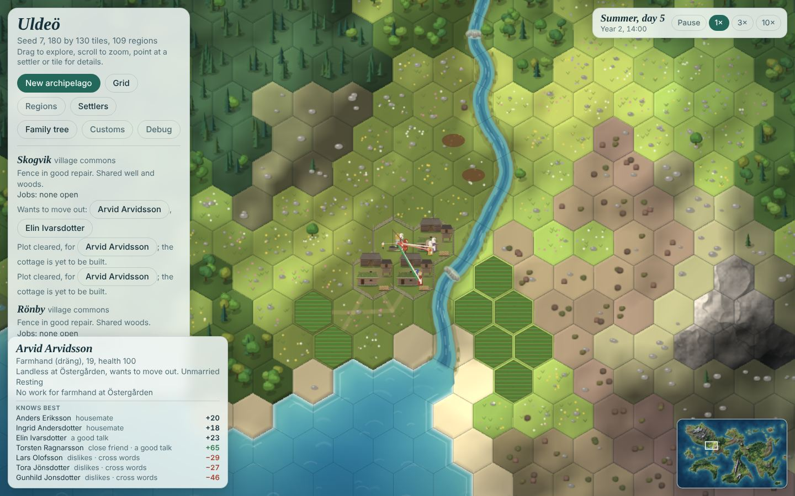
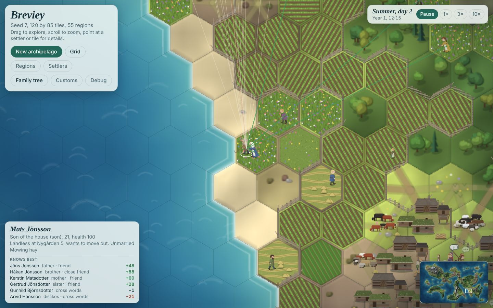
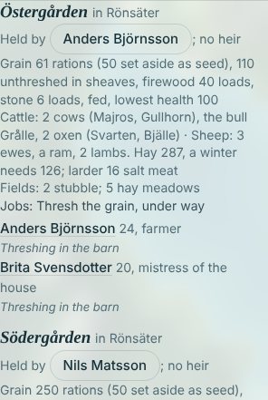

# Review: animals and husbandry

31 October 2026. A review of the animals design as it stands (`design.md` v0.3, Animals; Land and ecology; the `animals` arch, VB-047, VB-048, VB-091), against how husbandry worked on a medieval Swedish farm and against the game as built at `c613a9b`. It proposes a first version that is simple, cheap at 1,000 pawns and fits the job, relationship, customs and inheritance systems, and a plan to build it in small tasks. Nothing here is Decided; the questions are at the end and in `QUESTIONS.md`.

Measurements are from `populous`, medium map, seed 7 (about 840 people), or `founders`, small map, seed 7, unless stated. The appendix lists the probes.

## 1. What exists today

| Piece | State |
| --- | --- |
| Design | Agreed in outline (Animals, 29–30 Oct): cattle and sheep as two herds per household, roe deer as the wild grazer, hay meadows as built land, a hard winter limit, children herd from 8, the byre holds 6 cattle. Kim's numbers: a cow in milk gives 0.5 rations a day in summer; slaughter gives a cow 40 and a sheep 8 rations of meat, which a household job salts before it keeps; stored food spoils after a year. Founders: three farms keep 2 cows each (the first also a bull and the group's one pair of oxen), two keep 4 ewes (the first also a ram), one keeps neither. |
| Plan task | VB-047 is `ready`: its questions are answered; it has still to write the implement tasks, in the order Kim accepted. |
| Code | Nothing. No herd, hay, byre, milk, manure or soil wear exists in `src/`. The one trace is the barn art (`ladaCanvas`, "gapped logs let the hay breathe"). |
| Systems waiting on it | Forest spread (VB-091, blocked on grazing pressure); the food balance wrap-up (VB-048); mixed meals (VB-119: milk and meat as sources); labour short or spare (VB-090: meadows and herds join the count); fences, which wear and are mended but cost nothing when broken; inheritance shares ("can be paid partly in animals"); the children's work rates (VB-104: "later herding"). |

### What a summer looks like now

*Founders, small map, seed 7, summer day 5 of year 2 at 14:00. Between sowing and harvest there is nothing to do: every village's job list reads "none open", the farmhand's card says "No work for farmhand", and the grown pawns stand on the green. There is no byre, no animal and no meadow on the map.*

The idle report (`tools/sim.js --report idle`, populous small, seed 7, two years) puts numbers on it:

| Role | Spring | Summer | Autumn | Winter |
| --- | --- | --- | --- | --- |
| Farmer, idle share of work hours | 60% | 79% | 70% | 89% |
| Mistress of the house | 54% | 69% | 64% | 73% |
| Daughter | 72% | 82% | 74% | 85% |
| Son | 74% | 83% | 76% | 90% |
| Child (7–13) | no herding work exists | | | |

The design's target is 75–90% busy at the peaks and 40–60% idle in the slack seasons. Summer and winter are the two seasons animals fill, and they are the two emptiest today.

## 2. How husbandry worked: the hay year

A short account of the medieval Swedish farm's animal year, with the numbers the game needs, converted to game units. A **ration** is one adult's food for one game day, and a game year has 48 days, so a ration is 1/48 of an adult's yearly food: about 20,000 kcal (2,700 kcal a real day × 365 / 48).

**The loop.** *Äng är åkers moder*, "the meadow is the mother of the field": meadow hay carried the animals through winter, and the dung they left in the byre was the only fertiliser for the fields (Myrdal 1999, cited in the design). The number of animals a farm could keep was set by its hay, not its pasture: a Swedish county account of meadow history puts it as "the meadow harvest decided how many cattle would survive the winter" ([Länsstyrelsen, *Ängen*](https://www.lansstyrelsen.se/download/18.25c4d4aa18529c4ee136b421/1686136840267/%C3%84ngen.pdf)), and a Finnish study notes that winter fodder from meadows, leaves and straw "significantly limited the number of animals" until hay was sown in the 19th century ([informahealthcare.com](https://informahealthcare.com/doi/full/10.1080/01433768.2023.2196124)).

| Season | On the farm | In the game (proposed) |
| --- | --- | --- |
| Spring | Calves and lambs born in the byre; the animals, thin after winter, are let out once the grass grows; the meadows are raked clean of twigs and leaves (*fagning*); the winter's dung is carted to the fields before ploughing | Calving and lambing on spring day 3; turn-out on spring day 6; raking (2 h a meadow); carting manure before tilling |
| Summer | Milking morning and evening (women); the herd is taken to the outfield each day by a herder; haymaking, the hardest work of the year, men mowing with the scythe, women and children turning and raking, the hay dried and carried to the barn | Daily milking and herding; mowing, drying a day, carrying hay home |
| Autumn | After harvest the animals graze the stubble and the meadow aftermath; around November (*slaktmånad*, the slaughter month) the household reckons its hay against its animals and slaughters what it cannot winter; meat is salted, dried or smoked | The autumn count on autumn day 8; slaughter and salting; stalled on autumn day 9 |
| Winter | Animals stand tethered in the byre; daily feeding, watering and mucking out (women's work); hay often ran short by late winter and animals were fed so thin that some had to be helped out in spring | A daily fodder job; hay eaten daily; the hard limit when it runs out |

**Numbers, and how the design's compare.**

| Quantity | History (estimate) | In game units | Design | Verdict |
| --- | --- | --- | --- | --- |
| A cow's milk | A few hundred litres a year for a small medieval cow (I found no firm medieval figure online; the Swedish average in 1875 was about 1,200 kg, an upper bound; [Runeberg, *Sweden: its people and its industry*](https://runeberg.org/sverig01en/0593.html)); about 650 kcal a litre | 400–600 l ≈ 13–19 rations a year | 0.5 a day for 26 grazing days = 13 | Realistic, at the low end |
| Hay per cow per winter | Fed thin, a few kg a day over 6–7 months | 1 unit a stall day, 21 units a winter | 1 a stall day | Consistent |
| Hay per sheep | About a fifth of a cow | 0.2 a stall day | 0.2 | Consistent |
| Meadow yield | Natural meadow about 1–1.2 t of hay a hectare, cultivated hay 2.5–3.5 t (early 20th century; [Runeberg](https://runeberg.org/sweden14/2/0085.html)) | 30 units a tile ≈ 1–1.5 ha | 30 a tile | Consistent; meadows are compressed less than fields (a field tile stands for 3–4 ha), so the historical 2–5 times more meadow than field becomes about 0.7 times as many tiles |
| A cow's meat | A small cow (200–250 kg live) gives about 100 kg of meat and fat, about 180,000 kcal | About 9 rations | 40 | About 4 times high |
| A sheep's meat | 25–35 kg live, 12–15 kg carcass | About 1.2–1.5 rations | 8 | About 6 times high |
| Ox against hoe | An ard and a pair of oxen till several times the area a man can hoe or dig in a day | — | 2–3 times as fast | Conservative; keeps the hoe viable |
| Who herded | Young women and children on the summer farms ([Högman](https://hhogman.se/summer-pasture.htm)); a herd boy could start at 8 (*Från vargtider och vallpojksår*, [Gutenberg](https://www.gutenberg.org/ebooks/57622)) | — | Children from 8 | Consistent |
| Who milked and kept the byre | Women | — | Mistress and maids rank milking high | Consistent |
| Fences | Provincial laws made the keeper of a fence liable: the Westgöta law has the owner of the fence pay when an animal gets out over it, and caps what may be claimed for damaged crops (English translation, [Runeberg, *The Westgöta law*](https://runeberg.org/lawwestgot/); the site was down when this was written, so the page was not re-checked) | — | A broken stretch lets animals into the crop | Consistent; the law also says whom the field's owner blames |

The meat values are the one place where the design is far from history. It matters for play: at 40 rations a cow is worth three years of its milk dead, so the best use of a cow is to eat it; at about 10, a living cow (milk, calves, dung, and the oxen bred from her) is worth far more than her carcass, which is why medieval farmers kept every animal the hay allowed and slaughtered only what they could not winter. See question 3.

## 3. Findings: gaps in the design

**G1. The labour is not budgeted.** The design lists the jobs (raking, mowing, carrying hay, herding, milking, feeding and mucking out, slaughter, salting, carting manure) but not their hours. With the hours proposed in section 4, a farm with 3 cattle, 4 ewes and 3 meadow tiles needs about 130 adult hours a year besides herding, about 7.5% of three adults' work hours, and a herder for 26 days. Haymaking was the summer's hardest work, so mowing is priced like the field work it competes with: 16 h a meadow tile, against 20 h to hoe a field. Animals fill part of the slack, not all of it; VB-117 to VB-121 fill more.

**G2. "Herds, not individuals" leaves no way to breed, age or name animals.** Calves become heifers that calve from 3; bull calves are gelded at 1 and work as oxen from 3; old cows are culled. A count per herd cannot say which cow is in milk or which steer will be an ox. A farm's cattle are few (the byre holds 6), so a small list of named head per herd costs nothing (about 800 records at full scale), keeps the herd as the one unit that moves, grazes and posts jobs, and gives the stories ("Stjärna calved", "Rosa went to slaughter"; Swedish cows were named). Sheep stay as counts. See question 2.

**G3. Calving has no rule.** The design needs a bull and a ram ("oxen are castrated") but does not say how far a cow may be from the bull. Proposed: a cow calves in spring with chance 0.85 if a bull of 2 or more lives within 12 steps of her farm (a day's walk there and back), else not; a ewe lambs 1.3 times on average if a ram is within reach. Taking the cow to a neighbour's bull is a favour: the cow's holder remembers "Lent us the bull" (+0.05, a new memory in `SOCIAL.memories`), a small, real tie between households.

**G4. Soil does not wear, so manure has nothing to restore.** "Each harvest wears a field down; manure from the byre restores it" is Agreed, but no field loses anything today. Wear and manure must come in one task, and wear hurts farms without animals (one founders farm). See question 4.

**G5. Food from animals has no store to go into.** Today food is grain, cooked into a two-day buffer of rations. Kim's rule (meat salted by a job into food that keeps a year) and butter for winter need a larder of lots that spoil. Proposed: `hh.larder`, a list of `{kind, n, until}`; the meal eats the day's fresh milk first, then larder lots within 6 days of spoiling, then cooked rations and grain, then any larder when still short. Salt meat and butter are then a buffer against a lean spring, which is what they were. It fits VB-119 (milk and meat as sources of a mixed meal) without depending on it.

**G6. Grazing pressure by home range is costlier and less legible than grazing where the herd actually goes.** The design updates every tile in every herd's range daily (about 22,000 updates). If instead the herd goes out with its herder to one pasture tile a day, it adds pressure there each hour it grazes, and pressure fades by half each year like worn paths (`w.wear`). That is a few hundred updates a day, the pressure map shows exactly where herds have been, the herd's walk wears cattle lanes (*fägator*) through the existing path code, and forest spread (VB-091) reads one array.

**G7. A herd with no herder has no rule.** Proposed: it stays by the farm and grazes the yard and the tiles next to it, the cows give half their milk that day, and if a stretch of the farm's or village's fence is broken (below 0.45) the herd may get into a growing crop next to it: the field loses 10% of its yield, the event is logged, and the field's holder remembers "Cattle in our crop" (−0.1) about the household that keeps the broken stretch, as the Westgöta law has it. This gives the fence, which wears and is mended today for nothing, its consequence (Agreed in the design), and makes the herder's job matter.

**G8. The founders' first winter.** "A hay stock brought along" is Proposed. Proposed: hay for one winter of each farm's animals (42 units for 2 cows; 126 at the first farm, with 2 cows, a bull, the oxen, 4 ewes and a ram), so the first summer's meadows decide the second winter, not the first.

**G9. Generated villages have no meadows.** Populous and heirs farms are established; they need meadows, herds and hay at the start, or every herd dies in the first winter. The settlement generator places fields today; it should place 1–3 meadow tiles per farm with animals, beyond the fields, near water where it can.

**G10. Commands are not built, but herds do not need them yet.** Herds act through commands (Agreed), and the command layer (VB-076) is planned. A herd that follows the pawn on the herding job, and otherwise stands at the farm, needs no command of its own; it can become a command taker when VB-076 lands.

**G11. The order of tasks shows animals late.** In the accepted order, the herd that walks out with its herder comes ninth. Herds can be drawn by the farm from the first task (in the yard in summer, in the byre in winter), so the player sees them from the start; walking out to pasture follows with herding.

## 4. Proposed design, first version

### The model

| Part | Data | Notes |
| --- | --- | --- |
| Herd | `st.herds[]`: `{id, species, household, head[] (cattle) or ewes, rams, lambs (sheep), x, y, state, pasture, lean}`; id is the index, never reused | Two per household at most; a household without animals has none |
| Cattle head | `{id, name, sex, born, kind: 'calf'\|'heifer'\|'cow'\|'bull'\|'steer'\|'ox', calved (year)}` | Named from a list of old Swedish cow names; a calf takes its kind at the autumn count |
| Hay | `hh.hay` in units; the farm's barn holds it | The haystack by the byre shows it |
| Larder | `hh.larder[]` of `{kind: 'butter'\|'meat'\|'salt meat', n, until}` | Fresh meat keeps 3 days, salt meat and butter a year |
| Meadow | `f.meadows[]`: `{id, tile, stage: 'grass'\|'mown'\|'aftermath', raked, mown (day), held}` | Built land, like fields; `w.dev` set so paths do not cross it |
| Soil | `fd.soil` per field, 0.75–1.15 | Multiplies the yield; harvests lower it, manure raises it |
| Grazing | `w.graze`: Float32Array per tile, halves each game year | Pressure where herds have grazed; forest spread reads it |

### The year in numbers (starting values)

| When | What | Numbers |
| --- | --- | --- |
| Spring day 1–10 | Rake each meadow (*fagning*) | 2 h, any hands; an unraked meadow gives 80% |
| Spring day 1–6 | Cart manure to the fields before tilling | 1 h a load; a load raises a field's soil by 0.04 |
| Spring day 3 | Calving and lambing | Cow of 3+: 0.85 with a bull of 2+ within 12 steps; ewe: 1 lamb, 0.3 chance of twins, with a ram within reach; 15% of calves and 20% of lambs die in their first year |
| Spring day 6 | Turn-out | Herds leave the byre |
| Spring day 6 to autumn day 8 | Milking, daily at the byre | 0.3 h + 0.2 h a cow in milk; a cow in milk gives 0.5 rations (0.25 on a day without a herder); 40% is churned to butter, the rest eaten that day |
| Same | Herding, daily | One herder for both herds, 9 h from 7:00, to a pasture tile within 8 steps (best grass, least grazed); 1 unit of pressure a cow-hour, 0.25 a sheep-hour |
| Summer day 1 to autumn day 3 | Mow, dry, carry hay | Mow 16 h a tile (scythe), dry 1 day, carry 4 h (any hands); 30 units × site (river bank 1.3, meadow 1, marsh 0.8, heath 0.6) × weather × raking |
| Autumn day 8 | The autumn count | Winter need = Σ head × hay a day × 21 × 1.1; animals the hay cannot carry, and cattle beyond the byre's 6, go to slaughter, least valuable first: wethers and ram lambs, steers not needed as oxen, old ewes (8+), extra bulls, old cows (12+), heifers, cows, oxen last |
| Autumn | Slaughter and salting | Slaughter 3 h a head of cattle, 1 h a sheep; meat keeps 3 days fresh; salting 1 h per 8 rations makes salt meat that keeps a year |
| Autumn day 9 to spring day 6 | The byre | Hay a stall day: cow, bull, ox 1; heifer or steer 0.6; calf 0.4; sheep 0.2; lamb 0.1. A daily fodder job, 0.5 h + 0.15 h a head of cattle + 0.03 h a sheep; done, it collects manure (0.2 loads a cattle head-day, 0.04 a sheep); not done, the herd has a lean day (−2% milk next summer each, at most −40%) |
| When hay runs out | The hard limit (Decided) | When hay will not last the next day, an urgent slaughter of the least valuable head (lean meat, half yield); if it is not done within 2 days, an unfed head dies each day, weakest first, and gives nothing |
| Each harvest | Soil wear | −0.08 a harvest, to a floor of 0.75; manure up to 1.15 |
| Ploughing | Oxen | A household with two oxen of 3+ works one hoeing or breaking hand at 2.5 times; the oxen walk with that pawn |

**What a typical farm then looks like.** A household of 6 with 2 cows, a heifer, 4 ewes and 3 meadow tiles: winter need 2 × 21 + 12.6 + 4 × 4.2 ≈ 71 units (with the margin 78), so 3 meadow tiles in an ordinary year; milk 26 rations a year (16 eaten fresh, 10 as butter); 2 lambs and an old ewe slaughtered a year; about 16 loads of manure, more than the 6 a year that keep 3 fields level, so its soil climbs to the cap in a few years (a farm needs about 1.5 head of cattle wintered to hold 3 fields level). Labour: about 60 adult hours of haymaking in summer, 18 of milking, 22 of byre work in winter, 20 of carting manure and raking in spring, and a child herding 26 days.

**Meadows** are made like fields (`sim/fields`: a project of claim and clear, no breaking). A household with animals wants meadows for 1.2 times its winter need at 30 units a tile, and starts one when it has no field project; the tile is open meadow, marsh or shore within 6 steps of the house, unowned, river banks first. The design's fencing step waits; a meadow is outside the infield fence in this version.

### Fit with the existing systems

| System | How animals join it |
| --- | --- |
| Jobs (`KINDS`) | New kinds `rake`, `mow`, `hay` (carry), `milk`, `herd`, `fodder`, `slaughter`, `salt`, `manure`, each one record; posted from `refreshJobs`. A new field `minAge` on a kind (herding from 8). |
| Roles (`ROLES`) | Two new types of work: `husbandry` (milking, fodder: mistress 9, maid 10, daughter 9, retired 3, farmer 3, farmhand 4, son 3) and `herding` (child 8, daughter 6, son 5, retired 4, farmhand 3, farmer 2). Mowing is `harvest` with exceptions for women (4) and children (0); slaughter is `husbandry` with exceptions for men (farmer 8, farmhand 8, son 7) and women (2). Raking and carrying hay are `harvest`, so children help. |
| Relationships | Two memories: "Lent us the bull" (+0.05, cap +0.2, 3 years) and "Cattle in our crop" (−0.1, cap −0.3, 2 years). The herder talks with whoever is near the pasture, so herding children make friends across farms. |
| Paths | The herder treads as now, and a moving herd adds a quarter crossing a head on each tile: cattle lanes wear in between the farms and the outland. |
| Forest spread (VB-091) | Reads `w.graze`; its "keeps open" and "thins" thresholds are set in the herding task. |
| Fences | A broken stretch beside a crop lets an unherded herd in (G7). |
| Food | The larder (G5); VB-119 can count milk and meat as sources. |
| Inheritance | Shares value animals (proposed: a cow 30, an ox 40, a sheep 6 grain in `SHARES`) and can be paid in them; a new household (VB-032) can take a cow and two ewes from its old one. |
| Customs (later) | Candidates already in the design: grazing on the commons, hunting rights, sharing common hay. Proposed besides: how hard to stock for winter ("to the hay" against "keep the herd", the medieval habit of feeding thin), and herding by each farm or by turns for the whole village (*byahjord*). |
| Labour short or spare (VB-090) | A farm with animals needs one more hand. |

### What the player sees

- **A minute:** cows and sheep in the yard; a child walks them out at 7 along a worn lane and back at 17; women milk in the morning; men mow a meadow in a line with scythes, haycocks dry, and the hay is carried home; in winter a woman goes to the byre each day.
- **A session:** the autumn count is the year's hard choice made visible ("Hay for 4 of 6 cattle at Östergården: Rosa and the bull calf go to slaughter"); named calves in spring; a broken fence and a neighbour's cows in the barley, with the grudge that follows; one farm's oxen hoe its fields in a day while the others hoe for three.
- **A run:** herds grow with the meadows; old, well-dunged farms out-yield new ones; a younger son leaves with a cow and two ewes; grazed commons stay open while abandoned land goes back to wood.
- **At a glance:** the haystack by the byre shrinks through winter; the household card reads "Hay 34 of 71 for the winter".

## 5. Performance

### Where the time goes today

A CPU profile of one game year of populous medium at seed 7, after a year's warm-up (837 alive, 126 households, about 560 open jobs): **144 ms per game day** (median 134, 90th percentile 181, the moving round day 607).

| Part | Share of simulation time |
| --- | --- |
| Talk (`talkHour`) | 24% |
| Contact hours (`noteContacts`) | 19% |
| Daily ties and drift (`dailyLife`) | 14% |
| Idle pawns finding company or a spot (`idleAbout`, of which `companyFor` 9%) | 14% |
| Heir rankings (`heirRanking`: daily demand, prestige, the moving round) | 9% |
| The moving round | 9% |
| Job board (`refreshJobs`, `planRound`, `lookUp`) | 6% |
| Walking (`moveAgent`, `walkTo`, routes) | 7% |
| Meals, firewood, fields, trees, wear | about 2% |

The work and economy core, which animals join, is under a tenth of the cost; the social layer and idle pawns are two thirds. At 10× a game day passes in 4.8 s, so the simulation uses 3% of real time; at 30× about 9%, close to VB-088's budget of 10%.

### What animals cost

| Part | Work | Estimate at populous medium |
| --- | --- | --- |
| Herds | About 130 herds (cattle and sheep of one household move together) | Moving one point per herd per 6-minute step: under 1 ms a day |
| Jobs | 2–3 more jobs per household and day (milk, herd or fodder) and seasonal ones | `refreshJobs` and `planRound` up by about a third: 2–3 ms a day |
| Grazing | One addition per herd per grazing hour; a daily fade of one array, skipping zeros, like `fadeWear` | Under 0.5 ms a day |
| Pasture choice | A 8-step search per farm, cached and redone weekly | Under 1 ms a day |
| Hay, larder, the count | Per household, daily or yearly | Negligible |
| Idle pawns | Children herding, women milking and feeding, men mowing: fewer idle re-plans and smaller crowds on the green | A saving on the 14% of `idleAbout` and the 19% of `noteContacts` |

Expected: **+3 to +6 ms a game day, possibly a net saving**, measured in each task. Budget proposed: at most 10 ms a game day at populous medium for everything the animals add, reported in `tests/perf.js`.

In the page, each herd draws at most 8 animal sprites (cattle one each, sheep up to 8 for the flock), only in view and above the zoom at which pawns show, from a pool in their own layer. They never go through `visualDirty`, which rebuilds every farm and every pawn rig (`buildFarms`), so a calf's birth costs no rebuild.

### Making the village builder faster beyond animals

1. **Familiarity from talk rather than contact hours (VB-127)** removes `noteContacts`, 19% of the simulation, besides fixing the model; it is the largest single saving available.
2. **Idle pawns cost more than working ones.** Each idle pawn re-plans every 0.75–2 hours, searches for company and walks; in slack seasons that is 70–90% of adults. Work that fills the slack seasons (animals, VB-117 to VB-121) cuts it; so would a longer idle spell when a pawn has found no work twice in a row.
3. **Heir rankings are recomputed daily for every household** (for `st.demand` and prestige): 9%. They change only when someone is born, dies, marries, moves or comes of age; caching them per household and dropping the cache on those events would remove most of it.
4. **The moving round** (9%, in one step) is VB-129.
5. **Page:** the smoke loop checks every agent for every house each frame (`st.agents.some(...)` per house in `updateSettlement`: about 105,000 checks a frame at populous medium); one pass that marks the cooking households makes it linear. And `buildFarms` rebuilds every farm and rig on any change; per-farm rebuilds would keep deaths and marriages from costing a frame.

## 6. Plan

The arch's implement tasks, as VB-047 is to write them, in Kim's order with two changes: meat and salting go with slaughter (meat must go somewhere), and herding comes before manure and oxen (it is the most visible piece). Each is one nightly-sized task with its own test, golden re-record and `npm run verify`.

| Task | Size | Adds | You can see |
| --- | --- | --- | --- |
| VB-131 Herds as household data, at the farm and in the panels | M | `st.herds`, named cattle, sheep counts; founders, populous and heirs herds; calving, lambing and ageing; the byre drawn on farms with cattle; animals drawn in the yard; the household card; `--report herds`; invariants | Cows and sheep by the farms; calves in spring |
| VB-132 Hay meadows, made and placed | M | Meadow projects (claim, clear); the generator places meadows for populous and heirs farms; meadow art; tile card | New meadows next to rivers |
| VB-133 Haymaking and the hay barn | M | Raking, mowing, drying, carrying; `hh.hay`; the haystack | Mowers in a line; haycocks; the stack growing |
| VB-134 The byre, the autumn count, slaughter and salt meat | M | Stall period, fodder job, daily hay, the count, slaughter and salting, the larder in the meal, emergency slaughter and deaths | The autumn decision; the stack shrinking through winter |
| VB-135 Milk and butter | S | Milking job, fresh milk and butter in the larder | Women milking in the yard |
| VB-136 Herding and grazing pressure | M | The herder and the herd on the map; pasture choice; `w.graze`; cattle lanes; an unherded herd through a broken fence | Children taking herds out; lanes wearing in |
| VB-137 Manure and the soil | S | `fd.soil`, wear by harvest, manure heap, carting job | Fields of dunged farms out-yield |
| VB-138 Oxen at the plough | S | The team, 2.5 times for one hand, drawn with it | Oxen in the field |
| VB-139 Roe deer | M | Deer stock per region, sprites at forest edges, crop damage by broken fences, a hunting job when food is short | Deer at dusk by the woods |
| VB-140 Livestock in shares and a new household's start | S | `SHARES` for animals; after VB-032 | A son leaving with a cow |
| VB-141 Plan: customs of the animals | S | Winter keep, commons grazing, the village herd, hunting rights | — |

VB-091 (forest spread) unblocks after VB-136, and VB-048 (tune the food balance) after VB-138.

**Batches.** The proposed first pull request is this review, the task files and VB-131 to VB-134: herds you can see, meadows and hay, and the autumn count that closes the loop. Each task is its own commit with its own test and golden re-record, so the pull request can be read one task at a time. VB-135 to VB-138 make a second pull request, and VB-139 to VB-141 a third.

## 7. Tracking and showing it

**In the game:**
- **The farm:** a byre (*fähus*) behind the cottage on farms with cattle; a haystack beside it in four sizes by hay against the winter's need, as the woodpile shows firewood; animals in the yard by day and inside in winter; later a manure heap in spring.
- **Meadows:** their own art in three stages (tall flowering grass, mown windrows and haycocks, short aftermath), with a small hay barn on a meadow farther out.
- **The household card:** "Cattle: Stjärna (in milk), Rosa, the bull Brante, a calf. Sheep: 4 ewes, a ram, 5 lambs. Hay 34 of 71 for the winter. Larder: 6 butter, 12 salt meat."
- **The log:** calving, the autumn count's slaughter, hay running short, an animal lost to hunger, cattle in a crop, a new meadow.
- **Later:** a grazing overlay (pressure per tile) next to Regions and Grid, once VB-045's chunked overlay exists.

**For testing and tuning:**
- `tools/sim.js --report herds`: per household its herds by kind and age, hay and need, milk, meat and butter made this year, manure, and soil per field.
- `tests/herds.js` in `npm test`: the founders' herds as Kim decided; calves and lambs in spring; hay made each summer; a household short of hay slaughters down to what it can winter; emergency slaughter and deaths when hay runs out; no animal dies of hunger when hay suffices.
- `checkState` invariants: each herd belongs to a living household; counts not negative; hay not negative; cattle in the byre at most its capacity in the stall period; every head born in the past; larder lots not past their date.
- `tests/perf.js` reports the animals' share; the budget above.
- The golden file is re-recorded in each task, with the changed entries listed.

## 8. Questions

Answered on 31 October: questions 1 to 4 as proposed (the first pull request builds VB-131 to VB-134; named cattle; meat a cow 15, an ox 18, a sheep 3; wear and manure); the others taken as proposed. The answers are in `QUESTION_ARCHIVE.md` and the tasks in `backlog/VB-131.md` to `VB-142.md`. **P** is the proposal.

1. **The first pull request.** P: this review, the task files VB-131 to VB-141, and VB-131 to VB-134 implemented, one commit each.
2. **Cattle as named head inside the herd.** The herd stays the unit that moves, grazes and posts jobs, but its cattle are a short list of named animals with sex, birth and kind, so calving, gelding, oxen and culling work and the log can name them; sheep stay counts. P: yes.
3. **Meat.** Kim set a cow at 40 rations and a sheep at 8; history suggests about 9 and 1.5 (section 2), and at 40 a cow is worth more dead than alive. P: a cow 15, an ox 18, a sheep 3; lean meat from an emergency slaughter half that.
4. **Soil wear.** P: as Agreed, each harvest lowers a field's soil by 0.08 to a floor of 0.75, and manure raises it to at most 1.15; the farm without animals declines towards 0.75 of today's yield unless it gets animals, and VB-048 retunes the yield. The alternative is manure as a bonus only (soil 1.0 to 1.15, never below today).
5. **Calving.** P: a cow of 3 or more calves on spring day 3 with chance 0.85 if a bull of 2 or more lives within 12 steps; the cow's holder remembers "Lent us the bull" (+0.05) about the bull's.
6. **The founders' hay.** P: hay for one winter of their animals, and none of the founders' farms has a meadow at the start.
7. **Herds without a herder** stay by the farm, give half the milk and may get into a crop through a broken fence (G7). P: yes, in VB-136.
8. **Who works with animals.** The two new types of work and the role ranks in section 4. P: as listed.

## 9. Other findings

- **A pawn can be allotted two cleared plots.** At founders seed 7, small map, year 2, both of Skogvik's plots go to Arvid Arvidsson (pawn 8), the second one cleared for Elin Ivarsdotter (pawn 9): `allot` (`src/sim/expansion.js`) excludes household holders but not holders of a cleared plot. It shows twice in the settlers panel ("Plot cleared, for Arvid Arvidsson"). Proposed as a small task of its own.

## 10. Built in the first pull request (31 October)

VB-131 to VB-134 are built, one commit each: herds of named cattle and counted sheep that breed each spring; hay meadows made by the founders and placed for generated villages; raking, mowing and carrying hay; and the byre with the autumn count, slaughter, salt meat and the hard winter limit.

*Haymaking on a populous tiny map at seed 7, summer day 2. Uncut meadows flower; a mown one shows windrows and haycocks while the hay dries; the pawn card reads "Mowing hay". Cattle and sheep graze by the byres beside the cottages.*

*Founders, tiny map, seed 7, autumn day 9 of year 1. The household card lists the herds, the hay against the winter's need and the larder. The log line beside it: "The autumn count at Östergården: an old ewe, Brante, Stolt and 2 ram lambs go to slaughter" (the bull calves, as the farm has its oxen and a young bull); their meat is the 16 salt meat.*

| Measure | Before (`c613a9b`) | After |
| --- | --- | --- |
| Summer idle share, populous small, seed 7, 2 years: farmer / mistress / farmhand | 79% / 69% / 77% | 54% / 51% / 59% |
| Summer idle share: son / daughter / maid | 83% / 82% / 79% | 71% / 72% / 65% |
| Winter idle share: farmer / mistress / maid | 89% / 73% / 78% | 87% / 71% / 68% |
| Hungry household-days, populous medium, seed 7, years 1–3 | 0 / 106 / 122 | 0 / 33 / 61 |
| Hunger deaths, populous medium, years 1–3 | 0 / 1 / 0 | 0 / 0 / 0 |
| Hungry household-days, founders small, seed 7, years 1–6 | 0 / 9 / 1 / 0 / 0 / 0 | 0 / 12 / 0 / 0 / 0 / 0 |
| Simulation, populous medium, a game day (`tests/perf.js`) | 165.0 ms without animals | 159.2 ms with them (one run each; no measurable cost) |
| Meadows raked by spring day 11, brought in by autumn day 4 (populous tiny) | — | 100%, 100% |
| Hay against the winter's need at autumn day 4 of year 1 (populous tiny, 20 households) | — | 0.57 to 1.45, median 1.05 |
| Founders seed 7 (tiny), 3 years | — | 7 counts with culls, no animal lost to hunger, no meat spoiled, 45 rations of salt meat in larders |

Summer now has work for farmers and mistresses within the design's 40–60% idle range for the slack seasons; winter barely moves, since the fodder job is one hand for about an hour a day. Milking (VB-135) and herding (VB-136) are what fill more of the year. Populous households are hungry on fewer days, the larder's salt meat carrying them through lean springs. The founders' year 2 is a little hungrier (12 household-days against 9), which seems to be year 1's labour going into meadows; VB-048 tunes the food balance once milk and manure are in. Numbers are at `1aadf14`, after the fix for losses in the first spring.

## Appendix: probes

- Baseline runs: `node tools/sim.js --scenario founders --seed 7 --map small --years 6` and `--scenario populous --seed 7 --map medium --years 3`.
- Idle shares: `node tools/sim.js --scenario populous --seed 7 --map small --years 2 --report idle`.
- Profile: a scratch script outside the repo that seeds populous medium at seed 7, advances one year, then times 48 single days and runs under `node --cpu-prof`; inclusive times summed per function name below `advance`.
- Screenshot: Playwright on `index.html` (PixiJS from `node_modules`), founders, small, seed 7, "Skip a year", then 10× until summer day 5, 14:00.
- Plots: a scratch script printing `v.plots` after a year and 20 days of founders, small, seed 7.
