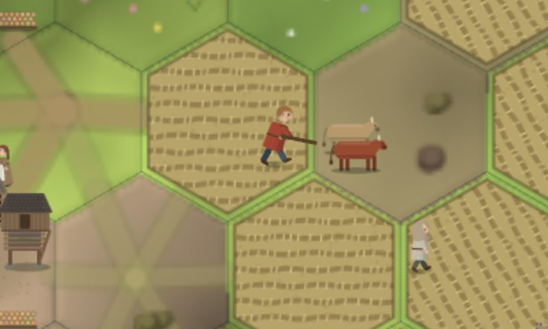
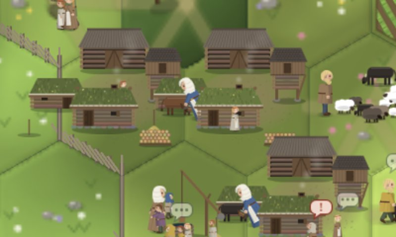
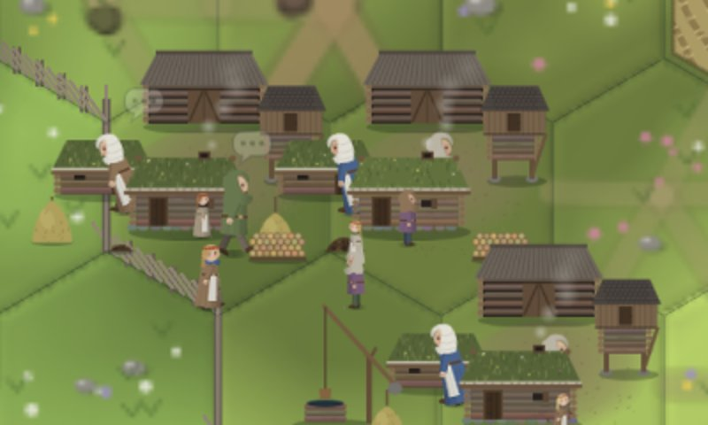

# Review: performance, the food balance and the animals' economics

1 November 2026. A review of where the simulation spends its time, of whether farms feed their people the way the design wants, and of what history says the numbers should be: above all the old rule that a cow is worth more for her milk than for her meat. It builds the three animal tasks the balance needed (milk and butter, manure and the soil, oxen at the plough), measures the food balance with a new tool, and tunes it. The tuned values are in the code as **Proposed**; the questions for Kim are in `QUESTIONS.md` under "Balance review: the tuned values".

Measurements are from `populous` on the small map (about 350–450 people) at seeds 3, 7, 11 and 42, or `founders` on the small map at the same seeds, unless stated; the speed figures are `populous` on the medium map at seed 7 (about 840 people). The appendix lists the probes.

## 1. Performance

### Where the time went

A CPU profile of one game year of populous medium at seed 7, after a year's warm-up, at `7e92296` (before this review): 127 ms per game day on average, but a worst day of 669 ms, and a worst single 6-minute step of **1,305 ms** in year 1: the moving round, which the page shows as a freeze.

| Part (inclusive) | Before | After VB-143 |
| --- | --- | --- |
| Contact hours (`noteContacts`) | 16% | 18% |
| Talk (`talkHour`) | 16% | 17% |
| Heir rankings (`heirRanking`) | 12% | 1% |
| The moving round (`movingRound`) | 12% | 1% |
| Daily ties and drift (`dailyLife`) | 11% | 12% |
| Idle pawns (`idleAbout`) | 9% | 9% |
| Job board (`planRound`, `refreshJobs`) | 6% | 7% |
| Meals, firewood, fields, herds, hay | 3% | 3% |

**The fault:** VB-052 had cached the man's place in the marriage match, but the woman's place was a default argument, `homeFor(m, f, cu, pm = place(m), pf = placeIfMarried(st, f.id))`, computed afresh for every pair, and each call ranked the heirs of every farm, each ranking ranking every other farm again: men × women × farms². `kinPressure`, `wantsOut` and the handover loop did the same. The yearly meetings' `updateTies` searched 160 steps of the island from every village.

**The fix (VB-143, behaviour unchanged):** one `ownFirstOf` shared until a marriage or a handover changes the families; `stepsTo`, a breadth-first search that stops at its target; the page's smoke loop marks the cooking households in one pass instead of one pass over all agents per house. The golden file is unchanged, and a 3-year populous medium run hashes the same before and after.

| Populous medium, seed 7 | Before | After |
| --- | --- | --- |
| Mean game day (2 years, every step timed) | 135.9 ms | 117.4 ms |
| Longest single step | 1,305 ms (the moving round) | 102 ms (a midnight; its parts sum to 15 ms, so a garbage-collector pause) |
| Moving round (`tests/perf.js`, after 2 years) | 228 ms | 20 ms |
| Meetings | 63 ms | 16 ms |

With the round at 20 ms, slicing it (VB-129) is no longer needed for the 50 ms step budget; VB-088's performance check is no longer blocked by it (question under VB-129).

### What is left

The rest of the cost is the social model itself, and it is already tight code. The next savings are design changes, not fixes:

1. **Contact hours, 18%.** Every hour, every pair of housemates indoors and every pair of pawns within 30 units outdoors adds to a `Map` keyed by pair; the keys are doubles above about 500 pawns, so each update hashes a heap number. VB-127 (familiarity from talk and time at home) removes the whole pass.
2. **Talk, 17%,** and **idle pawns, 9%:** idle pawns re-plan, seek company and talk. Work that fills the slack seasons cuts both: this review's fields, carting and ploughing moved the farmer's spring idle share from 56% to 51% (section 5).
3. **Daily ties, 12%:** every tie of every pawn decays daily. A decay applied lazily, when a tie is read, would make it proportional to the ties used, not held.
4. **The animals** cost about 7 ms a game day with this review's milking, dung and ploughing (`tests/perf.js`, budget 10 ms): a year of populous medium with and without herds, meadows and hay.

## 2. History: what a farm's food should look like

A **ration** is one adult's food for a game day; a game year has 48 days, so a ration is about 20,000 kcal (2,700 kcal a real day × 365 / 48).

### A cow: milk against meat

The anonymous 13th-century English treatise *Hosebondrie*, printed with Walter of Henley's *Husbandry* (Lamond 1890, [archive.org](https://archive.org/details/walterofhenleys00henl)), gives the clearest medieval dairy figures:

> "And be it known that each cow should give as well, from the kalends of May to Michaelmas, six stones of cheese and as much butter as shall make as much cheese — that is to say, always, to seven stones of cheese, one stone of butter."

and values the milk of the rest of the year at 10d against 3s 6d for the summer (about a quarter more). Walter of Henley's own rule is that three cows on ordinary pasture "ought to yield a wey of cheese and half a gallon of butter a week between Easter and Michaelmas", and he defends it against "servants and provosts and dairymaids who will contradict this thing, and that is because they give away and waste and consume the milk".

| Quantity | History | In rations | Game |
| --- | --- | --- | --- |
| A cow's milk in a year | *Hosebondrie*: 6 stones (38 kg) of cheese and 0.9 stone (5.4 kg) of butter in 24 summer weeks, a quarter more in the rest of the year; about 400–500 litres of milk | 13–16 as milk (about 650 kcal a litre); 9–11 as cheese and butter (whey drunk besides) | 0.5 a day for the 27 days out of the byre: 13.5 a cow in milk (VB-135) |
| A cow's meat | Medieval Swedish cattle stood 102–113 cm at the withers and grew smaller over the period ([Anthropozoologica](https://sciencepress.mnhn.fr/en/periodiques/anthropozoologica/25-26/evolution-de-la-taille-des-boeufs-en-suede-au-moyen-age-et-au-debut-des-temps-modernes)); a 200–250 kg cow gives about 100 kg of meat and fat (animals review) | About 9, once | 15 (Agreed 31 Oct) |
| A ewe | Walter of Henley: 20 ewes on salt-marsh pasture yield the cheese and butter of 2 cows; *Hosebondrie*: ewes give no milk after August | 1–1.5 a year | Not milked (question 7) |
| Ox against hoe | Experimental ards till 375–500 m² an hour against 250 m² in 50 hours with hoes and digging sticks ([Cucuteni-Trypillia experiments](https://arxiv.org/pdf/1505.05121)) | — | 2.5 times (VB-138): conservative, as the team must be fed and the ard's furrows harrowed |

**So a cow gives about her carcass's worth of food every year she is in milk.** Over a working life from 3 to 12 the milk alone is 10–14 times her meat; add a calf most years and the dung that keeps the fields, and the farmer who slaughtered a good cow for meat ate his capital. That is why medieval farmers wintered every animal the hay allowed and slaughtered at the autumn count only what they could not feed: the young bulls, the old ewes, the old cows past milking.

**In the game now** (per cow a year, `HERD` and `SOIL` after this review):

| | Rations a year | Work a year |
| --- | --- | --- |
| Milk and butter: 13.5 when she has calved, × 0.85 | 11.5 | Milking 0.2 h a day: 5 h |
| A calf (0.85 × 0.85 surviving), at least veal (5) | 3.6 | — |
| Dung: 4.2 loads a winter × 0.04 soil × a field of 100, while the fields are below the cap | up to 16.8 | Carting 4 h; fodder 0.15 h a day: 3 h |
| Hay: 21 units a winter, 0.7 of a meadow tile | — | Raking, mowing, carrying: 15 h |
| **A cow alive** | **15 to 32 a year** (the dung counts only while the fields need it) | **about 27 h** |
| **Her carcass** | **15, once** | Slaughter 3 h, salting 2 h |

A field gives about 75 rations net of seed for about 42 hours (hoe 20, sow 2, weed 8, reap 5, haul 1, thresh 6), so grain feeds more people per hour of work than cattle do, which is also true to history: cattle earned their place on land that would not grow corn (meadow, marsh and shore), by the dung without which the corn land wore out, and by the oxen bred from them.

### Hay, dung and the fields

*Äng är åkers moder*, "the meadow is the mother of the field": the hay fed the animals in winter, and "the manure the animals created during the winter was then spread on the fields and not on the meadows" ([Länsstyrelsen, *Ängen*](https://www.lansstyrelsen.se/download/18.25c4d4aa18529c4ee136b421/1686136840267/%C3%84ngen.pdf)); on Swedish cadastral maps of the 17th to 19th centuries "meadows often dominated the infield areas" ([Eriksson 2020](https://www.su.se/polopoly_fs/1.525796.1604929617!/menu/standard/file/Eriksson%202020%20Meadows.pdf)). Dung was what limited the corn, never in surplus. The agreed values have it the other way round: 1.5 head of cattle keep 3 fields at full strength, and every head beyond that piled dung on a heap that grew for ever (1,161 loads at one founders farm after 30 years). This review lets the heap rot; halving what a load does (so about 3 head keep 3 fields) was tried, and cost too much food for now (section 5).

### Grain in store

Grain kept in a barn is eaten by mice and rats and spoils with damp. The FAO's review of traditional post-harvest systems puts losses "generally... around 5%", with rats causing "as much as 20% loss per year" in one village ([FAO, Post-harvest losses](https://www.fao.org/4/w1544e/W1544E05.htm)). The game had no loss at all, so founders' farms hoarded 600 rations and rising, and their village store 9,500 (VB-130). The medieval Swedish tithe, a tenth of the farm's production ([Wiktionary, *tionde*](https://en.wiktionary.com/wiki/tionde)), and rents, taxes and tithes paid in butter, grain and cattle (for butter, Critch, Harland and Barrett in *Silver, Butter, Cloth*, [Oxford](https://academic.oup.com/book/2756/chapter/143245170)) are other historical outlets, left for later.

### Widows, widowers and remarriage

In pre-industrial Sweden "remarriage was common..., especially among men"; age lowered the chance, servants on the farm raised a widowed head's, and men who married a widow were 3–5 years older than those who married a single woman (Lundh, *Continuity and Change* 22:3, 2007, [Cambridge](https://cambridge.org/core/journals/continuity-and-change/article/remarriage-gender-and-social-class-a-longitudinal-study-of-remarriage-in-southern-sweden-17661894/D5FD98E270B7457F6F7379DD94ED3857)). Only as a widow could a woman manage her own property, so a widowed holder brought a farm to a second marriage; for a landless younger man that was a way onto the land (this last is the review's reading, not a figure from the study). The game's marriage match held the widowed to the first-marriage age gap, so a widowed holder of 40 could almost never marry.

## 3. What was built

| Task | What it adds |
| --- | --- |
| VB-143 | The performance fix above |
| VB-135 Milk and butter | A cow that calved this spring is in milk while the herds are out; a daily milking job at the byre gives 0.5 rations a cow (less for the winter's lean days); 40% is churned to butter that keeps a year; the meal drinks the day's milk first. The ledger records milk, butter and meat |
| VB-137 Manure and the soil | Each field has a soil; a crop yields in proportion and wears it by 0.08 to 0.75; feeding in the byre puts dung on the heap; in spring it is carted to the poorest field before the hoe |
| VB-138 Oxen at the plough | Two oxen draw the ard for the first hand on the household's hoeing or breaking, at 2.5 times; the team is in one field at a time |
| `tools/balance.js` | Rations made by source (grain net of seed, milk, butter, meat) against need, per household-year, by household size, cattle and weather |

*Populous, tiny map, seed 7, spring day 1, 08:50. The pawn panel reads "Ploughing with the oxen"; the pair walk ahead of the driver along the furrow, the ard's beam between them, and are missing from the yard meanwhile.*

*The same village on spring day 7, 06:22: "Milking the cows". The cow being milked stands by the milker at the byre door.*

*Winter day 12: the winter's dung heaps by the byre doors, carted to the fields in the first days of spring.*

Founders at seed 7 (small map, 2 years): the oxen's farm hoes a 20-hour field in 13.9 pawn-hours against 20.3 by hand; 6 cows in milk give 81 rations in the first summer, 32 of it as butter.

## 4. The balance before tuning

Measured after VB-135 to VB-138 were built, at `ab09a65`.

**Populous** (4 seeds, years 2–15, 3,033 household-years), the review's reference household (about 6 adult-equivalents of need on 3 fields, with cattle):

| Weather | Household-years | Made / need | From animals | Years hungry | Store |
| --- | --- | --- | --- | --- | --- |
| good | 146 | 1.18 | 8% | 12% | 323 |
| ordinary | 150 | 1.01 | 11% | 12% | 292 |
| poor | 86 | 0.88 | 15% | 6% | 275 |

On average the farms already met VB-048's target (fed in an ordinary year, short in a poor one). By household size, households of 9 adult-equivalents made 0.74 of their need and were hungry in 28% of their years; households without cattle made 0.96 and were hungry in 28%, those with 6 cattle 1.28 and 8%.

**What was wrong:**

1. **Big households starved on fixed fields.** Only founders could make fields; populous and heirs households kept their generated 3–4 fields while families grew to 8–14 members (made/need 0.74 at 9 adult-equivalents, 28% of their years hungry), and hunger crept up from 1% of households in year 2 to 20% in year 15.
2. **Hunger was not about the year.** Reference households were hungry in 12% of ordinary years but 6% of poor ones. 95% of hungry days at seed 7 were households with no grain at all in summer and autumn, before the new harvest is threshed: the hungry gap.
3. **Hoards with no end:** founders' grain (600 a household and rising), the village store (9,500), hay (2,240 at one farm, 31 winters' need; a farm with no animals left mowed 3,893), dung heaps (1,161 loads).
4. **Founders do not grow:** they start as four couples with a farmhand and a maid; under the "land" residence custom the servants can never marry, and the second generation's younger children wait for expansion (VB-032, VB-033). Two widowed holders cannot marry each other either (farms are not combined).

## 5. Tuning

Each change was measured on its own against the balance tool; all are **Proposed** (`QUESTIONS.md`).

| Change | Values | Why |
| --- | --- | --- |
| Fields by labour, no fixed cap (Kim's rule) | A household wants fields for 1.1 times its rations at 0.75 of the full yield, but no more than 2 a working adult (14–59, not retired), 1.5 more with a team of oxen (`FIELDS`); every scenario makes fields and meadows | Big households could not grow their land; the cap of 4 and the founders-only flag were implementation choices, the design says a household "starts one field at a time when it needs more" |
| Poorer land when meadow runs out | Heath, hills or marsh (fertility 0.5–0.7) are broken only when no meadow tile is free within reach | At seed 42 after 10 years, 24 of 28 short households had no free meadow tile; taking in poorer soils as the best land filled is a familiar pattern of medieval agrarian history |
| Grain spoils in store | 5% a year of the first year's need held, 20% of the second, 40% of the rest; the village store 20% a year | FAO: about 5% in traditional stores, up to 20% with rats; a good farm keeps a buffer, not a hoard |
| Haymaking to need | Rake and mow only while the barn and the mown hay hold less than 2 winters' need of the animals now | No hay for animals that do not exist; summer hands go to the fields |
| Dung | The heap loses half a year; carted before the hoe (urgency 1.7, from 0.9, which reached only one field a spring) | A heap that grew for ever; dung that never reached the second field |
| Remarriage | A widowed partner's age gap counts half (0.15 a year, from 0.3) | Remarriage was common, especially for men; widows' farms went to younger men |

**Tried and dropped.** *Scarcer dung:* a load +0.02 instead of 0.04, so herd size shows in the harvest. Over 8 seeds (years 2–5 and 6–8, hungry household-days): before tuning 2,095 and 2,313; all changes with +0.02, 1,713 and 1,734; all changes with +0.04, 1,353 and 1,025; all changes without new fields, 3,076 and 4,577. Fields by labour are the big gain, and +0.02 gives back a third of it, so it stays at +0.04 (question 4). *Eating the seed corn* when a household's hunger reaches a quarter. Hungry days fell at seed 42 (1,811 to 1,584) but rose at seed 3 (542 to 796): eaten seed is a field unsown next spring, so it moves hunger rather than easing it. It is the famine spiral of history, and a candidate for a custom later, not a balance fix.

### After

**Populous**, 4 seeds, years 2–15, before tuning (`ab09a65`) and after (rations a household a year):

By the year's weather:

| Weather | | Household-years | Grain | Milk | Butter | Meat | Made / need | From animals | Years hungry | Hungry days | Store | Fields | Soil |
| --- | --- | --- | --- | --- | --- | --- | --- | --- | --- | --- | --- | --- | --- |
| good | before | 1098 | 315.2 | 10.4 | 6.9 | 10 | 1.38 | 7% | 15% | 1.9 | 372 | 3.4 | 1.01 |
|  | after | 1080 | 395.5 | 13.7 | 9.1 | 17.5 | 1.6 | 9% | 10% | 1.2 | 419 | 4.5 | 1.01 |
| ordinary | before | 1229 | 261.3 | 11 | 7.4 | 10.4 | 1.13 | 9% | 15% | 1.8 | 328 | 3.4 | 1.02 |
|  | after | 1125 | 313.9 | 13.6 | 9.1 | 18.3 | 1.29 | 11% | 12% | 1.4 | 366 | 4.5 | 1.02 |
| poor | before | 706 | 206.5 | 11.8 | 7.9 | 14 | 0.94 | 12% | 14% | 1.8 | 287 | 3.4 | 1.02 |
|  | after | 827 | 259.4 | 13.8 | 9.2 | 20.2 | 1.11 | 13% | 7% | 0.8 | 340 | 4.5 | 1.01 |

By household size (adult-equivalents of need):

| Size | | Household-years | Grain | Milk | Butter | Meat | Made / need | From animals | Years hungry | Hungry days | Store | Fields | Soil |
| --- | --- | --- | --- | --- | --- | --- | --- | --- | --- | --- | --- | --- | --- |
| 3 | before | 199 | 216.8 | 8.4 | 5.6 | 11.4 | 1.77 | 10% | 10% | 1.3 | 389 | 3.1 | 1 |
|  | after | 114 | 222.2 | 10 | 6.7 | 11.7 | 1.77 | 10% | 3% | 0.4 | 309 | 3.2 | 0.95 |
| 4 | before | 431 | 251.7 | 10.6 | 7 | 11.2 | 1.55 | 10% | 3% | 0.5 | 406 | 3.1 | 1.02 |
|  | after | 467 | 256.8 | 13.3 | 8.9 | 16.3 | 1.62 | 12% | 5% | 0.5 | 342 | 3.4 | 1.02 |
| 5 | before | 559 | 261 | 9.1 | 6.1 | 9.6 | 1.25 | 8% | 9% | 1.1 | 359 | 3.2 | 1.02 |
|  | after | 599 | 295.9 | 15.1 | 10.1 | 18.9 | 1.49 | 12% | 7% | 0.8 | 371 | 4 | 1.03 |
| 6 | before | 633 | 268.9 | 10.9 | 7.2 | 10.9 | 1.08 | 9% | 15% | 1.9 | 333 | 3.4 | 1.02 |
|  | after | 605 | 327.8 | 14.6 | 9.7 | 21.2 | 1.35 | 12% | 7% | 0.9 | 385 | 4.4 | 1.03 |
| 7 | before | 496 | 290.4 | 12.1 | 8.1 | 11.5 | 1 | 9% | 18% | 2.2 | 316 | 3.5 | 1.02 |
|  | after | 501 | 352 | 12.6 | 8.4 | 20.4 | 1.22 | 10% | 13% | 1.3 | 386 | 4.8 | 1.01 |
| 8 | before | 349 | 292.1 | 14.7 | 9.8 | 13.1 | 0.89 | 11% | 20% | 2.3 | 288 | 3.7 | 1.04 |
|  | after | 362 | 366.1 | 12.6 | 8.4 | 18.3 | 1.09 | 9% | 17% | 2.1 | 385 | 5.5 | 0.99 |
| 9 | before | 315 | 298 | 12.7 | 8.4 | 12.3 | 0.74 | 9% | 28% | 3.5 | 260 | 3.7 | 1.03 |
|  | after | 379 | 434.4 | 14.2 | 9.5 | 16.3 | 1.08 | 8% | 18% | 1.8 | 424 | 6.1 | 1.01 |

By cattle wintered:

| Cattle | | Household-years | Grain | Milk | Butter | Meat | Made / need | From animals | Years hungry | Hungry days | Store | Fields | Soil |
| --- | --- | --- | --- | --- | --- | --- | --- | --- | --- | --- | --- | --- | --- |
| 0 | before | 778 | 202.6 | 0 | 0 | 6.7 | 0.96 | 2% | 28% | 3.8 | 238 | 3.3 | 0.87 |
|  | after | 779 | 259.6 | 0 | 0 | 14.4 | 0.99 | 4% | 24% | 3 | 291 | 4.5 | 0.86 |
| 1.6 | before | 199 | 257.6 | 2.1 | 1.4 | 2.8 | 1.06 | 2% | 22% | 2.7 | 293 | 3.2 | 1.04 |
| 3.7 | before | 653 | 280.3 | 9.8 | 6.6 | 7.1 | 1.25 | 8% | 10% | 1.2 | 364 | 3.3 | 1.07 |
|  | after | 300 | 334.9 | 9.2 | 6.1 | 11.8 | 1.34 | 8% | 5% | 0.6 | 372 | 4.3 | 1.07 |
| 5.9 | before | 1403 | 300.1 | 18.9 | 12.6 | 16.6 | 1.28 | 14% | 8% | 0.9 | 380 | 3.5 | 1.07 |
|  | after | 84 | 323.1 | 1.5 | 1 | 8.1 | 1.15 | 3% | 27% | 2.7 | 342 | 4.5 | 1 |
|  | after | 1869 | 355.8 | 20.7 | 13.8 | 21.7 | 1.51 | 15% | 4% | 0.4 | 416 | 4.5 | 1.07 |

| Year | 2 | 3 | 4 | 5 | 6 | 7 | 8 | 9 | 10 | 11 | 12 | 13 | 14 | 15 |
| --- | --- | --- | --- | --- | --- | --- | --- | --- | --- | --- | --- | --- | --- | --- |
| Households hungry, before | 1% | 12% | 12% | 11% | 12% | 18% | 16% | 19% | 15% | 13% | 16% | 20% | 20% | 20% |
| Households hungry, after | 6% | 7% | 9% | 11% | 11% | 13% | 8% | 12% | 9% | 12% | 11% | 6% | 12% | 14% |
| Hungry days, before | 5 | 303 | 255 | 241 | 329 | 615 | 387 | 624 | 311 | 236 | 393 | 619 | 672 | 585 |
| Hungry days, after | 78 | 164 | 203 | 267 | 288 | 331 | 226 | 397 | 188 | 227 | 216 | 170 | 329 | 404 |
| Mean store, before | 317 | 343 | 375 | 374 | 338 | 366 | 338 | 347 | 360 | 333 | 306 | 298 | 293 | 293 |
| Mean store, after | 330 | 365 | 344 | 365 | 365 | 387 | 353 | 371 | 411 | 410 | 443 | 386 | 382 | 376 |

All households, ordinary years: 1.29 of their need instead of 1.13, poor years 1.11 instead of 0.94; hungry days a household-year 1.4 and 0.8 instead of 1.8. The review's reference household (about 6 on 3 fields with cattle) is now a small group, as most households of that size have a fourth field: 1.17 of its need in a good year, 0.93 in an ordinary one and 0.92 in a poor one, over only 19–27 household-years each (1.18, 1.01 and 0.88 before, over 86–150).

**Over 8 seeds** (1, 2, 3, 5, 7, 11, 13, 42; years 2–10), the measure least at the mercy of chance: hungry household-days 4,505 before and **3,140 after** (years 2–5: 1,178 and 1,189, the cost of breaking new ground; years 6–10: 3,327 and 1,951); household-years with any hunger 10.6% and 7.9%; households of 8 or more adult-equivalents made 0.78 of their need and were hungry in 24% of their years, and now make 1.13 and are hungry in 16%; the mean store 352 and 371.

A caution about all these numbers: a run is chaotic. The same code advanced in steps of a different length draws different random numbers, and two such runs of the same 4 seeds gave 1,133 and 2,226 hungry household-days in years 2–6. Differences under about a third need 8 seeds or more.

**Population**, 4 seeds (3, 7, 11, 42):

| | Before | After |
| --- | --- | --- |
| Populous, after 15 years | 1,685 people; 957 births, 247 marriages (39 remarriages), 140 hunger deaths | 1,776; 977 births, 293 marriages (86 remarriages), 43 hunger deaths |
| Founders, after 30 years | 88 people; 98 births, 15 marriages, 3 hunger deaths | 80; 100 births, 18 marriages, 6 hunger deaths |

Remarriages doubled; founders' numbers are within chance of each other (an earlier run of nearly the same code gave 105): four farms hold four families until expansion exists.

**Founders**, 4 seeds, years 3–30 (small households on 3 fields make about twice their need; the store now levels off):

By the year's weather:

| Weather | | Household-years | Grain | Milk | Butter | Meat | Made / need | From animals | Years hungry | Hungry days | Store | Fields | Soil |
| --- | --- | --- | --- | --- | --- | --- | --- | --- | --- | --- | --- | --- | --- |
| good | before | 132 | 326.5 | 10.6 | 7 | 16.1 | 2.13 | 9% | 5% | 0.6 | 587 | 3.3 | 0.99 |
|  | after | 152 | 337.6 | 15.2 | 10.2 | 21.4 | 2.17 | 11% | 9% | 0.7 | 425 | 3.4 | 0.99 |
| ordinary | before | 184 | 269.3 | 10.3 | 6.9 | 14.3 | 1.73 | 9% | 8% | 0.6 | 484 | 3.3 | 0.99 |
|  | after | 156 | 271.6 | 16 | 10.7 | 21.2 | 1.72 | 14% | 9% | 1 | 384 | 3.4 | 0.99 |
| poor | before | 132 | 220.3 | 10.7 | 7.2 | 20.2 | 1.52 | 12% | 6% | 0.5 | 497 | 3.3 | 0.99 |
|  | after | 140 | 221.3 | 14.8 | 9.8 | 19.1 | 1.46 | 14% | 9% | 0.9 | 340 | 3.4 | 0.99 |

**Stocks**, seed 7 (founders 30 years, populous 10 years), before and after: the largest farm's hay 2,240 and 223 (founders), 679 and 320 (populous), at most about twice the winter's need after; hay held by populous farms with no animals 419 and 0; the largest dung heap 1,161 and 38 loads; the founders' village store 9,535 and 455 (populous village stores 150–2,500, levelling off).

**Work**: idle share of work hours, populous small at seed 7, 2 years, before (after VB-135) and after: farmer 56% and 51% in spring, 52% and 45% in summer; son 71% and 62% in spring, 71% and 64% in summer. Making fields, carting dung and ploughing fill part of the slack the design wants filled.

**Speed**: `tests/perf.js` (populous medium, seed 7, 2 years): 117.3 ms a game day; the animals' share 7.2 ms against a budget of 10. A first version searched for land every hour for every household short of it (139 ms a day, the animals' share 38.6 ms, as only households with herds want meadows); households now look once a day, at the start of work.

## 6. What is left

- **Land, not food, is now the limit** in crowded villages (seed 42): the short households have no land within reach. Expansion (VB-032 constructing a farmstead, VB-033 claiming an empty farm, VB-090 service) is where they should go; all are priority 1–2.
- **The hungry gap** remains: a household that makes about its need runs out in late summer before threshing. That is true to history; the food from the wild (VB-117 fishing, VB-118 gathering), urgent when food is short, is the designed answer.
- **Founders' growth** waits on expansion: remarriage adds marriages (populous remarriages doubled), but four farms hold four families.
- **Ewes are not milked** and give no wool (question 7, VB-144); **yields do not rise over a game** (question 8, VB-048).
- **Herding** (VB-136) is the last animal task: without it every day counts as herded, so milk is never halved and no cattle get into the crops.

## Appendix: probes

- Profile: `node --cpu-prof` of a scratch script that seeds populous medium at seed 7, advances a year, then times 48 single days; inclusive time summed per function.
- Steps: a scratch script timing every `Sim.advance(st, 0.1)` over 2 years of populous medium at seed 7, before (a `git worktree` of `7e92296`) and after.
- Equivalence: a scratch script hashing pawns, households, unions, demand, log and herds after 3 years of populous medium at seed 7, before and after VB-143.
- Balance: `node tools/balance.js --scenario populous --seeds 3,7,11,42 --map small --years 15 --from 2` and `--scenario founders ... --years 30 --from 3`, before at `ab09a65` and after.
- Hunger causes: a scratch script stepping populous small a day at a time and classifying each hungry household-day (no grain and nothing ripe, a crop ripe in the field, sheaves not threshed, grain kept as seed).
- Land: a scratch script counting, after 10 years, households with fewer fields than their need and whether they lack free land or hands.
- Population: a scratch script printing population every 5 years, births, marriages, remarriages and hunger deaths, before and after.
- Screenshots: Playwright on a scratch copy of `index.html` that exposes the state and camera, advancing until a pawn ploughs with oxen, milks, or feeds in the byre.
