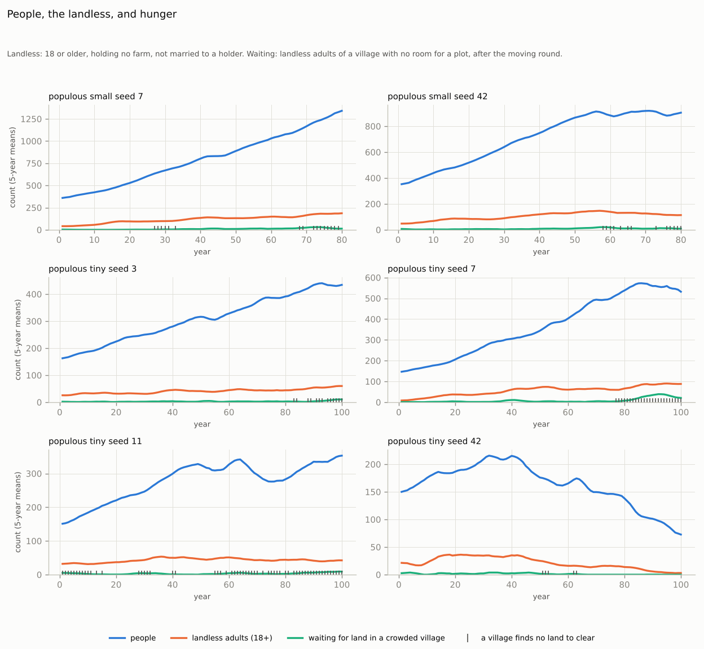
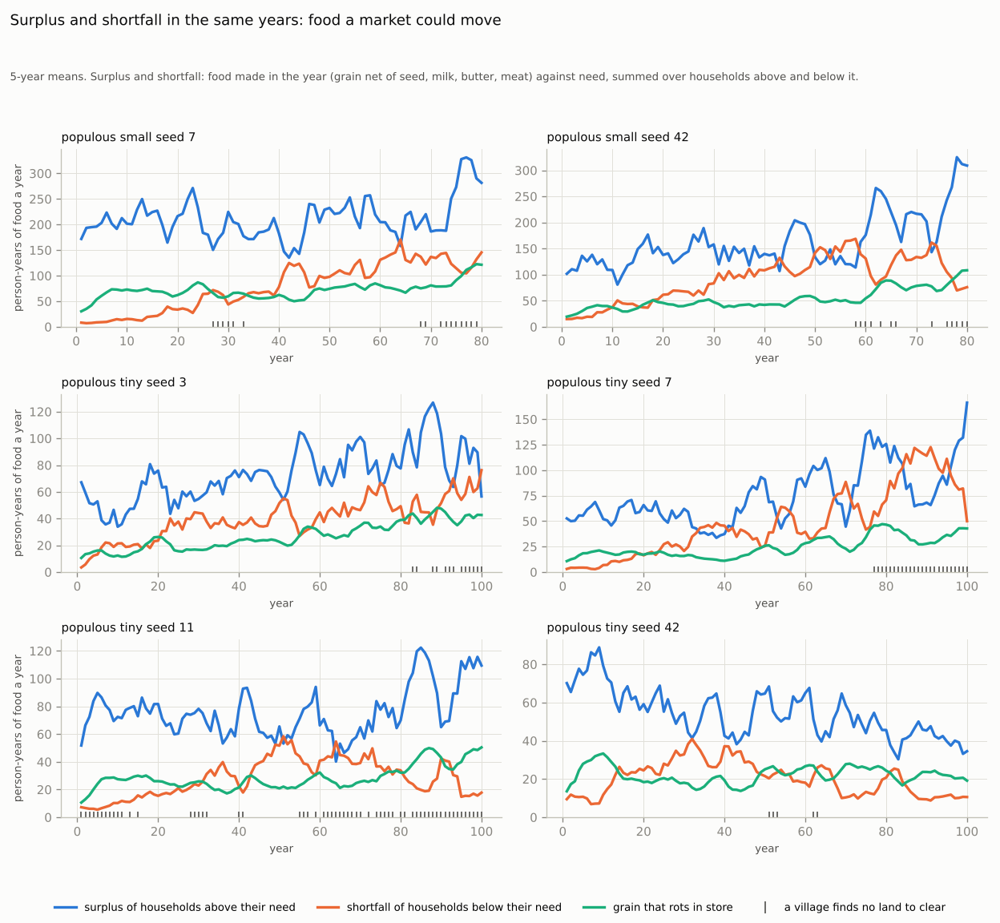
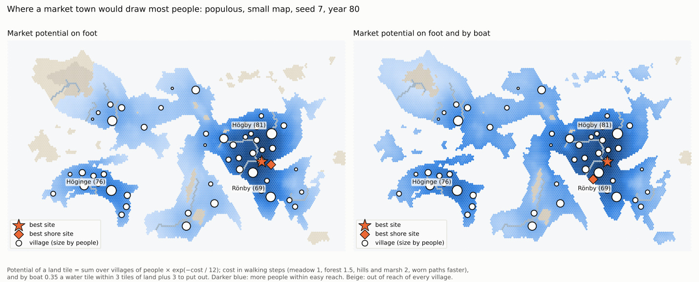
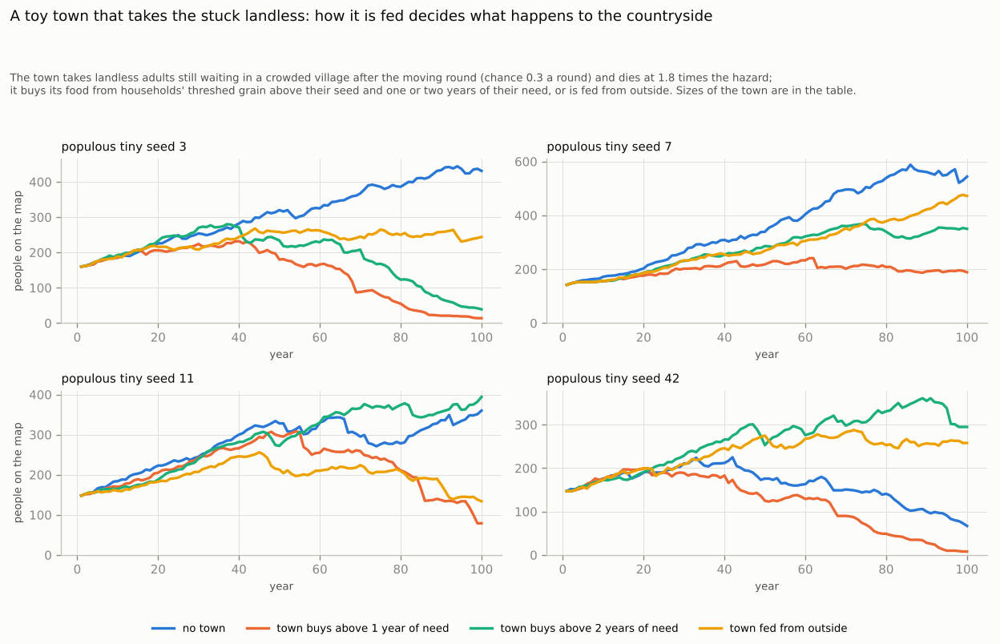
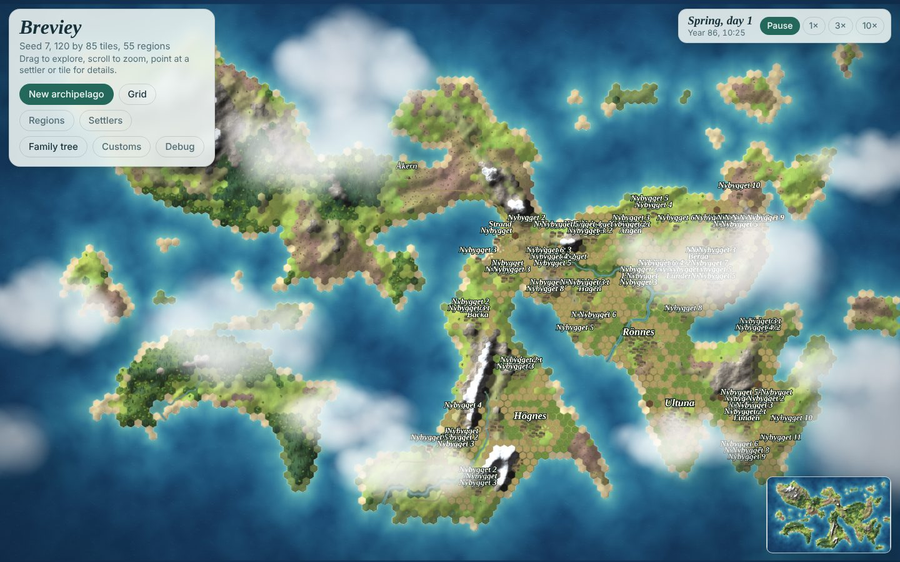
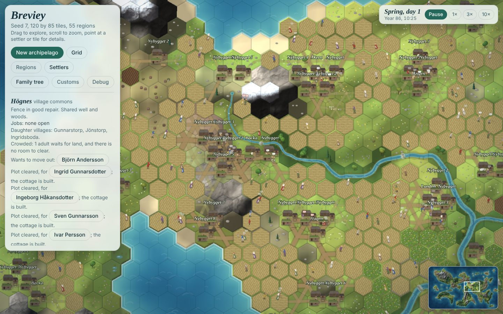

# Review: the bases of city formation, and towns in the game

1 November 2026. The game now has one base of city formation: landless adults with no land to clear, from the crowded villages of the expansion review (`docs/review-expansion.md`, VB-146 to VB-150). A second was named with the request: an elite, people rich enough not to work their own land, who live from what others produce. This review asks what else a town needs, grounds the answer in history and in measurements of the game as it is, and proposes game systems and starting scenarios. Nothing here is built: the probes only read the state (one, the toy town of section 4, takes pawns off the map). `design.md` is unchanged; the questions are in `QUESTIONS.md` under "Towns: the bases of city formation".

Scope agreed when the review was asked for (1 November 2026): a review document with questions and no backlog tasks yet; the elite layer designed and measured too; an outside world beyond the archipelago allowed as abstract actors (ships, the Crown, the Church); the work done in one go.

Measurements are from `populous` on the small map (seeds 7 and 42, 80 years, 350–1,400 people) and on the tiny map (seeds 3, 7, 11 and 42, 100 years), at `b38a443`, with screenshots of the page after 85 years. The probes are in `docs/cities/` (appendix).

## 1. The short answer

A town is a place where people live who do not grow their own food. So it needs, in this order of logic (not of building):

| Base | What it means | In the game now |
| --- | --- | --- |
| 1. People free to leave the land | A rural population that grows beyond its land, and adults with no farm to wait for | **Built:** crowded villages, landless adults, moving to new land (VB-146 to VB-150) |
| 2. A food surplus | Farms that make more than their own people eat, year in, year out | **There, but stuck:** households make 1.1–1.5 times their need; much of the rest rots (section 3.2) |
| 3. A way to move the surplus | Food goes to people who do not farm, either taken (rent, tithe, tax) or traded (a market) | **Missing:** grain moves only as gifts between kin and to the village store |
| 4. Work only a town does | Something the country needs and cannot make or do itself: iron, salt, cloth, the church, justice, protection, a market | **Missing:** every household is self-sufficient |
| 5. A place where routes meet | A central place: a harbour, a ford, crossroads, a lord's seat, reachable from many villages | **The map has them:** section 3.4 finds the sites |
| 6. Rules that make it safe | Market peace, a town law and charter, measures, money; a ban on trade outside towns | **Missing;** fits the customs model |
| 7. A patron with power | An elite or a ruler who gains from the town (tolls, taxes, goods) and protects it | **Missing:** wealth is stable but flat, and nothing makes it accumulate (section 3.3) |
| 8. A way of life the town can bear | High deaths, late marriage, servants, a steady stream of migrants | **Missing;** the toy town of section 4 sizes it |

Bases 1, 2 and 5 are in the game or on the map; 3, 4, 6, 7 and 8 must be built. The cheapest first step is the market (base 3), because the measurements show a surplus and a shortfall in the same years: food a market could move today (section 3.2).

The main findings of the measurements and the toy town:

- **The surplus is there and stuck.** Households above their need make 120–260 person-years of food a year more than they eat on the small map, while others fall up to 150 short, and 30–100 person-years rot: food for 7–13% of the people (section 3.2).
- **Grain, not land, keeps most settlers home.** Twice as often as a party left, a would-be settler stayed because the family could not spare the provisions (section 3.1).
- **Hunger is the check on growth, not marriage.** Once an island fills, deaths from hunger rise to 3–17 per 1,000, while almost every woman marries (section 3.1).
- **Wealth is flat and sticky,** and nobody has servants: an elite needs mechanisms to grow and labour to command, not protection from dissolving (section 3.3).
- **How a town is fed decides everything.** A toy town fed from the farms' grain above one year's need broke the countryside at every seed; fed from what would rot it was safe but small and hungry; fed from outside it relieved hunger. As a sink of births a town is small: it can only help the brake of late marriage, not replace it (section 4).
- **Two problems of the game as it is** shape any town: households of one go hungry beside full barns, and two holders cannot marry each other (section 3.5).

## 2. History

### What makes a town

- **The urban revolution.** Childe (1950, *Town Planning Review* 21) set out ten criteria of the first cities: size and density; full-time specialists fed by others; a surplus paid as tax or tithe to a god or king; monumental buildings; a ruling class; writing; exact sciences; art; foreign trade for raw materials; and a state based on residence, not kinship. His surplus, specialists and ruling class are bases 2, 4 and 7 here ([summary of the scheme](https://sk.sagepub.com/ency/edvol/embed/urbanstudies/chpt/childe-v-gordon)).
- **The medieval town.** Weber (*Die Stadt*, 1921) defined the full urban community by five marks: a fortification, a market, its own court and law, an association of burghers, and some autonomy ([Britannica](https://www.britannica.com/topic/The-City-by-Weber)). The market and the law are bases 3 and 6.
- **Trade.** Pirenne (*Medieval Cities*, 1925) tied the revival of European towns from the 10th century to long-distance trade, with merchants settling under the walls of a castle or a bishop's seat. Christaller (1933) explained the spacing of market towns by the reach of their hinterlands: central places, each serving the villages within a day's walk.
- **The limit.** Food sets the ceiling: Bairoch (*Cities and Economic Development*, 1988) puts pre-industrial urbanisation at 8–15% of the population at most, a level Europe reached about 1300 ([summary](https://econ.biu.ac.il/sites/econ/files/shared/staff/u46/bairoch-final.pdf)).
- **Transport.** Bulk food travelled by water. Overland carriage in 14th-century England cost about twice as much as by river (Masschaele 1993, [*Economic History Review*](https://ideas.repec.org/a/bla/ehsrev/v46y1993i2p266-279.html)); a common estimate for the Roman empire puts land transport of bulk goods at about 28 times the cost by sea ([Roman Britain](https://core-prod.cambridgecore.org/core/services/aop-cambridge-core/content/view/09FD867DD0C956EC284E538DDD72F36B/S1461957123000372a.pdf/transport-costs-and-economic-change-in-roman-britain.pdf)). A town's hinterland was a day's walk by land, much wider along coasts and rivers.

### Towns in Scandinavia

- **Few and small.** Sweden was late and lightly urbanised: about 4% of the people lived in towns around 1500 (Droste 2022). A typical medieval Swedish town rarely passed 300–500 people; only Visby (about 6,000) and Stockholm (about 10,000) were large by European standards (Nordström; both via [Medievalists.net](https://www.medievalists.net/2010/04/late-medieval-and-16th-century-urbanization-%e2%80%93-stagnation-expansion-or-both-2/)). The design's town of about 50 among 1,000 pawns (5%) matches this.
- **Magnates before towns.** Iron Age and Viking Age central places grew around magnate halls: Uppåkra in Scania kept its great hall from the 3rd century to the mid-10th ([Lund](https://lup.lub.lu.se/search/files/77547691/7._Centrality_Regionality._The_Social_Structure_of_Southern_Sweden_during_the_Iron_Age.pdf)); Gamla Uppsala was a magnate complex from the 6th century ([Ljungkvist and Frölund](https://journals.uu.se/jaah/article/view/148)); lesser magnate farms copied their halls ([Odarslöv](https://journals.uu.se/jaah/article/view/88)). Feasts, cult and assemblies came before trade.
- **Kings found towns.** Sigtuna was founded about 980 as a royal town, by Erik the Victorious or his son Olof Skötkonung, and Sweden's first coins were struck there about 995; it was the royal and commercial centre for 250 years ([Wikipedia](https://en.wikipedia.org/wiki/Sigtuna)). Its predecessor Birka, on an island in Lake Mälaren, was a trading place under a royal official.
- **Trade and law.** Earl Birger granted Lübeck its first trading privileges about 1250 ([Runeberg](https://runeberg.org/histswed/0117.html)); Visby was a Hanseatic town. Magnus Eriksson's town law (*stadslag*, about 1350) applied in towns as his land law did in the country, until 1734. The Crown tried for much of the Middle Ages to keep trade in the towns; a 1546 edict made a third conviction for trading in the countryside (*landsköp*) a capital crime ([Högman](https://hhogman.se/sorkorare-eng.htm)). Smaller market places were *köpingar* (Köping, Linköping, Norrköping).
- **The fair.** The Scania Market, the herring fair between Skanör and Falsterbo, ran from 24 August to 9 October each year for about 250 years, dominated by Lübeck, with merchants from England, Flanders and Normandy; its booths moved with the shoals and it faded as the herring left in the 15th century ([Wikipedia](https://en.wikipedia.org/wiki/Scania_market)). A town of booths that filled and emptied with the season.
- **Who took the surplus.** Tithes came to Sweden in the 13th century against strong opposition; the corn tithe was split between the priest, the bishop, the parish church and the poor ([Runeberg](https://runeberg.org/histswed/0115.html)). The levy for the fleet (*ledung*) became a tax in the 12th and 13th centuries ([Wikipedia](https://en.wikipedia.org/wiki/Leidang)). The Ordinance of Alsnö (1279 or 1280) freed from tax those who served the king with a horse and armour: the origin of the Swedish nobility, the *frälse* ([Wikipedia](https://en.wikipedia.org/wiki/Ordinance_of_Alsn%C3%B6)). Before the Reformation the Church held about 21% of the land, the Crown 6% ([Britannica](https://www.britannica.com/place/Sweden/The-early-Vasa-kings-1523-1611)); much of the rest was farmed by freeholders and by tenants (*landbor*) who paid their lords mostly in days of work ([Högman](https://hhogman.se/land_ownership_eng.htm)).
- **Crisis made towns.** Urbanisation in Sweden roughly doubled during the agrarian crisis of 1350–1460, after the Black Death, and then stalled until the 17th century (Sidén, via [Medievalists.net](https://www.medievalists.net/2010/04/late-medieval-and-16th-century-urbanization-%e2%80%93-stagnation-expansion-or-both-2/)).

### The town as a sink

- **Towns died faster than they bred.** In 1763 Stockholm had 72,979 people and had averaged 3,802 deaths a year over the six years before: 52 per 1,000, "one in nineteen" ([Philosophical Transactions](https://jimclifford.ca/philosophical-transactions-ocr-1665-1869/articles/jstor-106213/)), while the whole country's rate passed 50 only in crisis years such as 1773 ([a comparison of Swedish, English and Italian vital rates](https://link.springer.com/article/10.1007/s11698-016-0144-7)). London recorded over 400,000 more burials than baptisms in the first half of the 18th century and grew only by migration ([family reconstitution study](https://core-prod.cambridgecore.org/core/services/aop-cambridge-core/content/view/E59CCB180FB509A3EF6EBBB820A3B688/S0025727300071088a.pdf/londons-mortality-in-the-long-eighteenth-century-a-family-reconstitution-study.pdf); Wrigley 1967, *Past and Present* 37).
- **But a town is a small sink.** A town of size N with a natural decrease of r a year needs N × r migrants a year just to stay the same size. Stockholm's surplus of deaths over births was large; a small medieval town's was smaller. Section 4 works out what this means at the game's scale.

### The elite

- **Big men and chiefs.** Sahlins (1963, *Comparative Studies in Society and History* 5) contrasted the Melanesian big man, whose standing rests on followers won by giving feasts and gifts and must be earned anew, with the Polynesian chief, whose office is inherited and who redistributes tribute ([Wikipedia](https://en.wikipedia.org/wiki/Big_man_(anthropology))). Earle (*How Chiefs Come to Power*, 1997) names the sources of power as control over the economy (land, stores, trade goods), force (a retinue) and ideology (cult, feasts, monuments).
- **In the North,** the magnate hall combined all three: a large farm worked by servants, thralls and tenants, a retinue fed at the lord's table, feasts and cult in the hall, and later the king's service that freed the lord from tax. The elite took the surplus by rent and labour days; the town was where the elite and the Church spent it.

## 3. Measurements

Six runs of `populous`: the small map at seeds 7 and 42 for 80 years, and the tiny map at seeds 3, 7, 11 and 42 for 100 years, sampled once a year two hours after the moving round, when the harvest is in. Food is counted in person-years: 48 rations, one adult's food for a year.

### 3.1 The landless, and the ceiling

| Run | People at year 20 / 40 / 60 / 80 / 100 | Landless of adults (end) | First year a village finds no land | Times a party could not get provisions / parties that left | Deaths from hunger per 1,000, last 20 years | Women 45–54 never married (end) |
| --- | --- | --- | --- | --- | --- | --- |
| small, seed 7 | 531 / 807 / 1,023 / 1,376 / – | 196 of 698 (28%) | 27 | 314 / 148 | 3.2 | 0 of 38 |
| small, seed 42 | 520 / 744 / 860 / 924 / – | 115 of 506 (23%) | 58 | 264 / 121 | 12.3 | 2 of 36 |
| tiny, seed 3 | 226 / 282 / 325 / 386 / 431 | 63 of 249 (25%) | 83 | 116 / 52 | 9.6 | 1 of 20 |
| tiny, seed 7 | 203 / 309 / 404 / 539 / 544 | 87 of 317 (27%) | 77 | 355 / 64 | 16.8 | 1 of 20 |
| tiny, seed 11 | 223 / 300 / 330 / 278 / 360 | 45 of 194 (23%) | 1 | 67 / 20 | 5.8 | 4 of 20 |
| tiny, seed 42 | 190 / 212 / 163 / 141 / 67 | 3 of 45 (7%) | 51 | 48 / 24 | 45.4 | 0 of 2 |

"Landless" here is wider than the waiting queue: every adult of 18 or more who holds no farm and is not married to a holder (unmarried sons and daughters, the retired, followers).

- **A quarter of adults are landless,** in every run but the collapsing one, and the share is stable: the release valve of VB-146 keeps the queue short (0–34 adults waiting in crowded villages at a time), as the expansion review found.
- **The ceiling comes, but late.** A village first finds no land worth clearing within a day's walk in year 27 to 83 (in year 1 on tiny seed 11); small seed 7 is still growing at 1,376 people in year 80.
- **Grain, not land, is what keeps most settlers at home.** A waiting adult who draws to leave and whose family cannot spare 36 days of food and seed stays: this happened 264 and 314 times on the small map (counted per person and year), twice as often as a party left. The grain exists on the island (section 3.2), but not in the settler's family.
- **The check is hunger, not marriage.** In the last 20 years, deaths from hunger are 3–17 per 1,000 (45 at tiny seed 42), against 0–1 in the first decade, while almost every woman marries: 0–4 of 20–38 women aged 45–54 were never married. The European marriage pattern the design follows (Hajnal 1965) had 10–20% of women never marrying, and late marriage was its main brake on births; in the game, births stay at 42–48 per 1,000 on the small map in every decade (27–51 on the tiny map).
- **Tiny seed 42 collapses** from 212 people in year 40 to 67 in year 100: hunger kills 30–46 per 1,000 in some decades, although the island as a whole makes 1.1–1.4 times what it eats. Section 3.5 shows where that hunger sits.

### 3.2 The surplus, and the shortfall beside it

The small map, by decade (person-years of food a year; "made" is grain net of seed, milk, butter and meat):

| Years | People (end) | Made / need | Surplus of households above need | Shortfall of households below need | Grain rotting in store | Spare stock above seed and a year's need (end) |
| --- | --- | --- | --- | --- | --- | --- |
| seed 7, 1–10 | 425 | 1.60 | 193 | 11 | 57 | 209 |
| seed 7, 31–40 | 807 | 1.21 | 184 | 64 | 61 | 173 |
| seed 7, 71–80 | 1,376 | 1.12 | 257 | 130 | 98 | 213 |
| seed 42, 1–10 | 435 | 1.31 | 118 | 23 | 32 | 120 |
| seed 42, 31–40 | 744 | 1.07 | 140 | 102 | 40 | 195 |
| seed 42, 51–60 | 860 | 0.97 | 131 | 149 | 48 | 105 |
| seed 42, 71–80 | 924 | 1.16 | 234 | 116 | 88 | 380 |

- **There is a surplus,** 1.1–1.6 times the island's need in most decades, falling as the island fills.
- **A shortfall sits beside it in the same years:** the households above their need make 120–260 person-years more than they eat, while those below fall 10–150 short. Up to the smaller of the two could change hands each year if there were a way to move it: in the later decades food for 60–130 people, 8–15% of the island, close to Bairoch's ceiling of a pre-industrial town population. It is an upper bound: not every household is within reach of a market.
- **Much of it rots.** Grain spoiling in store (the balance review's storage loss) is 30–100 person-years a year, food for 7–13% of the island: the town of the design (5%) could be fed from what now rots.
- **Seed 42's decade 51–60 is the exception** that shows the risk: the whole island made less than it ate (0.97), 22 per 1,000 died of hunger, and the spare stock fell to 105 person-years.

### 3.3 Wealth: flat, and sticky

| Run | Gini of wealth | Top tenth's share | Gini of grain in store | Gini of cattle | Gini of fields | Households with a servant | Rank correlation of a farm's wealth after 10 / 20 / 30 years |
| --- | --- | --- | --- | --- | --- | --- | --- |
| small, seed 7 | 0.28 | 19% | 0.28 | 0.78 | 0.26 | 0.1% | 0.90 / 0.79 / 0.68 |
| small, seed 42 | 0.30 | 20% | 0.32 | 0.81 | 0.27 | 0.1% | 0.92 / 0.85 / 0.80 |
| tiny, seed 3 | 0.30 | 19% | 0.31 | 0.89 | 0.27 | 1.3% | 0.92 / 0.84 / 0.77 |
| tiny, seed 7 | 0.28 | 19% | 0.28 | 0.77 | 0.25 | 0.0% | 0.89 / 0.80 / 0.73 |
| tiny, seed 11 | 0.26 | 18% | 0.29 | 0.89 | 0.24 | 0.2% | 0.91 / 0.83 / 0.77 |
| tiny, seed 42 | 0.32 | 21% | 0.35 | 0.89 | 0.28 | 0.3% | 0.93 / 0.88 / 0.83 |

Wealth is the share rule's value of a farm (120 rations a field, half a ration a ration of grain; `SHARES`) plus 40 a head of cattle and 6 a sheep (this review's guess), averaged over years 5 on; the rank correlation is Spearman's, over farms occupied in both years.

- **Flat.** The richest tenth of households holds about a fifth of the wealth, a Gini of about 0.3, and it does not grow over 80–100 years. Fields cap it: a household wants fields for its own need and can till 2 per working adult (`FIELDS`), and a farm is never more than one household's.
- **Sticky.** A farm that is rich stays rich: a rank correlation of 0.9 after 10 years and 0.7–0.8 after 30, because the farm passes whole to one heir with its fields and herd.
- **Cattle are the only unequal wealth** (Gini 0.8–0.9), because settlers and many small households have none.
- **No servants.** One household in a thousand has a servant (VB-090, service, is not built), where in pre-industrial north-west Europe most young people spent years in service in other households (Hajnal 1982, *Population and Development Review* 8). An elite needs others' labour; the game has no way to hire it yet.

So the elite does not need to be kept from dissolving: it needs mechanisms that let wealth grow past one farm's need, and labour that works for it (Phase 2, section 5).

### 3.4 Where a town would stand

Market potential (Harris 1954) is the number of people within easy reach of a tile: the sum over villages of their people times exp(−cost / 12), with walking costs as in `src/sim/routes.js`, so a village 12 steps away counts at 37% and one 30 steps away (a day's walk) at 8%.

- **On foot,** each island is its own market area, and the best site is a meadow in the densest cluster of villages.
- **With boats** (a water tile within 3 tiles of land costs 0.35, putting out 3), the islands join into one area, the best site gains the other islands' people, and the best shore site lies in the bay closest to the dense cluster: the harbour a ship would call at and a town would grow around.
- **The harbour and the central place need not coincide.** At seed 7 the best shore site lies 5 tiles (on foot) to 12 (with boats) from the best site, with 80–86% of its potential; at seed 42 it lies 85 tiles away, with 89%. A game can have a market place inland and a harbour town on the coast, as Sweden had its *köpingar* and its ports.

The potential is cheap to compute (one search per village) and gives the fair its site (Phase 1).

### 3.5 Two findings about the game as it is

These are outside towns, but they shape what a town must do, and they belong to the expansion wrap-up (VB-035).

**Households of one go hungry beside full barns.** One household in six on the small map, and one in four on the tiny map, is a single person: mostly settlers who left alone and widowed holders. They make 1.5 times their need and hold nearly 3 years of it after the harvest, yet they are hungry in 41–49% of their years and account for a quarter to a third of all hungry days:

| Members | Household-years, small (tiny) | Hungry in the year | Hungry days a year | Share of all hungry days | Made / need | Store / need after harvest |
| --- | --- | --- | --- | --- | --- | --- |
| 1 | 4,127, 16% (6,783, 24%) | 41% (49%) | 4.5 (4.9) | 25% (34%) | 1.55 (1.54) | 2.7 (2.9) |
| 2 | 2,393, 9% (2,883, 10%) | 24% (26%) | 1.8 (2.1) | 6% (6%) | 1.50 (1.56) | 2.1 (2.3) |
| 3–5 | 10,123, 38% (11,220, 40%) | 26% (31%) | 2.3 (3.0) | 32% (34%) | 1.25 (1.21) | 1.8 (1.8) |
| 6 or more | 9,382, 36% (7,421, 26%) | 29% (34%) | 2.9 (3.5) | 36% (26%) | 1.09 (1.04) | 1.4 (1.4) |

Their hunger is labour, not food: one person cannot plough, reap, thresh, fetch water and wood, and cook at once. Historically a farm needed a couple, and servants filled the gaps.

**Two holders cannot marry each other.** Under the default residence custom ("with the land"), a couple needs exactly one place to live: two people who each hold a farm, or are first heir to one, cannot marry (`homeFor` in `src/sim/lifecycle.js`). Every lone settler becomes such a holder, so the lone stay lone unless a landless partner is free; tiny seed 11 had 1–8 single men and 0–14 single women holding farms at the decade ends. Heir–heiress marriages were the historical way farms were joined, and they are a path to the elite (Phase 2).

## 4. A toy town

The request's idea: towns draw the landless, and their deaths outrun their births, so a town can be the sink for the late game's surplus of births. The probe tests it with a town kept off the map, on the tiny map at seeds 3, 7, 11 and 42 for 100 years (`--town 1` in `docs/cities/probe.js`).

**The toy.** The town is a list of people (age, sex, married). Two hours after each moving round, every landless adult of 18–45 still waiting in a crowded village goes there with a chance of 0.3, with spouse and minor children, while the town was fed the year before; the map loses them through the death path, as "left for the town". Each year the town eats a year of rations; dies by the game's hazard by age (`hazard` in `src/sim/rules.js`) times 1.8, and up to 4 times more when it went short; bears at the rate of the map's married women times 0.8; and its single adults marry at 0.3 a year, with no land needed. It draws from its own random stream, so with no migrants a run is identical to the game's year by year (checked at seed 11). It is fed in one of three ways:

- **buys above one year:** from households' threshed grain above their seed and one year of their own need, in proportion to what each can spare, every year;
- **buys above two years:** the same, above two years of need: roughly the grain that would rot, since storage loss takes 20% of the second year's worth and 40% beyond;
- **fed from outside,** by ships, taking no grain from the map.

| Seed | People on the map at year 100: no town / buys above 1 year / above 2 years / fed from outside | Town at its peak / at year 100: above 1 year; above 2 years; from outside | Migrants in 100 years: above 1 / above 2 / outside | Deaths from hunger on the map per 1,000: no town / above 1 / above 2 / outside |
| --- | --- | --- | --- | --- |
| 3 | 431 / 14 / 39 / 244 | 29 / 5; 18 / 4; 39 / 31 | 22 / 26 / 51 | 7.7 / 20.5 / 16.1 / 6.9 |
| 7 | 544 / 189 / 350 / 472 | 44 / 36; 22 / 18; 107 / 107 | 36 / 34 / 100 | 8.0 / 9.5 / 6.1 / 2.1 |
| 11 | 360 / 79 / 394 / 134 | 44 / 38; 23 / 14; 9 / 2 | 38 / 32 / 23 | 8.8 / 18.0 / 7.8 / 11.1 |
| 42 | 67 / 8 / 295 / 258 | 26 / 11; 19 / 19; 115 / 110 | 16 / 40 / 64 | 17.2 / 22.6 / 10.5 / 7.3 |
| **All four** | **1,402 / 290 / 1,078 / 1,108** | | **112 / 132 / 238** | **mean 10.4 / 17.7 / 10.1 / 6.9** |

Each seed's history is chaotic: a few people more or less change who marries whom and when the famines strike, so single seeds disagree (seed 3 collapses under two of the variants, seed 42 collapses without a town). The totals over four seeds are the result, and only the first finding below is large against that noise.

What it shows:

1. **A town that buys the farms' reserve breaks the countryside.** Bought from grain above one year's need, the town took 13–21 person-years of food a year, less than the island lets rot, yet the map ended a fifth the size of the runs without a town (290 people against 1,402 over four seeds), with more deaths from hunger at every seed. The grain above one year's need is what kin give in hunger (`sim/help`), what settlers take as provisions and what carries a family through a second bad harvest, and the town took it in lean years too. Medieval towns did buy grain in the countryside in dearth while the country went hungry. A game market must leave each farm its reserve, and in a dearth the town must go short or be fed by ships.
2. **A town fed only from what would rot is safe, small and hungry.** Bought above two years of need, the town left hunger on the map as it was (10.1 per 1,000 against 10.4), but it stayed at 18–23 people and got only 61–75% of its food, so it died at 50–75 per 1,000. The surplus, not the migrants, set its size: Bairoch's limit at the scale of one island.
3. **Fed from outside, the town is a pressure valve.** It grew to 39–115 people at three seeds (9 at seed 11), up to 30% of all the people, took 238 migrants over the four centuries, and deaths from hunger on the map fell from 10.4 to 6.9 per 1,000. The map itself ended a fifth smaller (1,108 against 1,402): the migrants and their children were in town.
4. **As a sink of births it is small.** At 1.8 times the hazard the toy town's deaths barely outrun its births, and at two seeds its births are the higher (8–49 births and 28–75 deaths per 1,000 over the twelve runs), because everyone in it marries. The arithmetic at the ceiling: births of 42–43 per 1,000 and deaths other than hunger of 25–27 leave an excess of about 16 per 1,000, which hunger now removes (section 3.1). A town with a natural decrease of r takes N × r migrants a year; to take the whole excess of an island of P people at r = 15 per 1,000 it would need N ≈ P, a town as large as the countryside. A town of 5% (the design's, and Sweden's 4% about 1500) takes a twentieth of it; even Stockholm's 52 deaths per 1,000 would not change that much.

So a town can be a sink only together with the brake that worked in history, late marriage and never marrying among the landless and servants (section 3.1), and only when it is fed from a real surplus (what rots, what ships bring), not from the farms' reserve. In the town as proposed (section 5, Phase 4), servants live in town households unmarried, which keeps them out of the marriage market for years; that, more than the death rate, is what towns did for the balance of births.

## 5. Proposed systems

One new arch, `towns`, in five phases. Each phase is playable on its own and can be measured against the numbers of section 3. All numbers are Proposed starting values.

### Phase 1: the fair (bases 3 and 5)

The first outlet for the surplus, and the first place where the villages of an island meet.

- **Where.** At the land tile of highest market potential (section 3.4, on foot and by boat), on unowned meadow or on the green of the village there. Its reach is the villages within 30 walking steps (a day's walk) or a boat crossing of similar cost. The site is fixed once, when the first fair is called, and stays: towns rarely moved.
- **When.** Once a year after the harvest is threshed, autumn days 6–8, before the meetings (day 10) and the moving round (day 11). A second fair before sowing (spring day 1) follows when grain for seed is short anywhere within reach.
- **Who goes.** From each household within reach, one adult with up to one load (30 rations on the back, 90 with a cart and oxen), when it has grain above its seed and two years of its need to sell (section 4: a market that takes the reserve above one year breaks the countryside), or will run short of food before the next harvest. A job kind `fair` of a new work type `trade`, so roles rank it (holders and sons high, children never).
- **What changes hands.** Food first: grain, butter, salt meat. With no money yet, everything is valued in rations, the game's unit of account, at fixed rates in the first version. A household short of food pays with what it has: an animal (a cow 40 rations, a sheep 6, the worths used in section 3.3), its labour (days of work for the seller, at 3 rations a day), or on credit (Phase 2). A price that moves with supply and demand (dear in a hard year, cheap after a good harvest) comes with the first goods that are not food (Phase 3).
- **What else happens.** The fair is an occasion (VB-126, not built yet): people of different villages talk, court and make friends, which the marriage market needs (section 3.5).
- **What to measure.** Hungry household-days and deaths from hunger, grain that rots, the stores of the richest households (VB-130), and marriages across villages, before and after.
- **What the player sees.** Booths and stooks of goods on the fair meadow for three days, paths worn towards it from every village (VB-094 draws them already), and a fair report in the log ("At the Ängby fair 41 households traded 1,240 rations; grain fetched little after the good harvest").

### Phase 2: credit, tenancy and the master (base 7)

The current game has no way for wealth to grow beyond one farm (section 3.3). The mechanisms below, each with a history, make it grow; together they make an elite.

- **Grain loans.** Beyond the gifts of kin (`sim/help`, unchanged), a household short of food borrows from one with grain to spare, at the fair or at its door: repaid at the next harvest with a quarter more. A loan not repaid after two harvests is paid in labour days by the debtor's adults, and, under a new custom ("Debts are paid with": labour; land; labour, then land), with a field, which passes to the creditor. Bad years thus move land to those with full stores: the Matthew effect of famine. A would-be settler may borrow the provisions their family cannot spare, the most common reason a settler stays home now (section 3.1).
- **Tenancy.** A household that holds more fields than its hands can till (`FIELDS.perHand`), or a second farm, may let the land to a landless couple as tenants (*landbor*): they live and farm there as a household and pay a quarter of the harvest and some labour days. A tenancy is a place to live, so a landless couple may marry on it under the residence custom "with the land", and it ends at the death of the tenant or after a term (6 years for the Crown's tenants, Högman).
- **Two holders may marry.** The couple lives on the farm with more fields, and the other is let to tenants or passes to its next heir (a question for Kim, and for the expansion wrap-up, VB-035: section 3.5 shows why).
- **The master.** A household whose rents and stores have covered its need with a margin of half for three years is a master household (*storbonde*; later, with the Crown, *frälse*): its holder ranks field work low (2 of 10) and spends the time on the fair, the meeting, feasts and the town. Its servants and tenants do the work; service where labour is short (VB-090, ready) is where the servants come from.
- **Feasts and followers.** A master may give an ale (an occasion, VB-126) that costs grain and raises the guests' opinion of the host; prestige (`sim/society`, now 1.6 for any holder) gains a term for wealth and for feasts given in the last few years. Prestige already weighs a voice at the meeting, so a big man sways customs, such as who cleared land belongs to, towards his own.
- **What to measure.** The Gini of wealth and the share of the top tenth (section 3.3), the number of master households per 1,000 people, and whether a master farm keeps its rank after its holder dies.

### Phase 3: goods from outside, and the first specialists (bases 4 and 5)

- **Ships.** In summer, a merchant ship calls once or twice at the shore site of highest potential (section 3.4) and holds a fair there. It sells salt and iron, later cloth and wine, and buys butter, hides, salt meat and, after good years, grain. Its prices are fixed per decade, so the outside world is a source and a sink, not a simulation.
- **Salt.** Salting meat (`sim/byre`) now needs no salt. With ships, it does: without salt, the autumn slaughter keeps only as long as fresh meat (`HERD.freshDays`), so households need the fair to keep the winter's meat.
- **Iron.** With winter crafts (VB-121, not built yet), field work wears tools; iron mends them and makes them last. A smith household turns bought iron into tools and mending for grain.
- **The first specialists** are landless adults of a crowded village who set up at the fair site with a stake: a smith first, then a boatwright, a potter, a miller once the windmill exists (VB-093; the design already makes milling the miller's role in towns). They hold a house tile and no fields, and live from what they sell. At three such households the fair site is a market place (*köping*).

### Phase 4: the town (bases 6 and 8)

- **Kinds of settlement.** Village; market place (*köping*: a fair and at least 3 households that live by trade or craft); town (*stad*: chartered, Phase 5, or 10 such households and a church). The culture model already has a settlement kind `city`: its people's attitudes move 2.2 times as fast and are less anchored (0.15 against 0.35), and it weighs three times as much at the culture's reckoning (`src/culture.js`). A market place takes that kind.
- **Burgage plots.** A town is laid out in plots (*tomter*): a house tile and a yard, no fields, along a street from the market place, as the design's town of 35–40 tiles with about 11 houses and a 7-tile market.
- **Living in town.** Town households buy their food at the market, which in a town is held every few days; in a dearth the town goes short first, or buys from ships, and the farms keep their reserve (section 4). In a town a couple needs a plot or a place in a household, not land, to marry: the town is where the landless can marry. Servants in town households (maids, journeymen) come from the landless of the country.
- **The urban penalty.** In a town the death hazard is multiplied by 1.8 (section 4), more in crowded plots; epidemics, later, start in towns along the ships' routes.
- **The pull.** At the moving round, a landless adult of a crowded village may go to the town when the town has a place: a household there wants a servant, or a plot is free. The town's work sets its size, and its deaths set how many it draws (section 4).

### Phase 5: the Crown and the Church (bases 6 and 7)

- **The Church.** Once the island has about 300 people, a priest comes and a church is built at a central place, as village work over years (timber first, stone later). Mass on the first day of each week gathers the villages, an occasion that crosses village lines. The tithe, a tenth of each grain harvest, feeds the priest and builds the church; a share goes to the poor, which becomes help in hunger.
- **The Crown.** A bailiff (*fogde*) comes each autumn to take the tax, in grain or butter per farm. The Crown charters a town at a market place of 5 or more trading households: a town law, a market monopoly within a day's walk (trade outside it banned, as the *landsköp* bans did), and a toll. A master who keeps a horse and armed men for the king's service is freed of tax (*frälse*, Alsnö).
- **Customs.** "Trade outside the town" (free; at fairs only; banned) and "Debts are paid with" are customs of the culture, so they drift and split as the others do.

### Cost

A fair is a few dozen pawns walking 10–30 steps once or twice a year, less than a day of the moving round's walking. Prices are one calculation per market day. A town of 50–100 pawns is 5–10% of the 1,000-pawn budget. Market potential is one search per village (the probe takes under a second on the small map) and changes only when villages grow.

## 6. Scenarios for the start menu

Every scenario builds its villages through the same generators (Starting scenarios, `design.md`); each chooses only what to build and where. The first three need only Phases 1 and 2.

| Scenario | Start | What it tests | Needs |
| --- | --- | --- | --- |
| **The fair meadow** (*Marknadsängen*) | A populous small or medium island; on its central meadow the first autumn fair is called in year 1 | Exchange of the surplus, fewer hungry days, ties and marriages across villages, a market place that grows | Phase 1 |
| **The magnate's hall** (*Stormansgården*) | One great farm (a hall, 6 fields, 12 cattle, 8 servants and 3 tenant farms) among freeholders; its holder is 58 with three grown sons | Masters, tenancy and feasts; whether a big man's farm survives his death or is split; how far his prestige moves the customs | Phase 2 |
| **No land left** (*Inget land kvar*) | A full island: populous at the density of section 3.1's ceiling, no plot sites, landless adults waiting in most villages | The ceiling as it is now (hunger as the check), then the town as an outlet once Phase 4 exists; the marriage trap | Phase 1 now; Phase 4 for the town |
| **The herring autumn** (*Sillhösten*) | An outer archipelago where herring shoals come off one beach each late summer; ships and booths come with them and leave in autumn | The outside world, a seasonal town of booths that fills and empties, salt and fish | Phases 1 and 3; fishing (VB-117) |
| **Iron country** (*Bergslagen*) | A hilly island with bog iron and forest, and a farming island across a strait | Specialisation by region: iron for grain, trade by boat between islands | Phase 3, a bog iron resource |
| **After the plague** (*Efter digerdöden*) | A full island in which a third of the people die in the first year | The reversal: empty farms claimed (VB-033) by the landless, the town drained and refilled; Sweden's towns grew in the crisis | Phase 4, claims (VB-033) |
| **The king's town** (*Kungsstaden*) | A settled island with a market place; in year 1 the Crown charters a town at a site the player chooses | The charter, the market monopoly, tolls, the bailiff's tax, the town meeting | Phase 5 |

**No land left** can be made with what exists (a populous island grown denser by the generator), and it is the scenario that shows why the town is needed. **The fair meadow** is the first scenario of the new arch.

## 7. Questions

The questions are in `QUESTIONS.md`, "Towns: the bases of city formation", each with a proposed answer:

1. How a town comes about: from a fair that grows, or by charter, or both (proposed: both).
2. What comes first (proposed: the fair, Phase 1).
3. Money (proposed: none at first; rations as the unit of account).
4. The elite's mechanisms (proposed: grain loans, tenancy, the master household, feasts).
5. Two holders who wish to marry (proposed: they may; section 3.5).
6. Households of one (proposed: settlers leave with a companion; section 3.5).
7. The urban penalty (proposed: the hazard times 1.8; the town is a small sink, section 4).
8. The outside world (proposed: ships, the Church and the Crown with fixed rules).
9. Which scenarios first (proposed: "No land left", then "The fair meadow").

Two rules for any market follow from section 4 whatever the answers: a household sells only grain above its seed and about two years of its need, and in a dearth the town goes short first or is fed by ships.

## Appendix: probes

All at `b38a443`, in `docs/cities/`; none is part of the game or under test, and `src/` is unchanged. Python 3 with matplotlib for the figures; colours from the reference palette of the charting guidance (three categorical slots and a one-hue blue ramp, every figure with a table beside it).

- **The runs:** `node docs/cities/probe.js --scenario populous --seed S --map small|tiny --years 80|100 --out FILE`, for small seeds 7 and 42 and tiny seeds 3, 7, 11 and 42. The probe advances to two hours after each moving round, samples the state (population, landless adults by kind, crowded villages, every log line of the round, households' stores, reserves, need, food made since the last sample, grain spoilt, herds, fields, servants, hunger) and at the end computes market potential on foot and with boats. About 5–25 minutes a run.
- **The toy town:** the same with `--town 1` (buys above one year of need), `--town 1 --keep 2` (above two years), `--town 1 --buy 0` (fed from outside) and `--town 1 --pull 0` (no migrants: identical to the game's run, the check). Its other numbers: `--pull 0.3 --mort 1.8 --fert 0.8`.
- **Tables and figures:** `python3 docs/cities/analyse.py FILES --figs docs/img` prints the decade tables, vital rates, the summary tables of section 3 and the town comparisons, and draws `cities-landless.png`, `cities-surplus.png`, `cities-town.png` and the market potential maps.
- **Screenshots:** `node docs/cities/shots.js --seed 7 --size t --years 85 --out DIR`: Playwright on a scratch copy of `index.html` that exposes the state and the camera (PixiJS served from `node_modules`, as in `tests/browser.js`); it advances the populous tiny map 85 years a day at a time, as the debug skip does, and shoots the island, a crowded village and its panel.

