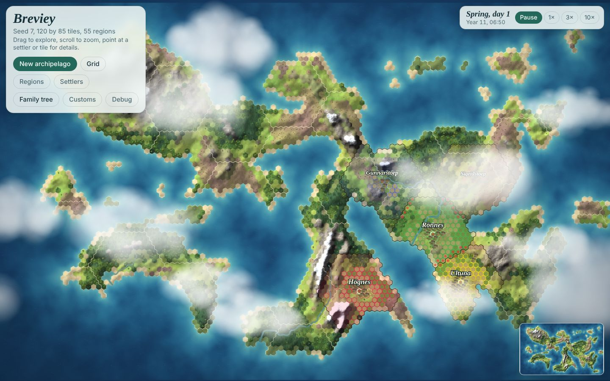
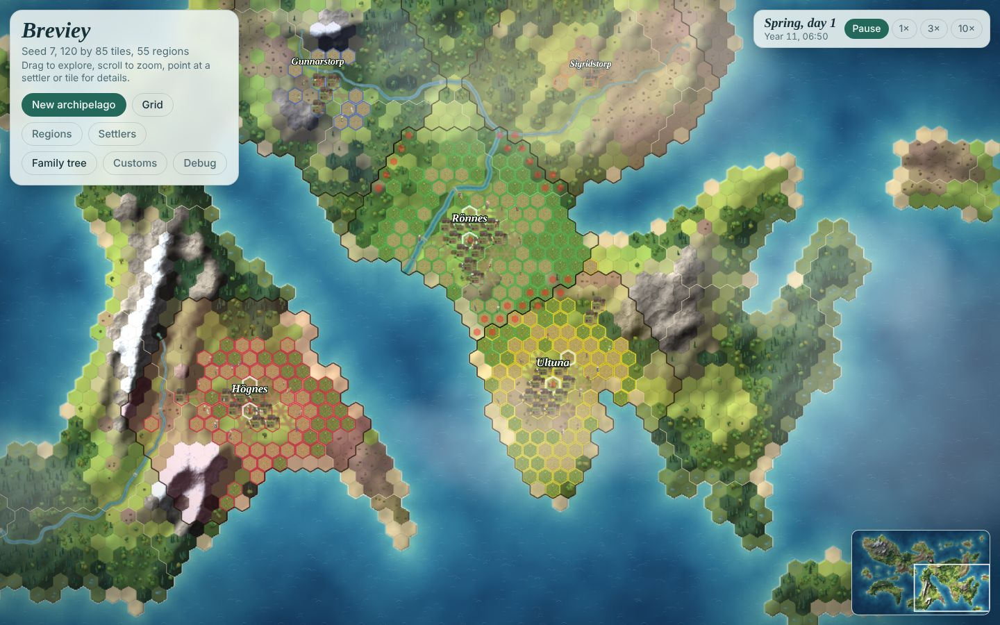

# Review: claims, ownership and territory

1 November 2026. A review of how land is held in the game today, set against the design (`design.md`, "Claims, ownership and territory") and against how land was held in medieval Scandinavia. It proposes a system of claims and village territory built for play, and asks Kim the questions that shape it. Aristocracy, elites and "big men" are outside it: land here is held by households and villages only.

Measurements are from `populous` on the tiny map (seeds 7 and 42, 10–15 years) and `founders` on the small map at seed 7, at `33e2ef3`. The mock screenshots are drawn by a throwaway script over the real page.

## 1. The state of the game

**Owners exist; claims and territory do not.** `st.owner` (`src/sim/ownership.js`) gives each tile one owner: a household, a village or nobody. It is set when:
- a scenario seeds its farms: houses and fields to their households; the green and the commons wood to the village;
- a household starts a field or meadow project (`startProject`, `startMeadow`): the tile is owned **from the first hour**, before any work;
- a village starts a plot for a landless adult (`startPlot`): the village owns it until the cottage stands, then the new household does;
- settlers found a farm (`sim/settle`);
- a farm empties (`farmToVillage`): its house, fields and meadows pass to the village.

Nothing ever contests a tile. The first household to want it takes it, and the rest look elsewhere: `chooseTile` and `chooseMeadow` skip any owned tile. There is no village territory: a household of one village may make a field next to another village's green, and the next commons wood is simply the nearest forest. Plots stay in the village's generator region or the regions touching it, an arbitrary hex patch.

**Two customs about land exist, one is used.** "Cleared land belongs to" (`newLand`) picks who gets a cleared plot. "Claims on empty farms" (`claims`) has no effect: claiming an empty farm (VB-033) waits on four questions, so a farm emptied by death stands empty until it is a ruin. The stability review counted 11–30 such farms in 60 years at tiny seeds 3 and 7, holding 3–6% of the farmable land. The "Disputed claims" custom is designed but not built.

**Tasks of the claims arch** are all open: VB-004 (overlay), VB-042 (tile claims), VB-043 (scope model), VB-044 (filters), VB-045 (chunk cache), VB-046 (wrap-up).

### Measured

| Run | Owned tiles | Farmable tiles | Notes |
| --- | --- | --- | --- |
| populous small, seed 7, start | 410 by households, 22 by villages | 4,257 | 11 villages; the farthest owned tile is 5–8 steps from its green |
| populous tiny, seed 7, year 15 | 289 by households, 6 by villages | 1,891 | 175 people; 15% of the farmable land is owned |
| populous tiny, seeds 7 and 42, year 10 | 261 and 329 | | 7 and 9 owned tiles lie nearer another village's green than their own; no woodlot does |
| founders small, seed 7, start | 4 and 3 | 4,257 | 2 villages, far apart |

Within 10 walking steps of each green, 118 tiles (71 farmable) are within reach of two villages at the start of populous small; within 15 steps, 892. Land is plentiful on the whole island but tight near the greens: fields are chosen within 4 steps of the house and meadows within 6, so that is where scarcity first bites.

*Mock, populous tiny at seed 7 after 10 years: each live village's tiles within 8 steps (nearest village wins), tinted; owned tiles outlined (white: village, coloured: its households); red dots where two villages are equally near, within a step. 32 tiles are contested between Rönnes and Ultuna, which already touch.*

## 2. History

- **Infield, outland and the commons.** A Swedish village's land was its infield (*inägor*: house plots, arable and meadow, fenced) and its outland (*utägor*, *utmark*: pasture and wood, used in common). Beyond the village lay larger commons (*allmänningar*) held at rising levels: of the village, the parish, the hundred (*häradsallmänning*), the province (*landsallmänning*) and the Crown. Upplandslagen (1296) speaks of "*ökn ok almaeningar*", wastes and commons where anyone may hunt ([SLU](https://pub.epsilon.slu.se/id/document/2578); [Lag 1952:166 om häradsallmänningar](https://data.riksdagen.se/dokument/sfs-1952-166.html); [Högman](https://hhogman.se/terms-land-reforms.htm)). The village commons were owned jointly by the farms of the village, each by its share (*bymål*), and that share also set its part of every field and meadow.
- **Who took land from the commons.** In medieval south-eastern Norway most farmers wanted the commons kept as they were, but two groups took parts of them: farms on the edge of the commons, which pushed their fields into them over time, and landless people, who cleared new farms there. The law was "double and ambiguous": the commons should stay as they had been, yet a new clearing in them was protected (Hansen, [*How to define borders between private and common land in Norway?*](https://tidsskrift.dk/dja/article/view/124834), 2017). This is the game's own tension: households making fields, villages clearing plots and settlers leaving all eat into the same open land that feeds the herds and the hearths.
- **Boundaries were marked and walked.** Boundaries between villages were marked by *rå och rör*: a *rå* is a boundary post or stone, a *rör* a cairn built in a set way. The provincial laws, Upplandslagen most fully, had rules on boundary lines (*rågångar*) and how to settle them, which passed almost unchanged into the national laws and the 1734 code. The line was fixed by a court, and in a dispute the marks long held to show it prevailed ([Riksdag report on the 1921 boundary law](https://weburn.kb.se/riks/tvåkammarriksdagen/pdf/web/1921/web_utl_1921___l2u_16/utl_1921___l2u_16.pdf)). In England the bounds were walked each year at Rogationtide ("beating the bounds"), so the young would remember them.
- **Use makes right.** Swedish law recognised rights to land grown from long use (*hävd*). *Urminnes hävd*, use so long that no one remembers or knows how it began (1734 code, 15:1), still counts for rights that arose before 1972 ([Mark- och miljööverdomstolen, F 5004-16](https://www.domstol.se/globalassets/filer/domstol/markochmiljooverdomstolen/avgoranden/2016/f-5004-16.pdf); [Lag 1970:995, 6 §](https://lagen.nu/1970:995)). In much of medieval Germanic law, possession held unchallenged for "a year and a day" (*Jahr und Tag*) became secure.
- **The family's right to its land.** Inherited land (*arvejord*) could not be freely sold or bequeathed; under *bördsrätt*, if it was sold, the seller's kin could buy it back, within a limit of years. It is the Swedish counterpart of Norwegian *odelsrett* (still in force) and Danish *lovbydelse*, and with sons inheriting twice a daughter's share it kept land in families across generations ([Lund University](https://lup.lub.lu.se/record/fcbbc412-5625-4dd8-8272-a7aaa510bcd0); [core.ac.uk](https://core.ac.uk/download/16329245.pdf)). Sweden abolished it in the 1860s.
- **Deserted farms.** After the crises of the 14th century many farms stood empty (*ödegårdar*), most often on the poorest soil. Their land was used by neighbours as meadow and pasture, held by another farm as *utjord*, or taken up again by new settlers (Gissel, Jutikkala, Österberg, Sandnes and Teitsson, *Desertion and Land Colonization in the Nordic Countries c. 1300–1600*, 1981; [review in *Saga*](https://saga.sogufelag.is/english/saga-greinar/desertion-and-land-colonization-in-the-nordic-countries-c-1300-1600/)).
- **Rules that keep a commons.** Ostrom (*Governing the Commons*, 1990) found that lasting commons have clear boundaries, rules fitted to local conditions and made by those who use them, monitoring, graduated sanctions and cheap ways to settle conflicts. The village, its meeting and its customs are that institution in the game.

## 3. Proposal: infield, outland and wilderness

Three rings of land, as in history. Numbers are Proposed starting values.

| Ring | What it is | Held by | In the game |
| --- | --- | --- | --- |
| Infield | houses, fields, meadows, the green, plots being cleared | households (their farm), the village (green, plots, empty farms) | `st.owner`, as today |
| Outland (*utmark*) | the village's own pasture, wood and land to take in | the village, in common | new: village land that is not infield |
| Wilderness | land no village holds | nobody | where settlers found villages |

**Claims (VB-042).** One record for every claim: `st.claims`, a short list per tile held sparsely. A claim is *unrealised* (wanted) or *realised* (in force without being ownership, such as a family's birthright on its old farm). An unrealised claim's strength falls from 1 to 0 over 3 years without work on the tile, and work or renewal sets it back (Decided). Two claims on one tile are settled by the "Disputed claims" custom: the first claim stands, the strongest (most recently worked or renewed), kin of the tile's last owner, or the meeting by voice-weighted support (Agreed).

**The village's outland.** At each autumn meeting a village claims free tiles next to its land, nearest its green first, within 8 walking steps, until its outland holds about 8 tiles a farm (a farm holds 6–8 tiles of infield, so the outland is about as large again; history had it larger). A claim that stands unopposed until the next meeting, "a year and a day", becomes village land. Where two villages claim the same tile, the custom settles it at the meeting, and the settled border is marked with cairns, drawn on the map and told in the log. Villages grow towards each other, the borders close, and the island fills in over generations, readable at a glance.

**What the outland does.**
- A household takes in a new field or meadow from its own village's outland or from wilderness, never from another village's land: a village hemmed in by its neighbours cannot grow, and its landless must leave (the release valve of `sim/settle`).
- Settlers found new villages in wilderness only.
- The commons wood is chosen inside the village's land when it has forest.
- Border disputes leave memories: the holders of the losing village think less of the winners' holders for a few years, which colours talk and courting across the border.

**Households stake before they clear.** A field or meadow project stakes an unrealised claim on its tile (stakes on the map) instead of owning it at once; breaking the ground realises it as the household's own. A project that stalls lets its claim weaken. A household with no free tile within reach may contest a neighbour's weakened claim, and the custom decides; the loser remembers it. Under the default ("the first claim stands") nothing changes hands; under "the strongest claim" active households take land from idle ones; under "kin" old families win; under "the meeting" the well connected do. The customs already drift by self-interest, so households that lose disputes will lean towards rules that would have let them win.

**Empty farms (VB-033) with a birthright.** When a farm empties, its last holder's family keeps a realised birthright claim on it (*bördsrätt*) for 20 years (a generation). Under "kin first", a landless adult of that family claims it before anyone else; the farm's other claimants follow the custom. A grandchild coming back to claim the family's farm is a story the game can tell. The four open questions of VB-033 (`QUESTIONS.md`) still need answers.

**Seeing it.** A "Land" button, next to Grid and Regions, draws the owners and claims: village land tinted lightly in the village's colour, household land more strongly, unrealised claims as dashed edges, contested tiles hatched, cairns on settled borders. The tile panel lists the claims on a tile. Filters by scope (VB-043, VB-044) and the chunk cache (VB-045) come later.

**Testing it.** A small world built from a text map (for example 10 × 10 tiles) with villages and farms placed by hand, so each rule is tested in milliseconds without generating an island or running years. A `--report land` in `tools/sim.js`, and a screenshot tool for the overlay.

### Left for later

- Trespass: grazing or felling in another village's land (needs herding, VB-136).
- Shares in the village (*bymål*) setting each farm's part of the commons, its stretch of fence and its voice.
- Borders moving with use (*hävd*): a village that uses a neighbour's unused outland for years gains it.
- Neighbours using an empty farm's fields as meadow (*utjord*).
- Buying and selling land, and the kin's right to redeem it.
- Lords, the Church and the Crown as landholders (the elites arch).

## 4. Decisions (Kim, 1 November 2026)

1. **The outland** is claimed by need at the meetings, as proposed.
2. **What it does:** all four effects: no household or plot takes in another village's land; settlers found villages in wilderness only; border disputes leave grudges; the commons wood is chosen in the village's own land. Kim added: "This is the basis for land based taxation later (and the aristocracy/big men)", so the land each household and village holds is counted in one place (`holdings`, VB-042).
3. **Stakes:** a project stakes a claim, breaking the ground makes it owned, a stalled stake weakens over 3 years, and a household short of land may contest a weakened stake; the custom decides and the loser remembers it.
4. **This change** builds the claims core and overlay, the village outland, household stakes and claiming empty farms, with VB-033's four proposed answers accepted and the birthright added.

The design is recorded in `design.md`, "Infield, outland and wilderness"; the answered questions in `QUESTION_ARCHIVE.md`.

## 5. Tasks

In order, each its own commit with its tests on tiny worlds:

| Task | What |
| --- | --- |
| VB-155 | `tests/lib/tiny.js`: a world from a text map with villages placed by hand; `--report land` in `tools/sim.js` |
| VB-042 | `src/sim/claims.js`: claims, their strength and lapse, the Disputed claims custom, `holdings` |
| VB-004 | The Land overlay and the claims in the tile panel; `tools/shot.js` |
| VB-156 | The outland claimed by need; taking in land, settlers and the commons wood respect it |
| VB-157 | Border disputes by custom, cairns and grudges |
| VB-158 | Stakes before clearing, and contests |
| VB-033 | Claiming an empty farm, with the birthright |
| VB-046 | Wrap-up (later): owners and claims at full scale, the overlay's cost |
