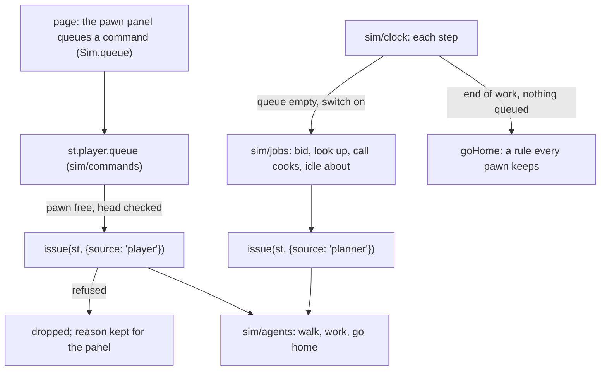

# Slice 2, a life: the design pass (VB-079, 7 and 8 November 2026)

The plan of slice 2 (`docs/roadmap.md`, section 3.2): the player inhabits a pawn. Kim answered eight questions in the session of 7
and 8 November (`QUESTION_ARCHIVE.md`, "VB-079"); the design is in `design.md`, section 15, "The player and what they see". This note
gives the reasoning, the seams in today's code, the tasks and their costs. Fixture numbers are from `4ee11e9`, all with a stale golden
hash (usable; the state is from an older build).

## 1. In short

- **The player is a source with a queue.** Its commands go before the pawn's own logic. With the queue empty, the pawn does what its
  role's automatic behaviour (today's planner) chooses; the player can switch that off. Needs and going home at dark go on either way,
  unless a command says otherwise. With no commands and the switch on, a played pawn does exactly what an unplayed one does, so a state
  hash cannot tell the two runs apart. That is VB-169's main test.
- **Three doors in slice 2:** commands (the queue), `Opportunities.forPawn` (what it may do here), and advocacy (the meeting). Offers in
  Exchange arrive with slice 1's gift. `Decisions.answer` waits for the first question that needs the player's answer: a holder's
  plan (slice 3) or a testament (slice 5).
- **Same rules as anyone.** The moving round's acts (moving out, claiming, service) take the player's wish where the round reads what
  the pawn itself wants, and decide by their rules, at the round. Marriage stays with the round until courting.
- **Postponed:** ambitions (Kim: tentative, an agent's idea; nothing depends on them).
- **Saves name their build.** The world is regenerated exactly within one build, so the save stays small (the world would add 14.3 MB
  at medium). Autosave at the round waits until a save takes under 0.5 s.
- **Cost:** 0 ms a game day of simulation. Opportunities are computed in the page, for one pawn, when the panel is refreshed.

## 2. The player as a source

Today the planner is the only source of work, and it acts at four sites. A played pawn must be left alone at each while a command
of the player's is queued or under way, and at three of them while the automatic switch is off.

| Site | File | Today | With a player's command queued or under way | Switch off, queue empty |
|---|---|---|---|---|
| Idle pawns bid for jobs every 6 minutes, or idle about | `src/sim/clock.js:95-104`, `src/sim/jobs.js:193-221` | the planner issues `work`, `walkTo`, `idle` | not in the idle list; the queue's head is issued | not in the idle list |
| Working pawns look up each hour for more urgent work | `jobs.js:130-145` | `work` on a better job | skipped | skipped |
| The best cook is called off other work from 14:00 | `jobs.js:32-44` | `work` on the cooking | skipped (another cook may be called) | skipped |
| Everyone goes home at the end of work | `clock.js:40-46` | `release`, then `goHome` | skipped while the command lasts | goes home (needs) |



When a command is done: `work` when the pawn no longer has that job (finished, or left by a later command); `walkTo` on arrival (no
path); `goHome` once indoors; `idle` when `args.until` has passed. The queue has a cap of 8 (Rules for cost, rule 2), and a command is
checked when its turn comes, not when queued, since the world moves on meanwhile.

State: `st.player`, null or `{pawn, auto, queue, refused, since}`, plain data, saved with the run. Its owner is `sim/commands`, where
target-v2 puts commands and their sources (section 4.1). The round reads it to find the player's wishes (VB-212); reads are free.

**Determinism.** A played run replays only given the player's commands and the ticks they were queued at. A bug report carries the save,
as today. The wrap-up scripts the player in Node.

## 3. What it may do here: `Opportunities.forPawn`

One pawn, when asked, through the actor view (omniscient now: `actorView(st, id)` returns the state, and every read goes through it). It
lists:

| Kind | From | Basis | Why not, when shown greyed |
|---|---|---|---|
| Work of its household and village | each kind's `available` (VB-208) for the holders it may work for, matched to the posted job | member, servant, villager | the planner's reasons (`explainIdle`, `jobs.js:152`): taken, not its work, a poor fit that waits |
| Walk to a tile, go home, idle | the verbs; tiles the walking rule opens (`walkable`, `src/sim/routes.js`) | itself | the verb's check |
| A cause | each custom's options other than its village's practice | itself | already argued for |
| Move out, claim an empty farm, take service (at the round) | `wantsOut` (`src/sim/heirs.js:371`), `claimable` (`src/sim/farmclaims.js`), the service rule (`src/sim/service.js`) | itself | the rule that bars it now |

Measured on 7 November: a pawn may take 1.5 open jobs on average at 10:00 at small-y40 (at most 7), and 1.3 at medium-y5 (at most 48),
so the list is short. Its cost is a handful of reads, under 1 ms a call (VB-209 measures it). `forPawn` for every holder every hour is
slice 3's cost risk and is not built here.

**The refactor first (VB-208).** Opportunities come from each kind's `available`, as target-v2 section 4.5 asks. Today the posting
rules are one loop in `refreshJobs` (`jobs.js:45-94`). A job's id is its posting order, and matching visits jobs by id
(`jobs.js:126`, `181`). The rules can move into the kinds with the golden file unchanged only if the loop keeps visiting fields,
meadows and farms in today's order, asking each kind of that scope in today's order. The kinds then post through a callback, so no
arrays are made per call. `refreshJobs` runs at 14 hours a day over every farm: 22.8 ms a game day for jobs refresh and matching at
small-y40, 33.5 at medium-y5 and 102.7 at medium-y60, which the refactor keeps within 5%.

## 4. The meeting: advocacy only

The meeting has no ballots: support is the mean of voiced pawns' attitudes weighted by voice and prestige (`src/culture.js:240-248`),
and a practice changes when the leading option beats it by a margin (`culture.js:249-268`). Advocacy already gives a pawn a voice beyond
its own attitude. An advocate's ties weigh it by prestige times 3 (`advocacyWeight`) and press its option (`culture.js:180-183`), and
its own attitude is pulled towards its cause (`culture.js:201`). Kim chose this door alone: the player's pawn takes up a cause with the
`argue` verb (today a debug verb, 10 years), or drops it. It gains no privileges (target-v2, principle 15).

## 5. Saves in the page

Decided on 30 October: autosave at each moving round and when the page is hidden, the last 3 kept, files to and from disk, the whole
world saved, saves from another build refused. VB-074 built saves in Node that regenerate the world from its seed and size, and refuse
only by a hand-kept `FORMAT` (`src/sim/saves.js:101-113`). Kim's answers of 7 and 8 November:
- each save names its build (a hash of `src/` written by `build.py`), so a save from any other build is refused. Within one build the
  world regenerates exactly, and the save keeps only the tiles the simulation changes. The whole world would add 14.3 MB at medium
  (6.2 MB at small) of typed arrays.
- autosave at the round waits until a save at `medium-ref` takes under 0.5 s (VB-199 and VB-204 aim at it). Until then a save is made
  by hand or when the page is hidden. On 5 November (`docs/bench/budget.md`, stale) a save took 1.09 s at medium-y5 and loading it
  0.32 s; the JSON was 19.2 MB and 3.9 MB gzipped.

## 6. The tasks

| Task | What | Size | Waits for | Golden file |
|---|---|---|---|---|
| VB-208 | Refactor: each kind's `available`; `refreshJobs` posts from them | M | (ready) | unchanged |
| VB-209 | `Opportunities.forPawn` and the actor view, in `sim/opportunities` | M | VB-208 | unchanged |
| VB-169 | The player's queue before the pawn's own logic (take control, widened) | M | VB-208 | unchanged |
| VB-210 | Playing a pawn in the page: Play as, the list, the queue, the switch, Follow | M | VB-169, VB-209 | unchanged |
| VB-211 | The player argues for a cause | S | VB-210 | unchanged |
| VB-212 | The round's acts: the player's wish where the round reads the pawn's own | M | VB-210 | unchanged |
| VB-213 | The player's succession | S | VB-210 | unchanged |
| VB-214 | Saves in the page, named by build | M | (ready) | unchanged |
| VB-215 | Autosave at the moving round | S | VB-214, VB-199, VB-204 | unchanged |
| VB-078 | Wrap-up: a played life over three generations | S | VB-209 to VB-214, VB-169 | report |

VB-208 and VB-169 both edit `sim/jobs`, so they run one after the other. VB-214 touches the page's start and `build.py` and can run
beside them. VB-215 is outside the wrap-up, since the yardstick's tasks decide when it can run.

**Taken over and closed.**
- VB-077 (plan: saves in the page) is closed by this plan: its answers of 30 October, with Kim's of 7 and 8 November, are VB-214
  and VB-215.
- VB-169 is rewritten around the queue; its question is answered.
- VB-078 is rewritten as the slice's wrap-up and waits for this slice's tasks. VB-098 (notifications) and VB-099 (the chronicle) stay
  in the arch, waiting for Kim, and the wrap-up no longer waits for them.
- VB-177 (movement only through `sim/agents`) was done on 6 November.

## 7. Cost, named

| Task | Entities × cadence × work | Budget line |
|---|---|---|
| VB-208 | farms × 14 hours a day × kinds, as today | jobs refresh and matching within 5% |
| VB-169 | one test per pawn at four sites a step; one queue head when the pawn is free | none measurable; counters unchanged |
| VB-209 | one pawn × panel refreshes (4 a second in the page) × its household's and village's jobs | under 1 ms a call (page) |
| VB-211 | the existing advocacy, one more advocate | none |
| VB-212 | one wish read in `wantsOut` per round | none |
| VB-213 | once per death of the player's pawn: heirs, kin, at most 150 ties | none |
| VB-214, VB-215 | one save per hidden page or per round; 1.09 s at medium-y5 today | save and load 0.5 s (owned by VB-199, VB-204) |

The Life panel reads no history: `recordOf` scans the whole record (1.76 ms for one holder at small-y40, 10.4 ms at medium-y60).

## Appendix: how the numbers were taken

A short script, not kept in the repository (its steps are below), loads a fixture after `tools/perf.js` has wrapped the systems, times 30 days, then samples 10:00 on the next 6 days. At each sample it counts, for each living pawn of 15 or
more, the open jobs of its household and village that `mayTake` allows. Last, it times `Sim.recordOf` for the first living holder, over
20 calls.

```js
const perf = require('./tools/perf.js'), VB = perf.load(), Sim = VB.sim;
const { st } = require('./tests/lib/fixtures.js').loadFixture(name, { fetch: false });
perf.reset(); const r = perf.result(perf.timeAdvance(Sim, st, 30 * Sim.DAY), 30);   // r.systems: 'jobs refresh and matching'
// then at 10:00 on 6 days: for each living pawn aged 15+, the open jobs in st.jobsBy for its household and village that mayTake allows
// then: Sim.recordOf(st, { pawn: holder.id }) timed over 20 calls
```

The world's size: `ArchGen.generate(7, {cols, rows})`, summing the `byteLength` of its typed arrays.

The tasks measure with commands in the repository instead: VB-208 with `node tools/sim.js --load tests/fixtures/medium-y5.gz --years 1
--report perf` (and `small-y40`), before and after.
