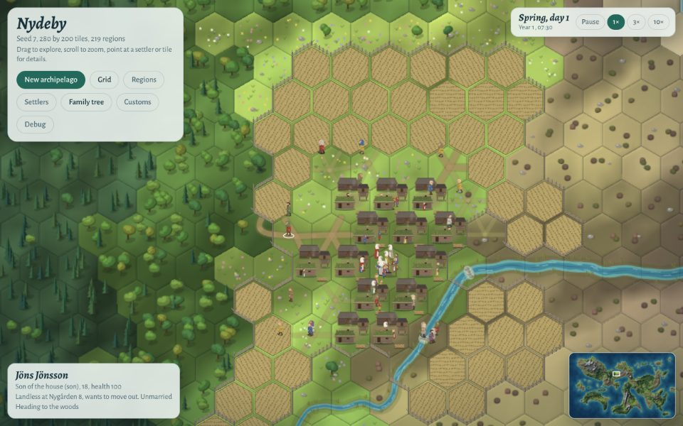
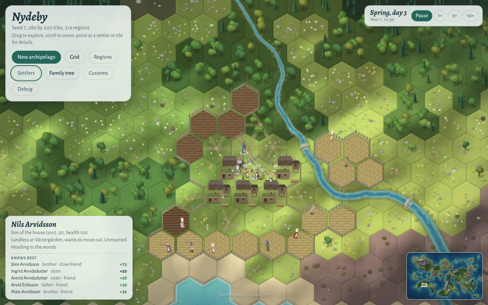
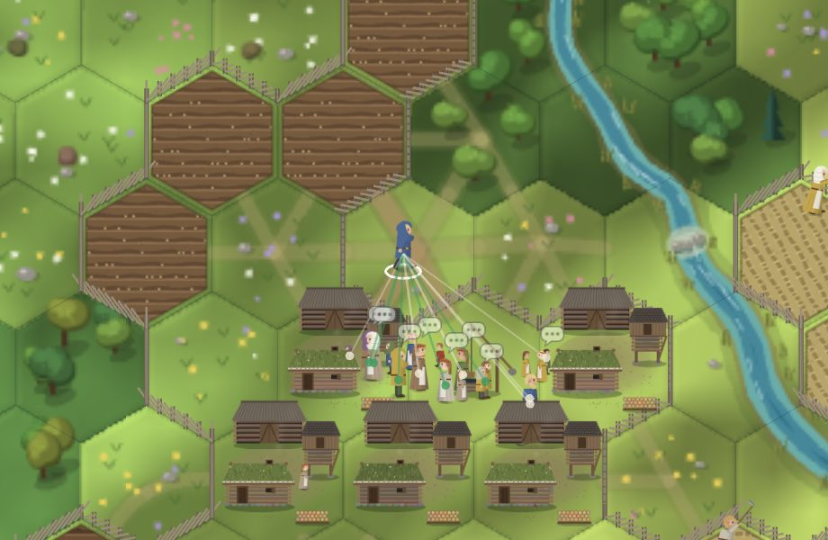

# Review: relationships and pawn interactions

30 October 2026. A review of the relationship system as built and as planned (the `social` arch, VB-059 to VB-063, and courting, VB-036), compared with the relationship systems of other colony and dynasty games, with measurements from the simulation. It proposes changes for discussion; nothing here is Decided.

Measurements are from `populous`, medium map (280 × 200), seed 7, about 830 people alive, unless stated. The probe scripts were scratch code outside the repo; the appendix says how to reproduce them.

## 1. What exists today

| Piece | Where | What it does |
| --- | --- | --- |
| Contact hours | `noteContacts` (`sim/society.js`), every game hour | A pair gets 1 hour if both are inside the same house, or both outdoors within 30 map units (about 0.6 of a hex) in x and y. Kept in `st.contacts` under string keys `"i:j"`. |
| Ties | `dailyLife` (`sim/lifecycle.js`), daily | `p.ties`: Map of pawn id to weight. Daily: every weight × 0.5^(1/48) (half-life one game year); contact hours / 24 added to both sides; near kin raised to at least 0.4; weights below 0.02 dropped. |
| Starting ties | `initCulture`, births, marriage | Household members 1, near kin 0.5, newborn and household 1, spouses 2 at the wedding. |
| Use | `Culture.dailyStep` | The only reader: ties weight whose attitudes a pawn is pulled towards (× prestige, × 3 for advocates), and the pressure of advocates. |
| Not used by | marriage, help, work, meetings | The yearly matchmaking scores the age gap, same village and noise; ties play no part. |
| Shown | nowhere | The pawn card shows role, age, health, holding, spouse and children, and the current activity. No relations, no mood. |

*The village green at 07:30, year 1. Pawns gather and stand together, but nothing in the game shows that this builds anything, or with whom.*

### What the ties look like after 2 years

| Measure | Value |
| --- | --- |
| Ties per pawn | mean 57, median 47, 90th percentile 104, max 166 |
| Tie weight | median 4.3, 90th percentile 13.8, max 44 (founders: about 60–69 inside a household) |
| Ties to people outside one's household and near kin | 51 per pawn; 96% of them above 1 |
| Contact pairs per day | 10,700: 2,500 within a household, 8,200 within a village, **0 between villages** |

## 2. Findings on the system as built

**F1. The tie is "days spent together", and the constants around it are on another scale.** A pair that shares a house all day tends to 1/(1 − 0.5^(1/48)) ≈ 70. The kin floor (0.4), the starting kin tie (0.5) and the wedding tie (2) are under 3% of that, so they are overwritten within days. In customs drift a pawn's household weighs about 95% of its social target; kin elsewhere, which the design lists as a source of contact ("plus kin"), count for almost nothing. Sleeping hours count as contact too (a household is inside together all night).

**F2. Villages are socially sealed.** No pair from different villages is ever within 30 units, so ties never cross a village boundary except through the kin floor. Today this matters little, because the matchmaking pairs across villages without ties. Once courting drives most marriages (Decided), courting needs ties and opinion, so marriages will stay inside the village, and closed villages run into the marriage limit sooner (VB-029).

**F3. Ties have no direction and no sign.** Everyone a pawn meets daily becomes a strong tie at the same rate. There is no liking, no dislike, no compatibility, and nothing a player could tell a story about.

**F4. The social layer is about half of the simulation's time.** At 830 people a game day costs about 86 ms, and the profile puts `noteContacts` and the daily tie loops at about 45% of it, plus much of the 10% spent collecting garbage (the string keys).

| Part | ms per game day |
| --- | --- |
| `noteContacts`, 24 calls | 27 (outdoor pairs 90% of it) |
| Daily ties: decay 7, contacts 11, kin floor 3, prune 6 | 27 |
| `Culture.dailyStep` | 4.4 |
| Whole simulation | 86 |

Most of the outdoor cost is not the all-pairs search but the pairs themselves: idle pawns gather on one green hex, and 150 pawns standing there make 11,000 pairs within 30 units every hour. Counting co-presence is quadratic in the size of a crowd, and no spatial index removes that.

## 3. Findings on the plan (VB-060 to VB-062, courting)

I replayed the rules of VB-060 and VB-061 over the contact hours of a real 2-year run (talk at chance 0.5 per meeting hour; +0.02 × (1 − opinion), +0.04 for two unmarried 16–30s; drift to the starting value with a half-life of 2 years).

**P1. Opinion saturates: everyone becomes a close friend.** Talk only ever raises opinion, and a pair that meets daily talks about twice a day, against a drift back of 0.7% a day. The equilibrium for a daily pair is about 0.85.

**P2. The courting gate stops selecting.** Courting is to start at a tie of 1.5 and an opinion of 0.4 (VB-036). Under the rules as written, 133 of 134 single, opposite-sex pairs of 16 or more with a tie of 1.5 pass it. Who courts whom would be decided by who stands near whom, which is how Dwarf Fortress players describe its friendships (see section 4).

**P3. A variant with compatibility gives a spread.** The variant below keeps talk as the only interaction, as Kim decided, but a talk can go well or badly. Each pair has a fixed compatibility c from −1 to 1, computed from the two ids and the seed, so it costs no memory. A talk goes well with chance 0.55 + 0.3c, plus 0.15 between kin or housemates. Going well moves opinion by +0.02 × (1 − o), or +0.04 for two young unmarried pawns. Going badly ("cross words") moves it by −0.02 × (1 + o). With much contact, opinion converges on what the pair's compatibility allows; with little, drift keeps it near the starting value. Familiarity reveals compatibility: it does not simply breed liking.

| Opinion band after 2 years | As written: other households | Variant: other households | As written: same household | Variant: same household |
| --- | --- | --- | --- | --- |
| Dislikes (below −0.2) | 0% | 7% | 0% | 1% |
| Neutral | 2% | 69% | 0% | 22% |
| Likes (0.2 and up) | 12% | 23% | 0% | 42% |
| Close friend (0.5 and up) | 85% | 1% | 100% | 35% |
| Courting gate passed (of 134 pairs) | 99% | 21% | | |

That is about 12 liked, 3–4 disliked and one close friend outside the household per pawn, plus a household that mostly gets along. These are starting values to tune in the wrap-up (VB-063). Questions remain on the gate itself: an absolute threshold, or "the eligible person one likes most, if liked enough"?

**P4. "Every meeting pair talks at chance 0.5" inherits the quadratic cost** of F4, and nobody chooses a partner. Other games let each pawn start at most one interaction at a time, with a partner chosen by weight. One talk per awake pawn per hour, with a partner drawn from nearby pawns and weighted by tie, opinion and courting, costs O(pawns), and friends then seek each other out.

**P5. "Both awake" has no meaning yet.** There is no sleep state until the night of VB-105. Until then, talk could be limited to 6:00–22:00.

**P6. Two Maps per pawn for the same pairs.** VB-060 keeps `p.rel` beside `p.ties`, with a record for every tie, and opinion drift adds another daily pass over all of them. A record is only needed where opinion differs from its starting value or a courtship runs. Drift can be applied when a record is read or written, from its last update time, instead of daily.

## 4. How other games do it

| Game | Model of a relationship | How it changes | What makes it work, or not |
| --- | --- | --- | --- |
| RimWorld | Opinion from −100 to 100, the sum of timed social memories ("chitchat", "deep talk", "insulted me") and lasting situational ones ("my wife"); friend at 20 and rival at −20 (from memory, not verified here). Fixed per-pair compatibility, lower with a larger age gap. | Pawns near each other interact; the interaction is drawn by weight. Chitchat +0.66, capped at +10 by stacking; deep talk +15, weighted by compatibility; slights and insults lower opinion and can start fights. Romance needs a minimum opinion. | Memories explain an opinion ("why does she hate him?"). Caps on stacking stop saturation. Negative interactions make drama. |
| Dwarf Fortress | A ladder: passing acquaintance, long-term acquaintance, friendly terms, friend, close friend, kindred spirit, lover; grudges. Personality facets and values. | Dwarves who idle or socialise together, in taverns and meeting halls, meet and talk. Acquaintances not met for about a year are forgotten, unless they had 30 or more talks. | Labels on a ladder are legible. Players report that friendships form at random because dwarves talk to whoever they run into: proximity without choice. |
| Crusader Kings III | Opinion as the sum of named modifiers, each with a value and an expiry; discrete relations (friend, best friend, rival, nemesis, lover, soulmate) that add large opinion bonuses. | Relations are made by schemes and events, not by passive drift. | Few, discrete, named relations carry the stories. Players criticise stacking modifiers that max everyone's opinion. |
| The Sims 2 | Two meters per pair: daily and lifetime; the lifetime meter drifts towards the daily one. | Each social interaction moves the daily meter; it fades. | Two time scales: a good afternoon is not a lifelong friendship. |
| Talk of the Town (research; Ryan) | Characters hold beliefs about each other and about places. | Beliefs pass on in conversation, chosen by familiarity; they decay, mutate and can be lies. | Gossip and reputation as a later layer. |

Patterns worth taking:
1. **A familiarity scale and a liking scale.** The plan has both (tie and opinion); keep them apart, as Dwarf Fortress and the Sims do.
2. **A source of negative change, and fixed compatibility.** Without it, opinion saturates (P1). RimWorld's per-pair compatibility costs nothing to store.
3. **Partner choice.** Without it, the social graph is the spatial graph (Dwarf Fortress).
4. **Caps.** Stacking caps on gains, and a cap on how many relations a pawn keeps. Dunbar's layers of about 5, 15, 50 and 150 suggest keeping the strongest 150 ties. This also bounds `Culture.dailyStep`, whose cost grows with ties: a village of 300 where everyone knows everyone holds 90,000 ties.
5. **Named, explainable relations.** Labels (friend, close friend, dislikes, enemy, courting) are derived, with some hysteresis, and the reason behind an opinion is kept as a few notes per pair: "helped at our harvest", "cross words over the fence".
6. **Curation.** The simulation makes far more events than a player can read. Only threshold crossings ("became friends", "fell out", "began courting") reach the log, and few of them (Ryan, *Curating Simulated Storyworlds*).

### Historical anchors for concrete interactions

- **Occasions.** The village meeting (*bystämma*) is in the game but takes place nowhere on the map. Weddings, funeral ales (*gravöl*) and harvest work parties brought households, and kin from other villages, together. They are rare, legible and visible, the kind of event the design's "Pace" section says carries the game at 10×, and they are how ties would cross village boundaries (F2).
- **Courting.** Night courting (*nattfrieri*): unmarried young men visited young women at night, mostly on Saturdays and Sundays, widespread in Svealand and Norrland from at least the 17th century. The church disapproved of it because it led to births outside marriage. It fits the Decided births while courting, and it gives courting a place and time on the map: the storehouse loft.

## 5. Proposals

### A. Speed, with no change in behaviour (a refactor; the golden file unchanged)

A prototype keeps the state bit-for-bit identical (same fingerprint of every tie, attitude, union and log line after 2 years on medium and 1 year on large):
- Outdoor pairs from 30-unit cells, each pawn visiting its later neighbours in the original order, so the Maps fill in the same order.
- Integer pair keys (`i * 65536 + j`) instead of `"i:j"` strings.
- One decay pass that remembers which ties fell below 0.02, so the prune checks only those.

| | Today | Refactor (measured) |
| --- | --- | --- |
| Contacts | 27 ms/day | 22 ms/day |
| Daily ties | 27 ms/day | 12 ms/day |
| Whole day, medium | 86 ms | 67 ms (−22%) |
| Whole day, large | 97 ms | 79 ms (−19%) |

### B. Speed through the model (changes behaviour; customs recalibrated)

- Talk partners chosen per pawn (P4) instead of co-presence of all pairs. Familiarity from talk, from the household's waking hours at home (one update per household and day instead of per pair and hour), and from working the same job. Estimated contacts cost: 1–3 ms/day, not 22.
- A shared decay scale instead of a daily pass over every tie: weights are stored divided by 0.5^(t/year) and renormalised every few years. `Culture.dailyStep` divides by the sum of weights, so a common scale cancels there.
- A cap of 150 ties per pawn, keeping the strongest.

### C. The relationship model (VB-060, revised)

- `p.rel`: a sparse Map of `{ opinion, t, courting, notes }`, only where opinion is off its starting value or a courtship runs. Opinion drifts lazily from `t`.
- `compat(st, a, b)` from the seed and the two ids, with a bonus for a small age gap. No storage.
- Derived words with hysteresis: stranger, acquaintance (tie 1 and up), friend (opinion 0.4), close friend (0.7 and tie 10), dislikes (−0.25), enemy (−0.6); kin, spouse and courting from the records.
- Up to 3 notes per pair: the largest recent causes of the opinion ("helped at our harvest, year 4").

### D. Concrete interactions (VB-061 and new tasks)

1. **Talk** (VB-061, revised): one talk per awake pawn per hour (6:00–22:00) at most, with a nearby partner chosen by tie, opinion and courting. It goes well or badly by compatibility. Idle pawns stop and face each other for a few game minutes; working pawns talk without stopping.
2. **Seeking company:** an idle pawn walks to where a liked pawn idles (the green, a yard), instead of choosing the green or its own yard at random. Friends then show as groups on the map.
3. **Occasions** (new): the village meeting gathers the people with a voice on the green before noon; a wedding feast at the couple's farm brings both families, across villages too; a funeral ale at the farm of the dead. Each occasion raises ties among all who come (capped per occasion, not per pair), and is the place where ties cross villages.
4. **Later:** help between households (VB-039, VB-106) raises opinion; quarrels over boundaries and the commons (claims arch, "Disputed claims" custom); persuasion at the meeting weighted by opinion; gossip and reputation.

### E. Tracking and showing it

1. **Pawn card:** a Relations block of the five strongest relations, with kin and word ("Erik Olofsson: brother, close friend"); courting; mood and its modifiers (VB-062).
2. **A social lens:** with a pawn selected, lines to the people it knows who are on screen, green for liked and red for disliked, wider for stronger ties, at most 20 lines.
3. **Bubbles:** an icon over a pair near the camera, by kind: talk (…), a talk that went well (♪), cross words (!), courting (♥).
4. **Log lines** only when a relation crosses a threshold (became friends, fell out, began courting), for adults, a few per day at most.
5. **`tools/sim.js --report relations`**, and relations in `--pawn N`: opinion bands, friends per pawn and talks per day, for tuning.

## 6. Suggested order

1. A: the refactor (golden unchanged).
2. C with E1, E5: relationship records, compatibility, words, the Relations block and the report (golden: added fields only).
3. D1 with E2–E4: talk with partner choice, outcomes and bubbles (golden re-recorded; customs calibration rerun, as VB-063 already asks).
4. VB-062 mood; D3 occasions; B; then the courting tasks of VB-036 on top.

## 7. Decisions (31 October 2026)

Taken in the discussion of this review:

| Question | Decision |
| --- | --- |
| How a talk changes opinion | **Timed memories**, as in RimWorld and Crusader Kings III: opinion is the sum of capped, expiring memories per pair. Talk outcomes are drawn by weights that depend on the pair's compatibility, so memories can be good or bad (P1, P3). |
| Who talks with whom | **One partner per pawn per hour**, chosen among nearby pawns by tie and opinion (P4). |
| This round of work | The speed refactor (A, VB-124); relationship records, compatibility, words, the Relations block and the report (C, E1, E5); talk with bubbles and the social lens (D1, E2, E3); idle pawns seeking company and stopping to talk (D2). Mood, occasions, the model-level speed-ups (B) and courting stay for later tasks. |
| Familiarity (ties) | **Kept as it is** for now, so customs calibration barely moves; reworked later with a full recalibration (B, F1). |

Follow-up answers: the starting values of section 3, replayed with one partner per pawn and accepted (chatted +0.03 up to +0.2 over a year; a good talk +0.1 up to +0.5 over 3 years; cross words −0.12 down to −0.6 over 3 years); becoming friends and falling out recorded as life events of the pawn; a bubble for every talk, a chat faint.

Built: VB-124 (A), VB-060 (C, E1, E5), VB-061 (D1, E2, E3) and VB-125 (D2). Populous medium, seed 7, 2 years: 8.3 talks per pawn and day; per adult 4.8 friends and 2.6 disliked people outside the household; about 100 ms per game day, against 87 on main before this work. Left for later tasks: VB-062 (mood), VB-126 (occasions), VB-127 (familiarity from talk, B), the courting tasks of VB-036, and help as memories (VB-039, VB-106); their questions are in `QUESTIONS.md`.

*After, year 1, 10:30 on day 3 of spring: the card of Nils Arvidsson lists the people he knows best.*

*The same moment, closer: chat bubbles over the crowd on the green, and Nils's lens, a line to each of the 20 people he knows best, green for those he likes.*

## Sources

The RimWorld and Dwarf Fortress wikis could not be fetched from this session (the network policy blocks them); their points come from search results and are marked where they come from memory.

- RimWorld wiki: [Social](https://rimworldwiki.com/wiki/Social), [Opinion](https://rimworldwiki.com/wiki/Opinion), [Romance](https://rimworldwiki.com/wiki/Romance), [Lovin'](https://rimworldwiki.com/wiki/Lovin); [Steam discussion on chitchat and deep talk](https://steamcommunity.com/app/294100/discussions/0/135507548126582042)
- Dwarf Fortress wiki: [Relationship](https://dwarffortresswiki.org/Relationship), [Friend](https://dwarffortresswiki.org/index.php/Friend), [Grudge](https://dwarffortresswiki.org/index.php/Grudge), [Tavern](https://dwarffortresswiki.org/tavern); [bug 10793 on forgetting acquaintances](https://dwarffortressbugtracker.com/view.php?id=10793)
- Crusader Kings III: [soulmate and relation tiers](https://www.nerdsandscoundrels.com/ck3-soulmate/), [Paradox forum on opinion stacking](https://admin-forum.paradoxplaza.com/forum/threads/the-gameplay-focus-on-stacking-stats-and-modifiers-runs-counter-to-the-core-design-philosophy-of-crusader-kings-3.1735002/page-2)
- The Sims: [Sims Wiki, Love](https://www.thesimswiki.com/wiki/Love), [Friendship](https://www.thesimswiki.com/wiki/Friendship)
- J. O. Ryan et al., [Toward characters who observe, tell, misremember and lie](https://aitopics.org/doc/conferences:EA0682D9); [Bad News (CHI 2016)](https://eis.ucsc.edu/papers/ryanEtAl_BadNewsCHI2016.pdf); M. Kreminski et al., [Toward better gossip simulation (CoG 2023)](https://mkremins.github.io/publications/Gossamer_CoG2023.pdf)
- Dunbar's layers: [a null model for Dunbar's circles](https://arxiv.org/pdf/1701.07428), [Dunbar's numbers from 5 to 150](https://www.globalsecurity.org/military/world/holocene/dunbar.htm)
- Night courting: [Store norske leksikon, nattefriing](https://snl.no/nattefriing), [Wikipedia, Bundling](https://en.wikipedia.org/wiki/Bundling_(tradition)), [Rig (Lund), on nattfrieri in Svealand and Norrland](https://journals.lub.lu.se/rig/article/download/8490/7628/22123)

## Appendix: reproducing the numbers

- One pawn's ties: `node tools/sim.js --scenario populous --map medium --seed 7 --years 2 --pawn 12 --json`. The totals in this review come from scratch probes that load `src/load.js`, run the same scenario, and time `noteContacts` and each daily tie loop with `process.hrtime` (proposal E5 adds a report for them).
- The profile: `node --cpu-prof` over a 2-year populous medium run; self time by function.
- The opinion replay: the contact hours of each game hour were recorded and the VB-061 rules applied to them in a shadow model, with its own random stream, so the run itself was unchanged.
