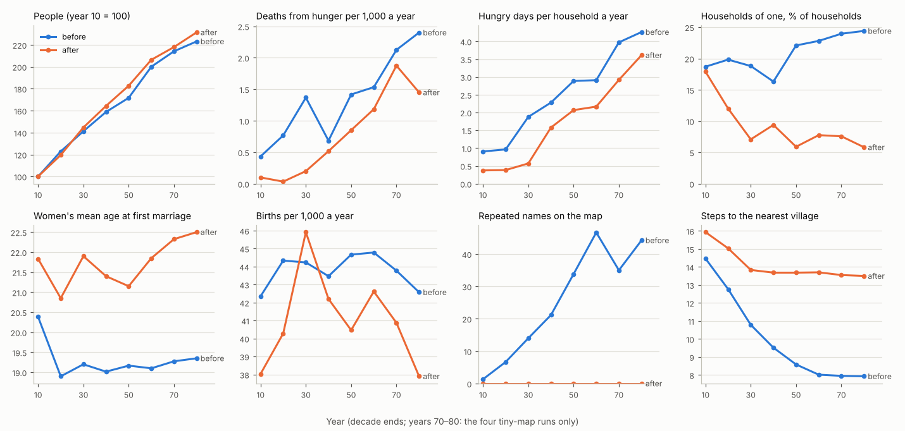
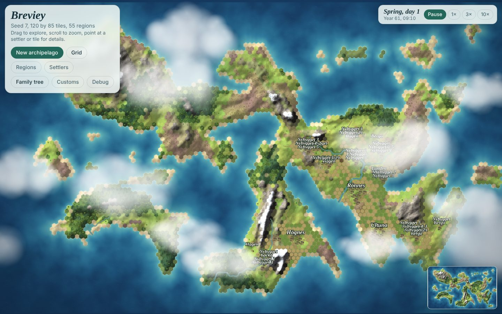
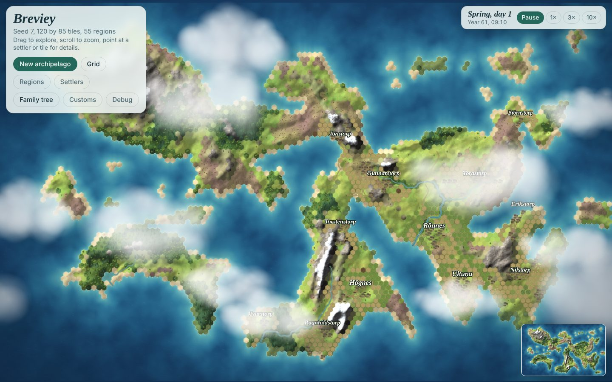
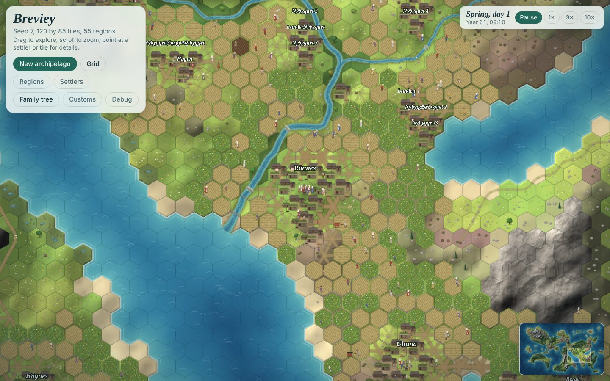
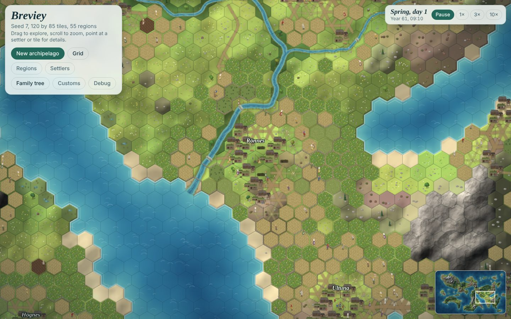

# Review: long-term stability (hunger, households of one and marriage), names, spacing and speed

1 November 2026. The cities review (`docs/review-cities.md`, section 3.5) found that the game's long runs are held in check by hunger, that households of one go hungry beside full barns, and that two holders cannot marry each other. Kim asked to address this, together with three smaller requests: simple speed-ups, fewer repeated village names, and villages that fill the land between them too slowly rather than too quickly. This review measures the problems at `65a81f9`, finds their causes, records Kim's decisions (section 3) and the work (VB-151 to VB-154, section 4), and measures the result (section 5). `design.md` is unchanged; what it should record, and the tuned values, are questions in `QUESTIONS.md` under "Stability review: the tuned values".

Measurements are from `populous` on the small map at seeds 7 and 42 (60 years, 350–1,000 people) and on the tiny map at seeds 3, 7, 11 and 42 (80 years, 160–510 people), the sets of the cities review, sampled at the end of each game year and reported per decade. Single seeds are chaotic (a few people more or less change who marries whom and when famine strikes), so the means over the six runs are the result, with the per-run numbers beside them. The probes are in `docs/stability/` (appendix).

## 1. The short answer

| Measure (mean of six runs) | Before | After |
| --- | --- | --- |
| Deaths from hunger per 1,000 a year, mean over each run's decades | 1.23 (0.8–1.6 by run) | 0.68 (0.2–1.0 by run) |
| Hungry days per household a year, years 30 / 60 / 80 | 1.9 / 2.9 / 4.3 | 0.6 / 2.2 / 3.6 |
| Households of one, years 30–80 | 16–24% | 6–9% |
| Women's mean age at first marriage | 19–20 | 21–22.5 |
| Births per 1,000 a year | 42–45 | 38–46 (about 6% fewer) |
| People, year 80 against year 10 | 2.23 times | 2.31 times |
| Repeated names on the map, year 60 | 47 | 0 |
| Steps to the nearest village, year 60 | 8.0 | 13.7 |
| A late game day (CPU profile, tiny seed 11, year 60) | 7.0 s for 48 days | 6.3 s (−10%) |

- **Hunger fell by about half,** without fewer people: the island carries as many or more and they starve less. Households of one are a third as common, and the means to marry now slows births when stores are short.
- **The ceiling is not solved.** Deaths from hunger still rise in the last decades (1.4–1.9 per 1,000 in years 70–80): births stay near 40 per 1,000, almost every woman still marries, and grain still cannot move from the full barns to the empty ones. Section 6 names what comes next.
- **Farms left empty** are the price of the orphan rule Kim chose: 11–28 farms over 60 years at tiny seeds 3 and 7, holding 3–6% of the farmable land, which nothing takes up until claiming an empty farm (VB-033) exists. That is why the land in use rose although villages lie farther apart (section 5.3).

## 2. What was wrong

### Hunger is the only brake

Births stayed at 36–53 per 1,000 (40–49 in most decades), deaths at about 20–51, and almost every woman married young: women's mean age at first marriage was 19–21 in every decade, and 0 to 5 of 5–34 women aged 45–54 had never married (the north-west European pattern the design follows had 24–26 and 10–20%; Hajnal 1965). With nothing to slow births, the people grow until the land is full and hunger takes the excess: in the last decades deaths from hunger rose to 1–4 per 1,000 a year, and tiny seed 11 ended with deaths (51 per 1,000) above births (44).

Where the hunger sits: stepping populous tiny seed 7 a day at a time from year 10 to 40 and classifying every hungry household-day after the meal, 93% were days with nothing to eat in store (neither grain above the seed nor sheaves to thresh), and 99% fell in summer and autumn, before the harvest. So hunger is a store that runs out before the harvest, in every size of household, not grain stuck in the barn.

### Households of one

| Run | Households of one (year 10 → end) | Hungry in their years | Lone holders of 20–49 (end) |
| --- | --- | --- | --- |
| small, seed 7 | 12% → 14% | 9–42% | 39 |
| small, seed 42 | 17% → 22% | 15–58% | 39 |
| tiny, seeds 3, 7, 11, 42 | 11–25% → 22–30% | 15–73% | 9–21 |

Who they were, three kinds:
- **Orphaned heirs.** When a holder died and the heir was a child, the guardian was looked for only among the adults of the house (`guardianOf`); with none, the child held the farm alone and mostly starved. At tiny seeds 3, 7 and 11 (years 20–40) one household-year of one in eight was a child under 18 (109 of 813). A child heir living elsewhere was even moved alone to a farm it inherited (`transfer`): at seed 3 one girl inherited three farms in a row this way, each emptying in turn.
- **Heiresses and lone holders who could not marry.** At tiny seed 3, year 15, the 19 households of one were almost all women of 25–35 who had held a farm alone for 7–14 years in villages of 5–13 farms, with no unmarried landless adult within 15 steps: every unmarried man was himself first heir to a farm, and under the residence custom "with the land" two people who each have a place could not marry (`homeFor`).
- **Lone settlers,** who left a crowded village alone (VB-146) and, for the same reason, rarely married.

### Names

The repeated names on the map were farm names, not village names. A village without a green (a lone farm, a settler's village, a hamlet that grew round them) was labelled by each of its farms; every new cottage was "Nybygget", "Nybygget 2"..., and lone farms took one of 8 words (Strand, Lunden, Backa, Myra, Ängen, Hagen, Berga, Åkern). Repeated labels grew from 0–7 at year 10 to 32–94 per run by year 60–80. Villages founded in play did get unique names (Erikstorp), but those never reached the map.

### Spacing

The nearest neighbouring village (mean over villages, hex steps between centres) was 11–22 steps away at year 10 and 7–9 by year 60–80. Settlers founded villages 10–30 steps from home with a house and fields as close as 3 steps to other farms, and three in four joined a small village, which grew into a hamlet of up to 4 farms in the gap.

### Speed

A game day cost 104 ms at 437 people and 446–460 ms at 1,005–1,034 (populous small, seed 7): faster than the people grew. A CPU profile of 8 days at year 55 (1,034 people): contact hours and talk 19%, the daily decay of every tie 15%, idle pawns seeking company 9%, garbage collection 8%, the culture's daily drift 6%, and the daily refresh of the route cache 5% (36,000 cached routes, each costed again every day). Ties per pawn grow with the village (mean 68, up to 187), which is why a day's cost grows faster than the people.

## 3. Decisions (Kim, 1 November 2026)

1. **Households of one:** an orphaned heir with no adult gets a guardian (a landless adult relative moves in; failing one, the children go to kin and the farm stands empty), and a holder who lives alone takes a servant; settlers need not leave in pairs.
2. **Marriage:** two holders may marry (`QUESTIONS.md`, Towns question 5, as proposed), and marriage needs means; no later minimum ages.
3. **Names:** VB-026's name generators, one label for a village of two or more farms, a founded village's farm named for its founder, lone-farm names unique on the island.
4. **Spacing:** both: new villages farther apart, and more land for each new farm.

## 4. What was built

| Task | What | Golden file |
| --- | --- | --- |
| VB-151 | Refactor: the daily route refresh works out the changed tiles' coordinates once and skips a route's cost where the outcome is certain without it; the culture drift and the contact count reuse scratch arrays | unchanged |
| VB-026 | Name generators (`src/sim/names.js`): farms by compass, landmark, owner, numbered only when all fail; each culture's order of preference (`namePrefs`); a lone farm's village bears its farm's island-unique name; a founded village's farm bears the founder's name; one map label for a village of two or more farms | names and texts only |
| VB-152 | `src/sim/service.js`: a household left with no adult takes in the ward's nearest landless adult relative as guardian, or else the children go to kin and the farm stands empty; a holder who lives alone takes in an unmarried landless adult as servant, from a household that keeps two working hands | heirs runs |
| VB-153 | Two people with a place may marry (4.1); the farm left behind passes to an heir who can keep it, a landless claimant of its village, or stands empty; a grown heir comes before a child when no adult is left to be guardian; a couple marries only with the means (4.2) | heirs runs |
| VB-154 | New villages 5 steps from other farms (was 3) and 12 hex steps from every village centre; every new farm (plot, join, new village) needs room: 6 free farmable tiles within reach besides its first field | unchanged |

Found and fixed on the way: a pawn married to a holder could be allotted a plot, and when its cottage was finished the couple moved in and the holder's own farm was left without its holder (`tests/invariants.js` caught it); `transfer` and `finishCottage` could take a child who held a farm away from it; service could take an adult whose plot was already being cleared.

### 4.1 Where a couple lives

Under "with the land" one of them needs a place: the farm they hold, or are first heir to. When both have one:
- a holder keeps the farm, and a spouse who is only first heir elsewhere moves to it and leaves that line (an heir whose spouse holds another farm is passed over, as before);
- of two holders, the couple lives where the *other* farm is best handed on: to an heir who can keep it (an adult, or a child with a grown housemate as guardian), then to a landless adult of its village who waits for land, then to a child or nobody; then on the farm with more fields, the man's on a tie;
- of two first heirs, on the farm with more fields.

A holder who marries away hands the farm on in that order (`handOn`); a claimant takes it as a claim (no shares owed on it), and a farm nobody takes stands empty, its grain and animals going with the holder. The first version handed the farm to the next heir whatever the age: at tiny seed 3 over 30 years that sent 15 farms to child brothers and sisters and emptied 17 for want of grown kin. With the order above and the grown heir first (`heirFor`), the final code empties 5 there for want of grown kin, against 78 marriages, 16 farms handed on at marriages, 47 servants and 2 guardians.

### 4.2 The means to marry

A chosen match goes ahead only when the household the couple will live in holds food (grain, rations, grain in sheaf, the larder) above its seed for `MARRIAGE.means` years of its members and one more; otherwise they wait a year, and the log says how many couples of a village put it off. This is Malthus's preventive check: in pre-industrial Europe marriages fell after dear harvests. Three versions were measured:

| Version | Households of one, years 30–80 | Deaths from hunger per 1,000, years 30–80 | Births per 1,000 | Women's age at first marriage |
| --- | --- | --- | --- | --- |
| Before | 16–24% | 0.7–2.4 | 42–45 | 19–19.4 |
| A year of food, every home (six runs) | 21–28% | 0.2–1.4 | 36–43 | 21–23 |
| A year, homes of fewer than two adults exempt (six runs) | 9–15% | 0.1–2.4 | 43–46 | 19–21 |
| 1.5 years, the same exemption, with VB-154 (final; six runs) | 6–9% | 0.2–1.9 | 38–46 | 21–22.5 |

Applied to every home, the rule kept lone holders and new settlers single (lone holders at small seed 42: 39 → 92 at year 60): a lone farm rarely holds a year of food for two. Historically the check bore on young couples setting up on a full farm, not on a widower or a lone settler, who remarried quickly because a farm needed a pair; so a home with fewer than two adults is exempt. With the exemption, at a year, the check seldom bound: the moving round falls just after the harvest, when stores are at their highest. At a year and a half it binds on the full farms and leaves the lone alone. 1.5 is a tuned value, Proposed to Kim.

## 5. Results

### 5.1 Hunger, households and marriage

Per run, at the end of the run (people; mean deaths from hunger per 1,000 over the decades; households of one; lone holders of 20–49):

| Run | Before | After |
| --- | --- | --- |
| small, seed 7 (60 years) | 1,005; 0.8; 16%; 39 | 961; 0.2; 5%; 21 |
| small, seed 42 (60 years) | 728; 1.2; 22%; 39 | 852; 0.7; 8%; 13 |
| tiny, seed 3 (80 years) | 398; 1.4; 21%; 12 | 486; 0.7; 4%; 15 |
| tiny, seed 7 | 396; 1.5; 24%; 9 | 385; 0.8; 5%; 15 |
| tiny, seed 11 | 437; 1.6; 24%; 9 | 432; 0.7; 3%; 5 |
| tiny, seed 42 | 350; 0.9; 28%; 21 | 336; 1.0; 11%; 11 |

- **Deaths from hunger fell at five seeds of six** and were unchanged at the sixth (tiny 42, the island that collapsed in the cities review); hungry days per household fell in every decade.
- **Households of one** fell from a fifth or a quarter of households to a twentieth or a tenth. Those that remain are as often hungry as before (in 21–53% of their years, against 24–54%); who they are now was not measured.
- **Marriage** is later by two to three years for women, and births are about 6% fewer; almost every woman still marries.

### 5.2 Names

No name repeats on the map in any run at any decade (32–94 repeats per run before by year 60–80). A village of 16 farms names every farm without a number (`tests/names.js`, populous medium).

### 5.3 Spacing

The nearest village lies 13.5–15.9 steps away in every decade after (14.5 falling to 7.9 before), and new villages keep a band of outland between them. But the farmable land in use rose (25.2% at year 60 against 21.1%), and the cause is not the new farms: at tiny seeds 3 and 7 in year 60, occupied farms hold the same share of the farmable land before and after (19.1% and 18.8%; 23.6% and 24.0%), with as many fields per farm (2.9–3.5 before, 3.4–3.6 after). The difference is farms standing empty: 1–3 before (0.2–0.4% of the land), 11–30 after (2.7–5.8%), nearly all "its heir is a child, with no grown kin to keep it". Before, such a child kept the farm alone and mostly starved, so it counted as occupied; now the child goes to kin and the farm stands empty, and nothing takes an empty farm up again until claims (VB-033) exist. A question for Kim (`QUESTIONS.md`).

### 5.4 Speed

Profiles of the same 48 days of both versions at tiny seed 11, year 60 (414 people): 7,014 ms before, 6,298 after; the route refresh 345 → 131 ms, the culture drift 403 → 355 ms. Behaviour unchanged (the golden file and a state hash agree). Tried and left out: pair keys below 2^30 for the contact map, within noise. The rest is the social model; VB-127 (familiarity from talk, at most 150 ties a pawn) is the change that removes most of it. The long runs' own ms per day are not comparable between versions: they ran four at a time with other work.

## 6. What next

- **Claims (VB-033)** are now the most useful next task: they would take up the farms the orphan rule leaves empty (3–6% of the land) and give the landless somewhere to go before the island is full.
- **Moving the surplus.** Hunger at the ceiling is a store that runs out before the harvest while other households' grain rots (cities review, section 3.2); the fair of the cities review (Phase 1) is the outlet, and it must leave each farm its reserve.
- **Late marriage and celibacy** should come from service (VB-090, the general rule by hands per field) and courting (VB-036): the means rule delays marriage, but almost every woman still marries.
- **Speed:** VB-127.

## Appendix: probes

All in `docs/stability/`; none is part of the game or under test.

- **The runs:** `node docs/stability/probe.js --scenario populous --seed S --map small|tiny --years 60|80 > FILE` (with `--repo DIR` to run another checkout's `src`); one line per decade. The outputs of this review are in `docs/stability/runs/before` (at `65a81f9`) and `docs/stability/runs/after` (at `488090e`). About 10–40 minutes a run.
- **Tables and the figure:** `python3 docs/stability/analyse.py docs/stability/runs/before docs/stability/runs/after --labels before after --fig docs/img/stability-runs.png` (matplotlib; colours from the reference palette of the charting guidance, validated for colour-blind readers).
- **The rules at work:** `node docs/stability/events.js . 3 30 tiny` counts the log lines of the new rules over a run (marriages, couples who put it off, hand-ons, claims, servants, guardians, farms emptied).
- **Screenshots:** `node docs/stability/shots.js --html index.html --tag after --seed 7 --size t --years 60 --out DIR --fx 4146.5 --fy 2212` (Playwright, as `docs/cities/shots.js`; the before images from `65a81f9`'s `index.html`).
- **Scratch diagnoses** (not kept): hungry household-days classified by what was in store, one-person households by age and how they came to be alone, land held by occupied and empty farms, and farms emptied by reason, each from a day-by-day run of the same scenarios.
